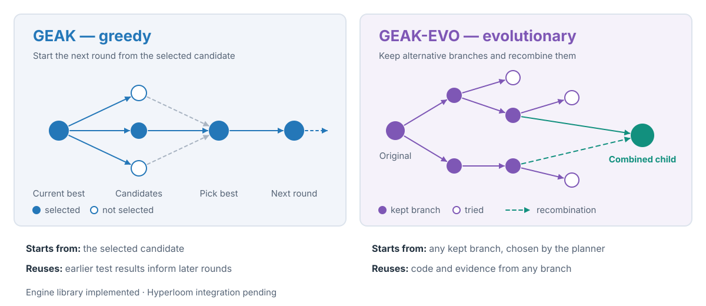
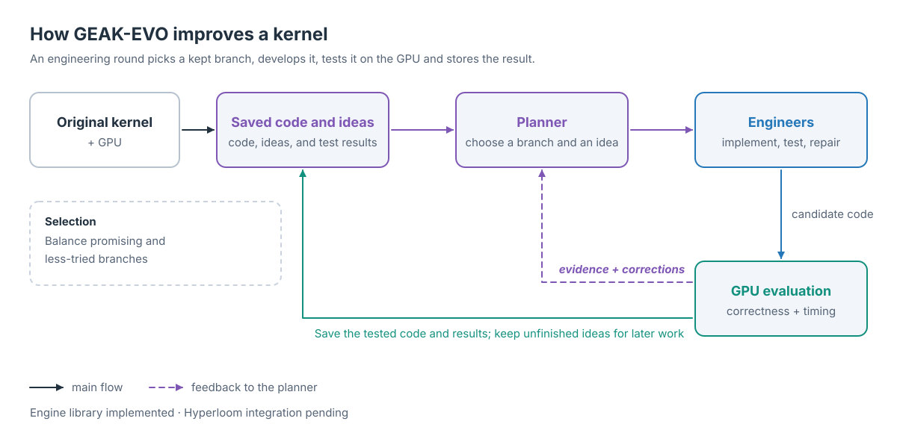

# GEAK + GEAK-EVO

GEAK improves GPU kernels by writing code, testing it, and keeping useful changes.
GEAK-EVO extends that loop: it keeps several ideas and code branches alive,
develops them over many rounds, and can combine earlier work.

The `evo` branch is available for code review. Existing GEAK commands remain.
The native EVO search, result exporter and dispatcher adapter are implemented
and have CPU tests; installation and live Hyperloom validation remain.
See [current support](geak_evo/README.md#current-support) before running EVO.

## Start here

| I want to… | Read |
| --- | --- |
| Install GEAK | [Installation](docs/install/install.md) |
| Improve one kernel | [Kernel workflow](kernel_workflow/README.md) |
| Improve a serving workload | [Serving workflow](e2e_workflow/README.md) |
| Use GEAK from Hyperloom | [Task and result interface](interface/run_e2e.md) |
| Understand or change EVO | [Architecture](docs/evo/architecture.md) |
| Run EVO with an existing native owner | [Admitted task command](docs/evo/admitted-command.md) |
| Browse saved programs, ideas and measurements | [Archive guide](docs/evo/archive.md) |
| Find existing examples and results | [GEAK guide](docs/reference/geak-guide.md) |

Build and test the original kernel in its GPU environment before optimizing it.
GEAK uses the compiler, libraries, and model weights you provide.

## How EVO works

1. The planner chooses an idea and a starting program. It may include another
   branch whose work could help.
2. Engineers inspect the code and hardware evidence, then build, test, and repair.
3. The evaluator checks correctness and measures performance.
4. The archive saves code, ideas, results, and parent links for later rounds.

A slower or unfinished idea can remain available for later work. Its status stays
clear: a proposal is not a measured improvement. The final selected program must
pass the same workload checks as GEAK.

## Where the code lives

| Directory | Responsibility |
| --- | --- |
| `interface/` | Accept tasks, call the runtime, return results |
| `interface/e2e/` | Check serving results and write reports |
| `kernel_workflow/` | Set up, optimize, and validate a kernel |
| `e2e_workflow/` | Profile and measure a serving workload |
| `geak_evo/` | EVO planner, engineers, archive, selection and evaluation library |
| `kb/` | Store and retrieve verified run records |
| `perf_knowledge/` | Hardware guides and reusable skills |
| `geak/` | Installation support |
| `docs/`, `examples/`, `ci/` | Guides, examples, and automation |

The cleanup keeps the public commands and saved record formats stable while
moving related work into smaller modules. The [architecture guide](docs/evo/architecture.md)
shows how the modules fit together and the checks required before enabling EVO.

Workflow code lives in the `src/` folders under `kernel_workflow/` and
`e2e_workflow/`. Edit those files, then run `node scripts/build_workflows.mjs`.
The generated scripts stay in the checkout because the workflow runner loads
one file. CI checks that they match the source.

## Contributing

Use short names that describe the work. Keep one implementation of shared logic.
Put experiment-specific setup and results outside the runtime. Preserve tests
that check behavior, and update the relevant ones when changing a public interface.

See [CONTRIBUTING.md](CONTRIBUTING.md) for the existing contribution workflow.
