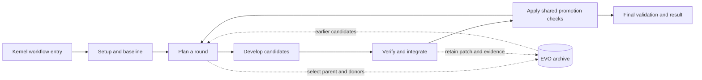

# GEAK-evo architecture

GEAK-evo retains alternative candidates inside GEAK's kernel workflow. It uses the same
setup, planner, engineer roles, tools, verifier, integration step, and final
validation as GEAK. EVO is the default; `optimizer: "greedy"` selects the original policy. See the
[run guide](stock-workflow.md).

See the [runtime configuration reference](configuration.md) for explicit
optimizer settings, and the [workflow comparison](geak-vs-evo.md) for diagrams
and source links.

For the intended role inside Hyperloom and GEAK's end-to-end workflow, see
[the workload discovery loop and pinned integration code](workload-discovery.md).

The planner chooses a `parent_id`, optional `donor_ids`, and an `approach` label
for each direction. The workflow creates a private workspace from a fixed run
base, applies the selected parent's cumulative patch, and gives the engineer
donor references. Combining donor contributions is an engineering decision.
Declared ancestry and approach labels do not prove that contributions survived
or that implementations are meaningfully different.

The archive retains patches and selected evidence from correct, slower,
incorrect, and unverified attempts when their source is available. Planning can
return to those candidates. The best validated candidate is tracked separately;
retention alone does not make a candidate eligible for promotion. The shared
promotion and final-validation rules still apply.

## Source map

| Source | Responsibility |
| --- | --- |
| [kernel_workflow.js](../../kernel_workflow/kernel_workflow.js) | Public dispatcher for the kernel workflow |
| [14_optimize_loop.js](../../kernel_workflow/src/kernel_lane/14_optimize_loop.js) | Shared plan, develop, verify, integrate, and promote loop |
| [14a_evolution.js](../../kernel_workflow/src/kernel_lane/14a_evolution.js) | Parent resolution, workspace preparation, patch retention, and archive updates |
| [roles/evolution.md](../../kernel_workflow/roles/evolution.md) | Guidance for continuing alternatives and inspecting evidence |
| [geak/native](../../geak/native/) | Shared native task validation, execution, source capture, and report reading |

The planner receives the latest twelve archive entries plus the best entry, and
can inspect the full archive. Engineers receive the selected starting source,
donor references, and archive path. The optional `evolution_evidence_handoff`
flag also puts selected parent and donor evidence into the engineer prompt;
it is off by default. See [archive fields](archive.md).

## Scope

This implementation provides source retention and a way to select and develop
earlier work within one run. It has no separate population service, semantic
cell allocation, or cross-run archive resume protocol. Deep engineers run in dedicated rounds; slower candidates may be verified and retained.
These choices can change the cost of a search.

When first-stall initialization succeeds, the lane result includes the existing
`evolution_start` record: `after_round`, the current `cumulative` score, the archive
path, and `first_round` if a later loop iteration begins. `first_round` is recorded
before the planner call; it does not prove that planning returned, an engineer ran,
or retained-source guidance was supplied. Join it with the timeline and archive
evidence for those questions. An absent record does not distinguish no attempt
from failed initialization or an older result format.

The former `geak_evo` Python driver, research-store exporter, pilot launcher, and
group coordination system are retired. The Python driver's earlier public source
is available at Git revision `f0f6ec427f98888644b2d5fb303540d15beb192a`. Historical deployments
and study records retain their own pinned source and environment; this cleanup
does not migrate or qualify them.
