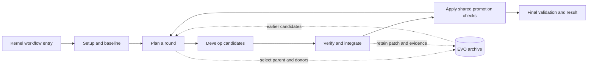

# GEAK-EVO architecture

GEAK-EVO retains alternative candidates inside GEAK's kernel workflow. It uses the same
setup, planner, engineer roles, tools, verifier, integration step, and final
validation as GEAK. Select it with `optimizer: "evo"`; see the
[run guide](stock-workflow.md).

For the distinction between one full GEAK lineage, a population of ordinary
GEAK lineages, and the hybrid GEAK-EVO population used in v1 experiments, see
[the updated diagrams, measured comparison, and code links](geak-vs-evo.md).
That guide distinguishes the code on this branch from the later population
extension and frozen experiment sources.

The planner chooses a `parent_id`, optional `donor_ids`, and an `approach` label
for each direction. The workflow creates a private workspace from a fixed run
base, applies the selected parent's cumulative patch, and gives the engineer
donor references. Combining donor contributions is an engineering decision.
Declared ancestry and approach labels do not prove that contributions survived
or that implementations are meaningfully different.

The archive retains patches and selected evidence from correct, slower,
incorrect, and unverified attempts when their source is available. Planning can
return to those candidates. The best validated candidate is tracked separately;
retention alone does not make a candidate eligible for promotion. The shared
promotion and final-validation rules still apply.

## Source map

| Source | Responsibility |
| --- | --- |
| [kernel_workflow.js](../../kernel_workflow/kernel_workflow.js) | Public dispatcher for the kernel workflow |
| [14_optimize_loop.js](../../kernel_workflow/src/kernel_lane/14_optimize_loop.js) | Shared plan, develop, verify, integrate, and promote loop |
| [14a_evolution.js](../../kernel_workflow/src/kernel_lane/14a_evolution.js) | Parent resolution, workspace preparation, patch retention, and archive updates |
| [roles/evolution.md](../../kernel_workflow/roles/evolution.md) | Guidance for continuing alternatives and inspecting evidence |
| [geak/native](../../geak/native/) | Shared native task validation, execution, source capture, and report reading |

The planner receives the latest twelve archive entries plus the best entry, and
can inspect the full archive. Engineers receive the selected starting source,
donor references, and archive path. The optional `evolution_evidence_handoff`
flag also puts selected parent and donor evidence into the engineer prompt;
it is off by default. See [archive fields](archive.md).

## Scope

This implementation provides source retention and a way to select and develop
earlier work within one run. It has no separate population service, semantic
cell allocation, or cross-run archive resume protocol. Deep engineers may run
alongside other EVO directions; slower candidates may be verified and retained.
These choices can change the cost of a search.

Useful diversity, semantic crossover, recovery of initially slower ideas, and
sustained discovery remain research outcomes to establish. Software checks can
verify source handling and control flow; they cannot establish those outcomes
or a performance advantage over GEAK.

The former `geak_evo` Python driver, research-store exporter, pilot launcher, and
group coordination system are retired. The Python driver's earlier public source
is available at Git revision `f0f6ec427f98888644b2d5fb303540d15beb192a`. Historical deployments
and study records retain their own pinned source and environment; this cleanup
does not migrate or qualify them.
