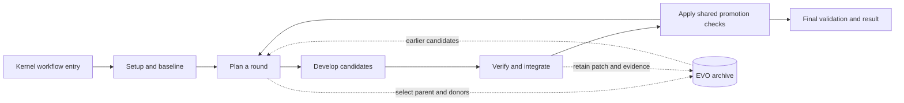

# GEAK-evo architecture

GEAK-evo is an agentic evolutionary optimization system built on GEAK. It extends
the shared engineering workflow with an archive of candidate programs, sustained
development from selected parents, deliberate crossover using donor programs,
and checkpoint migration between configured lineages. GEAK's greedy policy
develops the incumbent through the same setup, planner, specialist and deep
engineers, tools, verifier, integration step and final validation. EVO is the
default; see the [run guide](stock-workflow.md).

See the [runtime configuration reference](configuration.md) for explicit
optimizer settings, and the [workflow comparison](geak-vs-evo.md) for diagrams
and source links.

For the intended role inside Hyperloom and GEAK's end-to-end workflow, see
[the workload discovery loop and pinned integration code](workload-discovery.md).

The planner chooses a `parent_id`, optional `donor_ids`, and an `approach` label
for each direction. The workflow creates a private workspace from a fixed run
base, applies the selected parent's cumulative patch, and gives the engineer
donor references. Combining donor contributions is an engineering decision.
Declared ancestry and approach labels do not prove that contributions survived
or that implementations are meaningfully different.

The archive retains patches and selected evidence from correct, slower,
incorrect, and unverified attempts when their source is available. Planning can
return to those candidates. The best validated candidate is tracked separately;
retention alone does not make a candidate eligible for promotion. The shared
promotion and final-validation rules still apply.

## Branching development, crossover and migration

Parent links form the branches of an evolutionary history. Donor links connect
those branches when an engineer investigates a crossover. The planner can choose
an earlier implementation for its computational organization or useful case-level
behavior, even when another program has the best aggregate score. It directs
continued development of the incumbent alongside justified alternatives; the
planner chooses breadth and depth from the available evidence and budget.

With `population_lineage` and `evolution_start: "search_start"`, independently
launched lineages publish committed checkpoints and import compatible checkpoints
from explicitly named peers. Imports enter the local archive as selectable source
and evidence, while the lineage keeps its own incumbent and budget. Engineers can
develop an imported parent or use it as a donor. Imported source must satisfy the
existing local verification and promotion rules before replacing the incumbent.
See the [migration configuration](configuration.md#checkpoint-migration).

## Preserve engineering time

Both policies use the same role allowances and engineering/verification pipeline.
A direction can enter verification while another engineer continues developing;
integration follows the completed pipeline. Deep engineers keep their dedicated
round and multi-iteration rewrite loop. EVO adds source materialization, retention
and selection to this machinery; those operations also consume time.

Use the [search controls](configuration.md#sustained-development-and-time-allocation)
to allow several rounds of development, size the engineering fan-out to the
evaluation pool, and reserve enough time to verify and deliver candidates. The
planner's exploration/development balance is a policy decision, not an enforced
tree shape or a guaranteed fraction of wall time spent reasoning. GPU locks,
model concurrency and role deadlines still bound the work.

## Source map

| Source | Responsibility |
| --- | --- |
| [kernel_workflow.js](../../kernel_workflow/kernel_workflow.js) | Public dispatcher for the kernel workflow |
| [14_optimize_loop.js](../../kernel_workflow/src/kernel_lane/14_optimize_loop.js) | Shared plan, develop, verify, integrate, and promote loop |
| [14a_evolution.js](../../kernel_workflow/src/kernel_lane/14a_evolution.js) | Parent resolution, workspace preparation, patch retention, and archive updates |
| [roles/evolution.md](../../kernel_workflow/roles/evolution.md) | Guidance for continuing alternatives and inspecting evidence |
| [geak/native](../../geak/native/) | Shared native task validation, execution, source capture, and report reading |

The planner receives the latest twelve archive entries plus the best entry, and
can inspect the full archive. Engineers receive the selected starting source,
donor references, and archive path. The optional `evolution_evidence_handoff`
flag also puts selected parent and donor evidence into the engineer prompt;
it is off by default. See [archive fields](archive.md).

## Scope

Each run owns its archive; configured peer lineages exchange committed checkpoints
through a shared directory. The caller launches those lineages and assigns their
resources. There is no separate population service, automatic branch quota,
semantic cell allocation, or cross-run archive resume protocol. Migration is
opt-in; the default first-stall continuation uses a local archive rooted at the
incumbent reached before the stall.

When first-stall initialization succeeds, the lane result includes the existing
`evolution_start` record: `after_round`, the current `cumulative` score, the archive
path, and `first_round` if a later loop iteration begins. `first_round` is recorded
before the planner call; it does not prove that planning returned, an engineer ran,
or retained-source guidance was supplied. Join it with the timeline and archive
evidence for those questions. An absent record does not distinguish no attempt
from failed initialization or an older result format.

The former `geak_evo` Python driver, research-store exporter, pilot launcher, and
group coordination system are retired. The Python driver's earlier public source
is available at Git revision `f0f6ec427f98888644b2d5fb303540d15beb192a`. Historical deployments
and study records retain their own pinned source and environment; this cleanup
does not migrate or qualify them.
