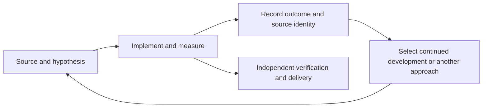

# Using candidate evidence

GEAK-evo keeps source references and engineering evidence together so later
planning can revisit an implementation and its unresolved questions. The
[archive reference](archive.md) describes the recorded fields, and the
[architecture guide](architecture.md) shows where selection and retention enter
the shared workflow.

When interpreting a candidate, distinguish the proposed idea, the code actually
implemented, the measured result and the next experiment. Keep case-specific
gains and regressions attached to their shapes, numerical contract, input state
and measurement context. An aggregate score alone does not explain which change
helped a case.

Parent and donor references support source reuse. The engineer still needs to
inspect the source, determine which contributions apply, implement the combined
program and measure it. Retention and source survival are recorded independently
of correctness, promotion and delivery.

Use applicable hardware and trace evidence to choose the computation boundary.
A larger region can include producers, consumers, intermediate storage and state
updates. The complete region must preserve its interface and pass its evaluator.
Backend choice, fusion and launch count are engineering decisions assessed
through that contract.

For workload integration, retain the exact tested source, deployment location
and dispatch evidence, then use the workload's own quality and performance
evaluation. See [workload integration](workload-discovery.md).
