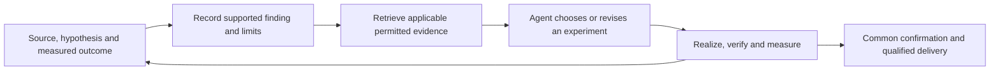

# Learning from completed searches

GEAK-EVO should preserve the evidence behind useful discoveries and use it to
improve later investigations. The mHC and MoE results motivate specific behaviors
to preserve and test. They do not yet identify which evolutionary mechanisms
caused the gains.

This is a research-side decision record and prospective policy proposal. It adds
no runtime component or default instruction. Researcher-written kernel answers
and this document stay outside prospective optimizer input closures. Existing
frozen studies retain their declared inputs.

## Evidence and the decisions it motivates

The [completed comparisons](geak-vs-evo.md) contain the task contracts, source
identities, confirmation data, historical failures and limits. These observations
have different evidential strength:

| Record | Observed context, decision and realization | Confirmed outcome and limits | Behavior to preserve; next test |
| --- | --- | --- | --- |
| Whole-call investigation: mHC | H's selected implementation changes the callable through timed per-call packing, a fused prefill producer and custom finalizers. A separate same-source replay observes three prefill and two decode dispatches. Cross-lineage source contributions survive. | **1.194615× ORIGINAL**, under the declared numerical contract. This is a task-local reorganization, not a causal decomposition or a serving result. Related solution cards were readable in both engine packages; actual exposure is unknown, so independent invention is not established. | Let engineers question existing computational boundaries when measurements justify it. Test generic investigation guidance prospectively; measure any integrated result on the enclosing workload. |
| Whole-call investigation: MoE | The winning lineage introduced combined decode preparation in round 1 from ORIGINAL, before a retained or peer parent was available. Separate same-source tracing observes five decode dispatches for ORIGINAL/GEAK and three for EVO. Projection stages also change. | **1.071309× ORIGINAL; 1.053692× GEAK**, in one completed search pair. Preparation takes about 15.4 microseconds for both GEAK and EVO in the traced calls. No isolated fusion speedup or retention-based origin of the round-1 rewrite is established. | Preserve freedom to change dataflow and decomposition; require source and execution evidence for the claimed change. Test the guidance package on a held-out task, and keep complete-task performance as the outcome. |
| Retention distinct from promotion | MoE's winning E/b round 3 initialized the retained round-2 integration. That integration's recorded reading was about 1.05712× versus the incumbent's 1.04721×, below the required 2% relative promotion margin. | Exact continuation was exercised. The retained candidate was **not demonstrated slower than the incumbent**. No no-retention counterfactual establishes necessity or benefit. | Keep archived alternatives selectable under an explicit continuation policy. The fresh weak-source/incumbent study tests development and opportunity cost; E1 tests continuation versus restart; frozen-archive admission can separately test delivery loss. |
| Contribution survival | A 3,423-byte MoE reducer from an earlier candidate survives byte-identically into the selected program. Earlier source readings conflict. In the separate selected-source prefill trace, the rewritten reducer takes about 97.0 microseconds versus 86.7–87.9 for the native reducer. | Survival and execution are observed. The profiled reducer is slower in those calls while the final complete prefill case improves in all common cycles. Neither the component's isolated contribution nor the cause of the full-call gain is established. | Preserve exact donor/source identity and inspect what actually executes. Use a discriminating component comparison when attribution matters; do not require every integration to run every possible ablation. |
| Source and evidence transfer | The mHC H delivery has a peer-derived parent. MoE E/d initializes peer_b_r1 exactly, away from the winning E/b path. A positively identified original HP planner receives peer evidence and cites it in its plan. | Adoption, source survival and evidence use are distinct observations. None alone establishes beneficial transfer. Original HP/H was about **0.970152**, from separately normalized confirmations in one unrepaired pair. | Keep source, design and evidence channels distinguishable. Repaired H/HP tests the specific PE03 evidence-access package; a clean source-transfer-only benefit remains open. |

Parallel engineering, integration and accumulated history also exist in ordinary
GEAK. They should remain available in GEAK-EVO, but they cannot alone explain its
incremental advantage. Both arms in MoE R1 had four lineages: that comparison
bundles policy, retention and transfer, rather than changing population count.

The three earlier completed GEAK-favored comparisons remain in the record. The
repaired MoE win is one independent search pair; its three confirmation cycles
are measurement repetitions. Changed runtime conditions prevent treating all
historical results as interchangeable replications. Execution failures and
missing finals remain visible without becoming evidence that a search idea failed.

## A small feedback loop using existing records

This is a proposed use of existing investigation notes, archives, learned knowledge
and handoff channels. It does not require a new memory service, scheduler or reward
model. The record should identify context, the prospective decision, realized
source/execution, outcome and cost, then the supported interpretation, competing
explanation and next discriminating experiment. Corrected and negative findings
travel with positive ones.

There are two distinct uses. Research-side records guide which generic system
policies to test. System-generated evidence may guide subsequent optimization
when its provenance, applicability and permitted exposure are declared. Feeding
researcher-derived task solutions into an independent-discovery arm would change
the experiment. A knowledge-reuse study must declare that exposure separately.

## Candidate guidance and its ablation

Four task-agnostic suggestions are proposed for review:

1. When evidence challenges the current decomposition, reconsider the complete
   permitted computation. State a prediction and a competing explanation.
2. Separate a candidate's promotion from its availability for later development.
   Keep a correct alternative with a concrete unresolved hypothesis when the
   declared retention policy allows it; continuation still consumes budget.
3. When integrating a contribution, check the exact source and executed path.
   Distinguish survival from benefit, and run a discriminating test when needed
   to resolve a consequential attribution question.
4. Consider applicable peer source, designs and evidence as optional inputs to
   a revisable investigation. Record what was received, used and realized, and
   preserve contradictory findings. A stronger peer score is not sufficient
   evidence that adoption will help the recipient.

The proposed **G** comparison is current GEAK-EVO versus the same system with
this guidance package on a held-out, qualified task. Freeze exact packet bytes,
model, tools, starting information, permitted source exposure, ordinary knowledge
retrieval and declared resources before search. Both arms use the same final
evaluator. Actual costs and all registered outcomes accompany the best confirmed
result. Record guidance receipt, prospective plan changes, implementation and
measured outcomes; a persuasive retrospective story is insufficient.

G tests a guidance package, not each suggestion or a general learned-memory
architecture. A later channel ablation can distinguish structured guidance,
raw-history retrieval and source transfer if a completed result warrants it.
No currently qualified held-out task or G launch is asserted here. Required
finals, direct replications and the first admitted weak/incumbent pair retain
their priority.

Correctness and target performance determine candidate qualification. Fusion,
fewer launches, peer adoption, source survival and retention receive no automatic
fitness bonus. Evidence changes what the agent considers and tests; independent
evaluation decides what can be delivered. Interfaces can support these behaviors
now while their default use remains subject to scoped, completed experiments.
