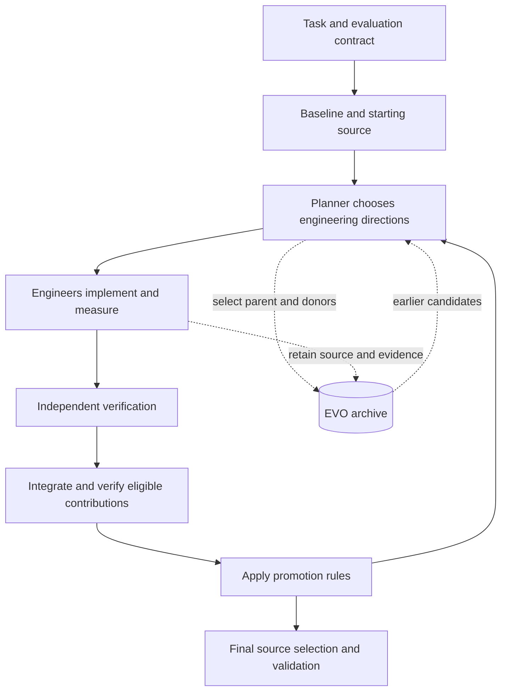

# GEAK and GEAK-EVO workflows

GEAK and GEAK-EVO share the setup, planner, engineers, tools, verification and
integration loop. Select ordinary search with `optimizer: "greedy"`, or retained
candidate search with `optimizer: "evo"`.

## One optimization lineage

A lineage contains multiple rounds and engineering directions. Engineers work
in private workspaces, and the runtime schedules their tool use within the
configured model and GPU resources. Each round can revise the investigation
using its accumulated history and measurements.

## Candidate handling

| Operation | GEAK | GEAK-EVO |
| --- | --- | --- |
| Planning | Current source, history and hypotheses | History plus retained alternatives |
| Starting source | Current canonical source | Selected retained parent, with recorded initialization |
| Engineering | Shared roles, tools and evaluator | Shared machinery with parent and donor references |
| Earlier attempts | Available through recorded history | Captured source can also be selected for development |
| Integration | Implement and verify combined changes | Implement and verify contributions from selected sources |
| Delivery | Qualified source and final checks | Qualified source and final checks |

The planner supplies `parent_id`, optional `donor_ids` and an `approach` for each
direction. The workflow applies the parent's cumulative patch to a fixed run
base. Engineers inspect donor references and decide which contributions to use.
The archive preserves source and measured evidence separately from the current
best validated candidate.

An archive entry does not itself qualify a program for delivery. Source identity,
correctness, case-level performance and the complete-operation objective govern
verification and final selection. The numerical promotion margin and the
candidate retention policy serve different purposes.

## Implementation

| Responsibility | Source |
| --- | --- |
| Optimizer dispatch | [14b_optimize_dispatch.js](../../kernel_workflow/src/kernel_lane/14b_optimize_dispatch.js) |
| Shared engineering loop | [14_optimize_loop.js](../../kernel_workflow/src/kernel_lane/14_optimize_loop.js) |
| Parent resolution and retained source | [14a_evolution.js](../../kernel_workflow/src/kernel_lane/14a_evolution.js) |
| Evolution guidance | [roles/evolution.md](../../kernel_workflow/roles/evolution.md) |
| Model-call runtime | [run_workflow.mjs](../../interface/runtime/engine/run_workflow.mjs) |
| GPU acquisition | [gpu_lock.sh](../../kernel_workflow/scripts/gpu_lock.sh) |

See [architecture](architecture.md), [configuration](configuration.md) and
[archive fields](archive.md) for the corresponding interfaces.
