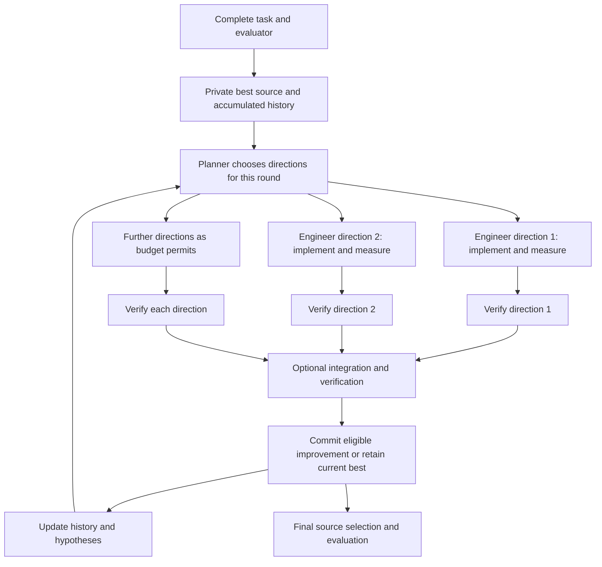
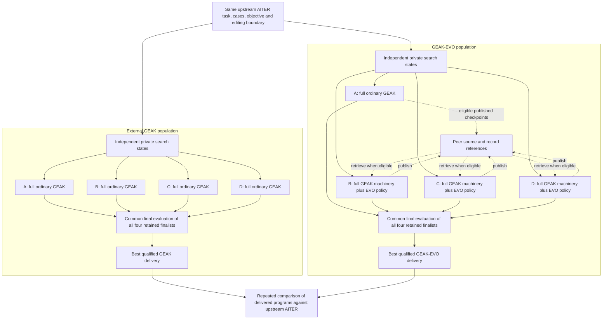
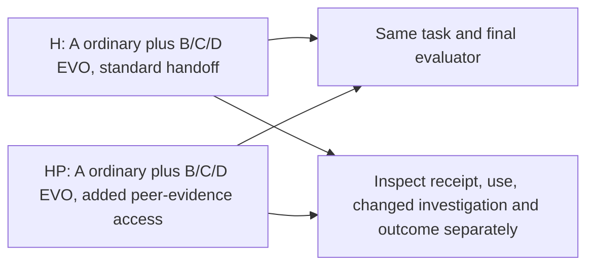

# GEAK and GEAK-EVO: workflows, populations, and measured comparisons

The v1 GEAK-EVO populations studied here contain a **complete ordinary GEAK lineage** alongside other complete
lineages that use GEAK's engineering machinery with retention and exchange.
One lineage contains several engineering directions over many rounds; it is not
one engineer call.

The three completed GEAK-versus-EVO population comparisons compared **four ordinary GEAK lineages**
against **one ordinary GEAK lineage plus three EVO lineages**. The ordinary member
inside EVO is an independent search. It is not a replay of the external
population's winning trajectory, so including it does not guarantee beating
that other population.

**1. Inside one full lineage**

The arrows show the logical work, not guaranteed simultaneous execution. An
engineer can enter verification while another is still working. The next round
uses retained source and history through fresh role calls. Ordinary GEAK already
has this continuity. Its ordinary deep-exploration direction occupies a local
round; EVO can mix deep and specialist directions within its direction budget.

**2. The actual population comparison**

The ordinary member A has no EVO imports or EVO planning treatment. It can
publish its committed source for other members. B, C and D can select retained
parents and inspect eligible peer information, while preserving their own local
search state. Diagrammed access is a capability; it does not establish that a
particular run exchanged or benefited from information.

Each population has its own shared model-call capacity and GPU pool. A full
workflow does not mean a dedicated GPU or a reserved share of model calls.
Lineages progress independently; there is no population-wide round barrier.
Finite budgets, scheduling and stochastic decisions can produce different
trajectories. These are possible contributors, not measured causes of the
performance gaps below.

**3. What changes inside an EVO member**

| Operation | Ordinary GEAK member | EVO member |
| --- | --- | --- |
| Planning context | Own current best, history and hypotheses | Own history plus retained alternatives and available peer references |
| Starting source for a direction | Current canonical source | Selected retained parent; default is local best verified, otherwise ORIGINAL |
| Engineering and validation | Shared GEAK roles, tools and evaluator | Same machinery, with parent/donor and retention instructions |
| Earlier unsuccessful attempts | History can inform later search | Captured alternatives can also be selected and developed when their source is available |
| Peer information | No EVO imports | Eligible source/design/evidence references; actual availability and use must be checked |
| Promotion and delivery | Qualified improvement and final checks | Same objective and final checks; retaining an alternative does not qualify it for delivery |

In the continuing population runs, ordinary engineers retain their ordinary
per-invocation submission limits. EVO's continuation guidance makes iteration,
plateau and target limits reassessment checkpoints. Both still use the common
outer-loop budget, no-improvement counters, forced-replanning rules and
deadlines; EVO does not get an independent unlimited host loop.

Implementation inheritance transfers source; design inheritance transfers an
idea; evidence inheritance transfers an experiment, constraint or unresolved
question. A parent reference, a record read, a changed investigation and a
beneficial outcome are different observations.

**4. Why the observed GEAK population won**

The endpoint audit establishes **which programs won**, but does not yet isolate
the cause of the search difference. In all three completed pairs, the embedded
ordinary member A's retained common-final candidate was ORIGINAL. It was included
in selection. The external winners were different searches: B, C and C.

| Completed AITER block | External GEAK population | Ordinary A inside EVO | GEAK-EVO population |
| --- | --- | --- | --- |
| b08 mHC full03 | B: **1.01616×** | ORIGINAL | A: ORIGINAL, **1.00000×** |
| c08 MoE R03 | C: **1.03949×** | ORIGINAL | C: **1.01936×** |
| c08 MoE R02 replacement | C: **1.02363×** | ORIGINAL | D: **1.00882×** |

The scores are repeated confirmations of the selected deliveries. They use the
fixed-workload kernel objective: 64 prefill calls at M=8192 and 1024 decode calls
at M=64, with speedup equal to baseline weighted time divided by candidate
weighted time. They are not end-to-end serving speedups. ORIGINAL is normalized
to 1.0; small timing differences between two measurements of unchanged source
are not kernel improvements.

All six native parents have four completed confirmation rows. The recorded
winner matches recomputation from those rows. In R03 and R02 replacement, A's
selected source is the round-0 fallback; that does not mean it performed no
later engineering. The [extracted evidence](evidence/population-finals-20261028.json)
records per-member qualification, source identities and provenance separately
from the repeated delivery measurements.

The selector first chooses among qualified improvements, ordered by the declared
primary score. If none qualify, it uses the valid no-improvement fallback.
Consequently, an EVO population cannot select below **its own qualified ordinary
finalist** in that common evaluation. This is not a guarantee about an external
GEAK trajectory, an earlier unretained candidate, or future measurements.

There is no evidence in these finals that selection discarded a better
qualified A. There is also no established explanation yet for A's weaker
delivered source, or a demonstrated benefit from cross-lineage evidence. The
three completed outcomes favor the external GEAK populations at their tested
scope; they do not establish that GEAK is universally superior.

**5. The evidence-access follow-up is a different comparison**

Both arms are hybrid EVO populations. HP's PE03 treatment adds peer archive
paths, evidence-reading guidance and optional citations. It is not a new
GEAK-versus-EVO comparison. Current declarations use four lineages and a shared
limit of eight concurrent agent subprocesses per population, with a shared
10,000-call lifetime cap. The c08 pair has one GPU per population; b08 wave2
declared four. These are configured limits, not measured utilization, and they
must not be projected backward onto older experiments. The b08 H arm failed,
leaving that H/HP contrast unavailable; the c08 comparison is still in progress
as of 28 October 2026. Neither supplies a completed positive mechanism result.

**6. Code to compare manually**

This comparison is maintained on the `evo` branch. The code already on `evo`
when this documentation was added was `4457f6e04569d0885348472eec689465a333254c`:
it provides the within-lineage retained-candidate machinery. The multi-lineage
v1 extension is separately published at
[`42b83027`](https://github.com/AMD-AGI/GEAK/tree/42b830278588aefeeb534f67b6e0273e41052258).
This documentation update does not merge experimental runtime code. The links
below distinguish the two versions so a reader can inspect what is implemented.

| Question | Code |
| --- | --- |
| Do ordinary GEAK and EVO use the same engineering loop? | [Dispatch on this branch](../../kernel_workflow/src/kernel_lane/14b_optimize_dispatch.js), [shared loop](../../kernel_workflow/src/kernel_lane/14_optimize_loop.js) |
| Where do selectable parents and retained attempts enter? | [EVO state and source handling](../../kernel_workflow/src/kernel_lane/14a_evolution.js), [EVO instructions](../../kernel_workflow/roles/evolution.md) |
| How are four full private member workflows launched? | [Published v1 population dispatcher](https://github.com/AMD-AGI/GEAK/blob/42b830278588aefeeb534f67b6e0273e41052258/kernel_workflow/src/kernel_workflow/01b_population.js#L108) |
| Is ordinary A given the EVO planning treatment? | [Published v1 dispatch: ordinary calls the loop with `evo=null`](https://github.com/AMD-AGI/GEAK/blob/42b830278588aefeeb534f67b6e0273e41052258/kernel_workflow/src/kernel_lane/14b_optimize_dispatch.js#L24) |
| How do members publish and import? | [Published v1 checkpoint publication and peer refresh](https://github.com/AMD-AGI/GEAK/blob/42b830278588aefeeb534f67b6e0273e41052258/kernel_workflow/src/kernel_lane/14a_evolution.js#L162) |
| Does final selection include A? | [Published v1 common final evaluation and selection](https://github.com/AMD-AGI/GEAK/blob/42b830278588aefeeb534f67b6e0273e41052258/kernel_workflow/src/kernel_workflow/01b_population.js#L240), [per-lineage finalist query](https://github.com/AMD-AGI/GEAK/blob/42b830278588aefeeb534f67b6e0273e41052258/kernel_workflow/scripts/query_population.py#L436) |
| Are model sessions and GPU evaluations separate resources? | [Shared runtime](../../interface/runtime/engine/run_workflow.mjs), [GPU pool locks](../../kernel_workflow/scripts/gpu_lock.sh) |

The later AITER deployments contain additional task/runtime fixes. Their exact
frozen source identities are not interchangeable with the public v1 source:
b08 full03 identifies `473bc7e32d6fc3616c60e0ceab4568e51929e5f1`; the later H
source identifies `95127660493673553bc7073482975d44bb7fce04`. HP is H plus PE03,
with tree `98b58347fee4cfabc234c7e0fb033353fc28f2e6` (a tree, not a commit).
Those later source IDs are provenance, not purported working GitHub links.
Use the public links for the specified implementation and the extracted final
records for the reported outcomes; do not assume a moving branch reproduces a
historical experiment.
