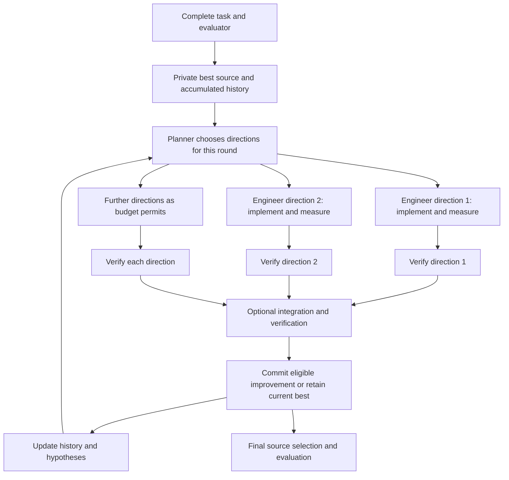
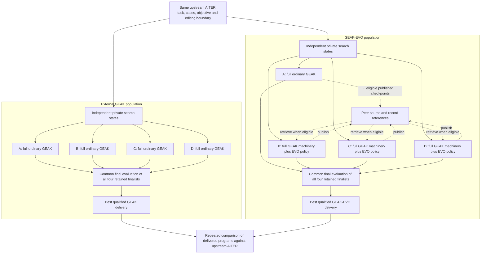
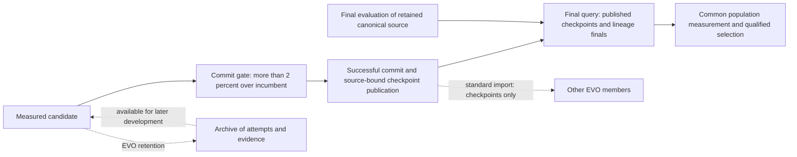
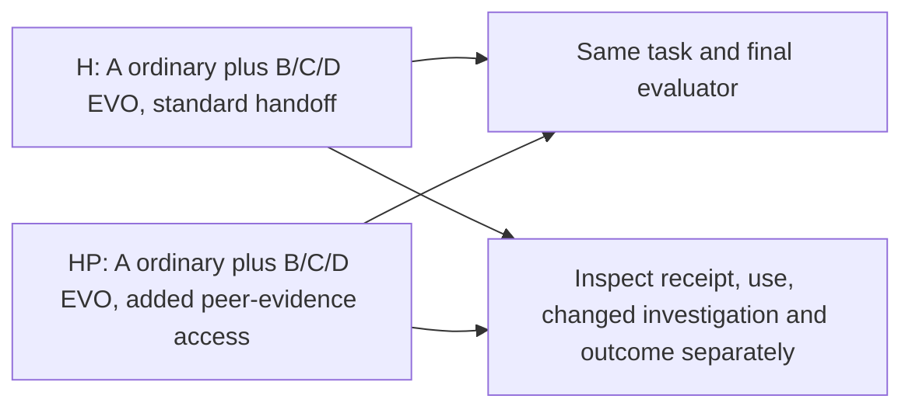
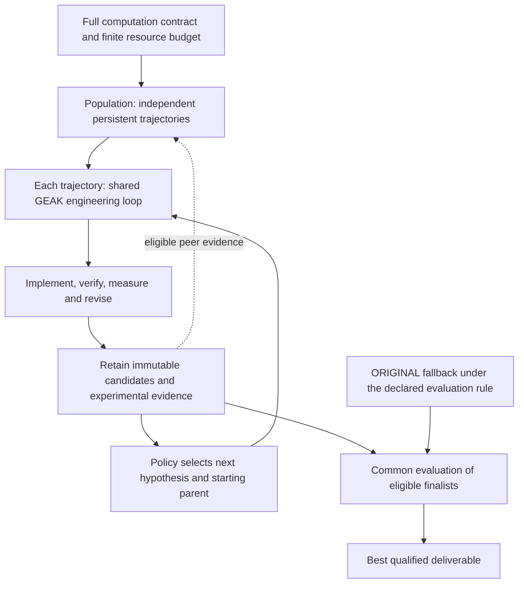

# GEAK and GEAK-EVO: workflows, populations, and measured comparisons

The v1 GEAK-EVO populations studied here contain a **complete ordinary GEAK lineage** alongside other complete
lineages that use GEAK's engineering machinery with retention and exchange.
One lineage contains several engineering directions over many rounds; it is not
one engineer call.

The three earlier completed GEAK-versus-EVO population comparisons and the separately
repaired MoE R1 comparison below compare **four ordinary GEAK lineages**
against **one ordinary GEAK lineage plus three EVO lineages**. The ordinary member
inside EVO is an independent search. It is not a replay of the external
population's winning trajectory, so including it does not guarantee beating
that other population.

**1. Inside one full lineage**

The arrows show the logical work, not guaranteed simultaneous execution. An
engineer can enter verification while another is still working. The next round
uses retained source and history through fresh role calls. Ordinary GEAK already
has this continuity. Its ordinary deep-exploration direction occupies a local
round; EVO can mix deep and specialist directions within its direction budget.

**2. The actual population comparison**

The ordinary member A has no EVO imports or EVO planning treatment. It can
publish its committed source for other members. B, C and D can select retained
parents and inspect eligible peer information, while preserving their own local
search state. Diagrammed access is a capability; it does not establish that a
particular run exchanged or benefited from information.

Each population has its own shared model-call capacity and GPU pool. A full
workflow does not mean a dedicated GPU or a reserved share of model calls.
Lineages progress independently; there is no population-wide round barrier.
Finite budgets, scheduling and stochastic decisions can produce different
trajectories. These are possible contributors, not measured causes of the
performance gaps below.

**3. What changes inside an EVO member**

| Operation | Ordinary GEAK member | EVO member |
| --- | --- | --- |
| Planning context | Own current best, history and hypotheses | Own history plus retained alternatives and available peer references |
| Starting source for a direction | Current canonical source | Selected retained parent; default is local best verified, otherwise ORIGINAL |
| Engineering and validation | Shared GEAK roles, tools and evaluator | Same machinery, with parent/donor and retention instructions |
| Earlier unsuccessful attempts | History can inform later search | Captured alternatives can also be selected and developed when their source is available |
| Peer information | No EVO imports | Eligible source/design/evidence references; actual availability and use must be checked |
| Promotion and delivery | Qualified improvement and final checks | Same objective and final checks; retaining an alternative does not qualify it for delivery |

In the continuing population runs, ordinary engineers retain their ordinary
per-invocation submission limits. EVO's continuation guidance makes iteration,
plateau and target limits reassessment checkpoints. Both still use the common
outer-loop budget, no-improvement counters, forced-replanning rules and
deadlines; EVO does not get an independent unlimited host loop.

Implementation inheritance transfers source; design inheritance transfers an
idea; evidence inheritance transfers an experiment, constraint or unresolved
question. A parent reference, a record read, a changed investigation and a
beneficial outcome are different observations.

**4. Why GEAK won the three earlier comparisons**

The endpoint audit establishes **which programs won**, but does not yet isolate
the cause of the search difference. In all three completed pairs, the embedded
ordinary member A's retained common-final candidate was ORIGINAL. It was included
in selection. The external winners were different searches: B, C and C.

| Completed AITER block | External GEAK population | Ordinary A inside EVO | GEAK-EVO population |
| --- | --- | --- | --- |
| b08 mHC full03 | B: **1.01616×** | ORIGINAL | A: ORIGINAL, **1.00000×** |
| c08 MoE R03 | C: **1.03949×** | ORIGINAL | C: **1.01936×** |
| c08 MoE R02 replacement | C: **1.02363×** | ORIGINAL | D: **1.00882×** |

The scores are repeated confirmations of the selected deliveries. They use the
fixed-workload kernel objective: 64 prefill calls at M=8192 and 1024 decode calls
at M=64, with speedup equal to baseline weighted time divided by candidate
weighted time. They are not end-to-end serving speedups. ORIGINAL is normalized
to 1.0; small timing differences between two measurements of unchanged source
are not kernel improvements.

All six native parents have four completed confirmation rows. The recorded
winner matches recomputation from those rows. In R03 and R02 replacement, A's
selected source is the round-0 fallback; that does not mean it performed no
later engineering. The [extracted evidence](evidence/population-finals-20261028.json)
records per-member qualification, source identities and provenance separately
from the repeated delivery measurements.

The selector first chooses among qualified improvements, ordered by the declared
primary score. If none qualify, it uses the valid no-improvement fallback.
Consequently, an EVO population cannot select below **its own qualified ordinary
finalist** in that common evaluation. This is not a guarantee about an external
GEAK trajectory, an earlier unretained candidate, or future measurements.

There is no evidence in these finals that selection discarded a better
qualified A. There is also no established explanation yet for A's weaker
delivered source, or a demonstrated benefit from cross-lineage evidence. The
three completed outcomes favor the external GEAK populations at their tested
scope; they do not establish that GEAK is universally superior.

**4a. What the eight R03 histories establish**

The next audit inspected the actual saved arguments, task descriptors, all eight
lineage-final timelines, and the two winning C checkpoint chains. The task text
and task configuration match exactly; none of the eight members has a focus
override. Full descriptors are not identical: 47 fields differ within initial
action observations (measurements, numerical checks, command wall times,
invocation IDs and command output), and one differs in the baseline workspace
path. Both arms
have `design_genome_mode=off` and `evolution_evidence_handoff=false`. R03 tests
the continuing-population policy, not the later evidence-access treatment.

In the table, each dispatch column is **attempts / truthy returns**. A truthy
return means the outer agent call returned a result. It does not establish
correctness, acceptance of that result, GPU work completed, or provider-call
usage. Engineer calls are identified by their `eng ` label prefix; the other
three columns use the recorded role and sub-phase.

| R03 member | Planning | Engineering | Verification | Integration | Committed rounds | Common-final delivery |
| --- | ---: | ---: | ---: | ---: | ---: | --- |
| GEAK A | 5 / 4 | 12 / 11 | 7 / 6 | 0 / 0 | 1 | 1.01922× |
| GEAK B | 4 / 3 | 9 / 7 | 5 / 4 | 0 / 0 | 1 | 1.02468× |
| GEAK C | 4 / 3 | 9 / 8 | 8 / 8 | 1 / 1 | 1 | **1.03998×** |
| GEAK D | 6 / 5 | 10 / 8 | 7 / 7 | 0 / 0 | 0 | ORIGINAL |
| Hybrid A, ordinary | 5 / 4 | 12 / 8 | 12 / 10 | 0 / 0 | 0 | ORIGINAL |
| Hybrid B, EVO | 4 / 4 | 8 / 7 | 8 / 7 | 1 / 1 | 0 | ORIGINAL |
| Hybrid C, EVO | 3 / 3 | 9 / 5 | 9 / 5 | 2 / 2 | 1 | **1.02445×** |
| Hybrid D, EVO | 3 / 3 | 8 / 6 | 8 / 5 | 0 / 0 | 0 | ORIGINAL |

These scores are the native population common-final measurements. The separate
repeated confirmations in section 4 remain the delivered-program comparison.
The direct committed-round counters total three for GEAK and one for the hybrid.
Both winning C lineages committed **once**: GEAK C published `r0` and `r2`, while
hybrid C published `r0` and `r1`. A checkpoint's round number is not a count of
successful commits.

Across the populations, GEAK recorded 40 engineer dispatches with 34 truthy
returns; the hybrid recorded 37 with 26. The hybrid recorded more verification
dispatches, 37 versus 27, including attempts to recover engineer submissions.
Ordinary members skip verification of a trustworthy measurement at or below the
candidate floor; EVO does not apply that skip after workspace initialization.
Verification dispatches labelled as recovery after a failed or missing engineer
return number 11 in the hybrid and 6 in GEAK. These counts describe recorded
workflow activity. They do not measure realized resources or establish the
cause of the score gap. The timelines have no timestamps and do
not distinguish all reasons for a missing return. The saved `budget_used` totals
are 40 and 41 **direction-cost units**, not model calls. All eight finals report
stopping at their deadline.

Four EVO directions failed **before engineer dispatch**: hybrid B's `r2_d0`,
`r2_d1`, `r2_d2`, and hybrid D's `r2_d1`. Their retained records have the workflow's
fixed `parent initialization failed` note and no ready initialization. B's
timeline consequently has no engineer call for that round. This is a concrete
loss of planned engineering opportunities. Separately, all four matching shared
log messages report `evolution git failed`. That identifies a Git-command
failure class; it does not identify the failed Git operation, its underlying
cause or time lost. The messages have no lineage attribution, so their
individual event joins remain unproved. This finding does not show how the
unexecuted directions would have performed.

An isolated CPU diagnostic identified a reproducible defect matching this
pattern: **all four failed directions selected a parent whose recorded patch
digest is the digest of an empty file**. All 14 ORIGINAL-parent directions and
all 11 directions with nonempty retained-parent patches initialized successfully.
The frozen initializer applies every retained parent with `git apply -- <patch>`.
In local Git 2.47.3, the exact command on an empty patch exits 128 with
`No valid patches in input`; a valid nonempty control succeeds. The empty patch
leaves the source unchanged. This supports an empty-parent handling defect,
without uniquely recovering the historical failed Git subcommand or measuring
its effect on the final score gap. Why those parent attempts retained no source
change remains a separate question. No historical run or source was changed by
the diagnostic.

The shared logs also contain 6 agent-timeout and 16 process-deadline messages
for GEAK, versus 11 and 17 for the hybrid. The hybrid has 6 peer-refresh failure
messages. These messages lack member attribution and may overlap; they are not
additive event counts. Neither their counts nor a failed refresh establishes
how much peer information was actually available or used.

**Retention, promotion and final selection are separate boundaries.** Hybrid D
retained three rows marked correct, with recorded weighted scores 1.00328×,
1.00942× and 1.00948×. Their stored verifier fields report valid measurements and
gain eligibility. D nevertheless recorded zero commits and delivered ORIGINAL.
The frozen source requires a candidate score to be strictly greater than
`incumbent_score * (1 + min_improve)` to commit; the default is `min_improve=0.02`,
and neither arm nor any member overrides it. Retaining a gain below that bar
does not promote it into the canonical source.

The final query does not automatically enumerate every retained archive row.
Standard peer import also queries published checkpoints; an unpublished
alternative is not available through that channel. These are source-level
boundaries, not measurements of their effect on search.
Thus the finding that final selection chose the best qualified **finalist** does
not establish that every measured alternative reached that selection. D's small
gains have not had separate common confirmation, and their existence does not
explain the external population's larger winning gain.

Hybrid C's selected `r1_integrated` record names two own same-round donors. A
later retained row, `r2_d0`, reports 1.02604×, compared with the selected
checkpoint's 1.02373×. This is a lead for examining the promotion boundary, not a
confirmed lost improvement: these are stored measurements, and the exact
then-incumbent value, source realization and common remeasurement matter.

Across the three EVO members, 25 of 29 retained direction rows have `ready`
initialization records: B has 8 of 11, C has 9 of 9, and D has 8 of 9. The four
remaining directions are the initialization failures above; C's integration
record is separate. Ready records carry initial tree/commit identities and a
parent-patch reference where applicable. For three concrete examples, hybrid D
loaded `r1_d2` for `r2_d2`, then loaded `r2_d2` for `r3_d2`; hybrid C loaded
`r2_d0` for `r3_d0`. The source writes this status after checking and applying the
parent patch and creating the initial workspace tree. This establishes recorded
implementation reuse within those lineages. D's first parent was unverified;
its descendants have the small verified gains above. C's later direction
remained unverified: its third round recorded three engineering and three
verification dispatches with no truthy returns. These observations establish
neither beneficial peer evidence transfer nor superiority over continuing GEAK. Other parent and donor
references still require their own initialization or use evidence.

The [R03 audit extract](evidence/r03-search-audit-20261028.json) records counts,
input scope, source references and missing evidence. The remaining questions are
distinct-source generation and correctness, the full parent-selection history,
historical peer receipt/read/use, per-lineage waiting and model usage, and why
engineering attempts failed to return results. The present records narrow
the diagnosis; they do not isolate a beneficial or harmful EVO mechanism. The
architecture remains unchanged while those questions are investigated.

**4b. Candidate-to-finalist audit and the next comparisons**

The [direction-by-direction audit](evidence/r03-candidate-funnel-20261028.md)
joins all eight timelines with the retained EVO records: 81 observed direction
identifiers and four integration attempts. These are not 81 distinct programs.
It keeps initialization, returned results, verification, promotion, later
development and final admission separate, and marks missing evidence explicitly.

Two hybrid directions with no returned engineer result nevertheless obtained
valid, gain-eligible verifier results through recovery: C `r2_d2` and D `r1_d0`.
Missing engineer returns therefore cannot all be counted as lost candidates.
Conversely, D `r1_d1` has an explicit invalid measurement with correctness not
checked. Its engineer candidate identity matches ORIGINAL; the record does not
establish that a changed implementation was lost.

Six distinct retained gain-candidate IDs are absent from the common-final set.
They remain unconfirmed alternatives, not proven better deliveries. C `r2_d1`
is excluded from this count because it repeats the selected integrated candidate
under a different evaluation. Four of the six alternatives had later ready
children: two children have missing engineer/verifier returns, one has a slower
recorded result, and one retains a small gain. No retained verified descendant
above the promotion gate is observed in those four paths. This does not establish
the outcomes of unrecorded work.

The repair and delivery questions are being prepared as separate comparisons:

- **Repaired search:** handle a hash-verified empty parent delta as the unchanged
  baseline, preserving parent and evidence identity. Keep the existing search,
  promotion and final-admission policies. The prepared evo-descendant repair
  changes only this initialization behavior; it is not the source of historical
  R03 or a live-run update. Its complete public EVO suite (21 existing scenarios
  plus the regression), ordinary GEAK parity checks and generated-source checks
  pass on CPU. These checks establish software behavior, not improved performance.
- **Alternative finalist admission, proposed:** keep the 2% promotion rule and
  checkpoint-only peer import. Give each of the four lineages in both arms two
  fixed slots: the usual finalist and the best distinct eligible alternative,
  with at most eight sources per population. Use captured full sources and valid
  measurement evidence available to both methods, deduplicate source identities,
  disclose eligible pool sizes and missing sources, and fix the evaluation budget
  before measurement. Common evaluation selects the winner; a separate three-cycle
  confirmation measures its delivered performance. This protocol is not installed.

Ordinary working directories can be removed by round-end cleanup, so source
availability must be checked in retained native captures rather than inferred
from an archive or a surviving patch alone. New repeated search pairs require
declared capacity for search and final evaluation, including the storage problem
observed in the newer b08 runs. Every node, source and resource difference from
R03 must be named; no new result retrospectively replaces R03 or isolates the
repair's effect by itself.

**5. The evidence-access follow-up is a different comparison**

Both arms are hybrid EVO populations. HP's PE03 treatment adds peer archive
paths, evidence-reading guidance and optional citations. It is not a new
GEAK-versus-EVO comparison. Current declarations use four lineages and a shared
limit of eight concurrent agent subprocesses per population, with a shared
10,000-call lifetime cap. The c08 pair has one GPU per population; b08 wave2
declared four. These are configured limits, not measured utilization, and they
must not be projected backward onto older experiments. Both b08 arms failed
without canonical final endpoints, leaving that H/HP contrast unavailable;
the original c08 comparison has completed. Its independently confirmed deliveries
are shown below. Later repaired c08 pairs remain separate experiments.

| Completed original c08 arm | Confirmed speedup over ORIGINAL | Weighted baseline / candidate time, ms | Improving measurement cycles |
| --- | ---: | ---: | ---: |
| H: standard handoff | **1.194615×** | 51.103443 / 42.778159 | 3 of 3 |
| HP: added peer-evidence access | **1.158959×** | 51.025326 / 44.026870 | 3 of 3 |

Both programs passed compilation, four-output correctness and changed-state
replay. The [evidence extract](evidence/completed-h-hp-20261029.json) includes the
source identities, all per-case cycle latencies, estimator and archived evidence
references. Each score uses separate case medians and the same 64/1024 weights.
The three cycles are measurement repetitions of one selected program, not three
independent searches. Baseline ran first twice. The ratio HP/H is 0.970152, from
separate confirmations against ORIGINAL; it is not a direct randomized timing
comparison of H with HP. This one unrepaired pair favors H's delivered program
and establishes neither a general nor a causal effect of the added access.

**What this establishes toward computational discovery.** H implements a changed
organization of the full callable, including per-call packing, a fused prefill
producer and custom finalizers. Packing remains timed. Decode retains an FP32 folded numerator where upstream
rounds BF16; it passes the declared tolerance, without a bitwise-identity claim.
A separate same-source
trace observed three prefill and two decode dispatches with no range-crossing
dispatches. That trace was not the scored confirmation call. Source inspection,
contract correctness, full-call improvement and surviving cross-lineage source
contributions support one task-local example toward Level 4. They do not establish
reliable discovery across tasks, superiority over external GEAK, worldwide
novelty, or serving benefit. Related earlier solution cards were readable in both
engine packages despite disabled automatic injection; actual exposure is unknown,
so independent invention is not claimed.

**What this establishes about evidence use.** In one positively identified HP
round-two planner session, observable tool returns contain peer source and
experimental evidence, and the emitted plan explicitly cites those records.
This establishes receipt and use in the plan. It does not establish what would
have happened without those records, useful changed engineering, or causal
performance benefit. HP's recorded donor offers also do not by themselves prove
that the donor's code survived integration. The native final rows rank the later
H and HP deliveries above their compared cross-lineage sources, but those small
point-reading gaps are not independently confirmed incremental benefits.

**5a. General design and the remaining experiments**

The general architecture need not reserve an ordinary GEAK lineage inside every
EVO population. Each member is a complete persistent engineering trajectory;
ordinary or EVO policy determines how it chooses the next investigation and
parent. All members use the shared GEAK engineering loop and the same full-task
contract. Different, revisable hypotheses can guide exploration without creating
a separate engineering engine for each specialization.

This diagram describes the general design. The historical population and its
actual admission rules remain as documented above. Retention, development,
canonical promotion and final admission are different decisions. Preserving a
candidate makes later development possible; it does not allocate that candidate
a full search budget or make it a finalist. The tested policy must explicitly
provide and account for the development opportunity.

Three questions therefore remain separate:

- **Search advantage:** do hybrid or all-EVO populations outperform independent
  ordinary GEAK populations under declared, comparable resources and repeated
  full searches?
- **Depth:** does a weaker computational design repay a full development trajectory
  compared with continuing the stronger design, and does deep allocation beat
  additional shorter independent searches at the same total budget?
- **Accumulation:** does inherited evidence or source change a later investigation
  and improve a separately confirmed outcome?

Fresh repaired comparisons and depth studies address these questions. A failed
or truncated arm is retained as such; a fallback score assigned by an evaluation
rule is not evidence of search inferiority. A useful structural improvement on
one task does not answer all three questions.

**5b. Repaired MoE R1: one positive comparison for GEAK-EVO**

The separately declared repaired MoE pair completed both searches and its common
confirmation. Codex and the actual Claude researcher independently checked the
raw records and obtained identical medians, scores and cycle ratios.

| Delivered program | Weighted full-call time (ms) | Speedup over ORIGINAL |
| --- | ---: | ---: |
| ORIGINAL AITER | 263.259410 | 1.000000× |
| Four-lineage ordinary GEAK population | 258.930215 | **1.016720×** |
| Hybrid GEAK-EVO population | 245.736094 | **1.071309×** |

**GEAK-EVO/GEAK = 1.053692×:** about 5.37% speedup, or 5.10% less weighted time,
in this one completed population pair. The three cycle ratios favor EVO:
1.045830, 1.054520 and 1.056474. These are repeated measurements of one pair,
not three independent searches. The estimator first takes each case's median
across cycles, then weights prefill by 64 and decode by 1024. All four prerequisite
checks and all nine timing actions passed; both changed deliveries qualified,
so no fallback score was assigned.

Each population used one MI350X, four independent ORIGINAL starts, an eight-hour
search allowance per lineage, and the same Astra/ultra model setting and repaired
engine. The hybrid has one ordinary and three EVO members; explicit evidence
handoff and genome mode were disabled. The actual arm-start lag was about
59 minutes 38 seconds. Matching configured allowances do not establish matching
realized model calls, GPU work or opportunity. R2's unchanged comparison and
reversed start order were agreed before R1's source identities and numbers were
revealed. This R1 result does not establish general superiority, a causal
retention or transfer benefit, or serving throughput improvement. The three
older losing comparisons above remain separate historical results.

**Computational change.** Both researchers froze their source assessments before
mapping or numeric results were opened. GEAK's selected program leaves prefill
unchanged; decode uses existing 16-row tiles and replaces per-route activation
re-quantization with token-once quantization that scatters scale bytes through
the sorter's reverse index. EVO's preparation shares the token-once idea.
Both researchers identified a stage-boundary change
in EVO's decode path: one preparation kernel combines routing, token quantization,
scale placement and output zeroing. EVO improves the decode case in all three
common cycles, but it also changes the projection kernels. The case-level gain
cannot be assigned to preparation alone. A separate same-source dispatch trace
is still pending, so the source/execution/benefit label is not yet complete.

EVO's combined preparation kernel already appears in round 1 of its selected
lineage, initialized from ORIGINAL before a retained alternative or peer checkpoint
was available. Its origin is therefore not evidence of retention or transfer.
Later retained-parent development is under separate source and record review;
using a retained parent does not by itself establish that retention was necessary
to find the final program.

EVO also improves prefill in all three cycles. Its prefill preparation already
exists in the inspected upstream split path; the initial claim of a preparation
transformation was withdrawn while preserving the frozen rating. The selected
program rewrites the route reducer and call path. The raters retain a disagreement
about some within-stage classifications; no label was changed to favor the winner.
Correctness means the frozen elementwise-or-global-error rule, which permits
localized elementwise mismatches, not strict elementwise equivalence.
GEAK and GEAK-EVO have identical aggregate prefill error statistics in the
correctness actions; ORIGINAL, GEAK and GEAK-EVO have identical aggregate prefill
statistics in the performance actions' current-value checks. These observations
do not establish identical output tensors or identify where errors originate.
Decode error statistics differ among the programs.

The [reviewable evidence](evidence/completed-moe-r1-20261029.json) retains the
source identities, operands, all cycle and correctness rows, independent reduction
hashes, prior failed confirmation attempts and scope limits. For manual code
comparison, the exact ORIGINAL-relative patches are
[GEAK's selected round-1 program](evidence/moe-r1-geak-selected-20261029.diff) and
[GEAK-EVO's selected program](evidence/moe-r1-evo-selected-20261029.diff).
EVO's final round-4 label refers to the same source retained at round 3; it is
not evidence of a new round-4 contribution. The patches need the pinned task and
runtime and are not standalone benchmark packages. The two failed b08 mHC A1
arms have no native final endpoints and are not counted as another efficacy pair.

**6. Code to compare manually**

This comparison is maintained on the `evo` branch. The code already on `evo`
when this documentation was added was `4457f6e04569d0885348472eec689465a333254c`:
it provides the within-lineage retained-candidate machinery. The multi-lineage
v1 extension is separately published at
[`42b83027`](https://github.com/AMD-AGI/GEAK/tree/42b830278588aefeeb534f67b6e0273e41052258).
This documentation update does not merge experimental runtime code. The links
below distinguish the two versions so a reader can inspect what is implemented.

| Question | Code |
| --- | --- |
| Do ordinary GEAK and EVO use the same engineering loop? | [Dispatch on this branch](../../kernel_workflow/src/kernel_lane/14b_optimize_dispatch.js), [shared loop](../../kernel_workflow/src/kernel_lane/14_optimize_loop.js) |
| Where do selectable parents and retained attempts enter? | [EVO state and source handling](../../kernel_workflow/src/kernel_lane/14a_evolution.js), [EVO instructions](../../kernel_workflow/roles/evolution.md) |
| How are four full private member workflows launched? | [Published v1 population dispatcher](https://github.com/AMD-AGI/GEAK/blob/42b830278588aefeeb534f67b6e0273e41052258/kernel_workflow/src/kernel_workflow/01b_population.js#L108) |
| Is ordinary A given the EVO planning treatment? | [Published v1 dispatch: ordinary calls the loop with `evo=null`](https://github.com/AMD-AGI/GEAK/blob/42b830278588aefeeb534f67b6e0273e41052258/kernel_workflow/src/kernel_lane/14b_optimize_dispatch.js#L24) |
| How do members publish and import? | [Published v1 checkpoint publication and peer refresh](https://github.com/AMD-AGI/GEAK/blob/42b830278588aefeeb534f67b6e0273e41052258/kernel_workflow/src/kernel_lane/14a_evolution.js#L162) |
| Does final selection include A? | [Published v1 common final evaluation and selection](https://github.com/AMD-AGI/GEAK/blob/42b830278588aefeeb534f67b6e0273e41052258/kernel_workflow/src/kernel_workflow/01b_population.js#L240), [per-lineage finalist query](https://github.com/AMD-AGI/GEAK/blob/42b830278588aefeeb534f67b6e0273e41052258/kernel_workflow/scripts/query_population.py#L436) |
| Are model sessions and GPU evaluations separate resources? | [Shared runtime](../../interface/runtime/engine/run_workflow.mjs), [GPU pool locks](../../kernel_workflow/scripts/gpu_lock.sh) |

The later AITER deployments contain additional task/runtime fixes. Their exact
frozen source identities are not interchangeable with the public v1 source:
b08 full03 identifies `473bc7e32d6fc3616c60e0ceab4568e51929e5f1`; the later H
source identifies `95127660493673553bc7073482975d44bb7fce04`. HP is H plus PE03,
with tree `98b58347fee4cfabc234c7e0fb033353fc28f2e6` (a tree, not a commit).
The repaired MoE R1 engine tree is `e4cf1602952073fa5cdb7d0a82d2c42c6005c56c`;
its source package is `d54d3d4f51ed24d4b702838e574fb42776218d541a497d981282c54b9b682cdf`.
Those later source IDs are provenance, not purported working GitHub links.
Use the public links for the specified implementation and the extracted final
records for the reported outcomes; do not assume a moving branch reproduces a
historical experiment.
