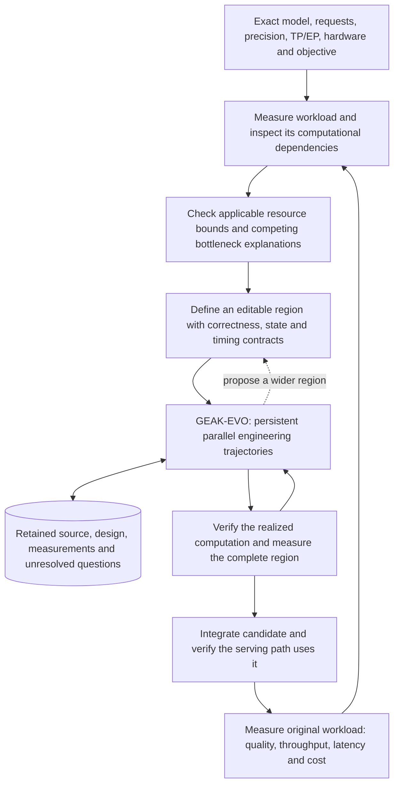

# GEAK-EVO in a full workload optimization loop

The intended Level 4 system autonomously investigates a workload, develops better
computational organizations, integrates them, and measures the resulting workload.
GEAK-EVO supplies the persistent engineering search inside Hyperloom or GEAK's
end-to-end workflow. The outer workflow retains responsibility for the workload
objective, serving configuration, task boundaries and final acceptance.

This is the deployment target, not a claim of completed integration or general
discovery capability. The [measured comparisons](geak-vs-evo.md) currently establish
two task-local computational reorganization examples and one completed MoE
population comparison favoring GEAK-EVO. They do not establish serving gains,
general superiority or the benefit of protecting initially weaker approaches.

The [evidence-to-policy record](evidence-to-policy.md) connects those completed
results to generic behaviors and prospective ablations. The full recipe-level
controller and its population, transfer and allocation policies remain research
hypotheses; the first inner-worker integration does not freeze that architecture.

Each trajectory uses the complete GEAK engineering loop. Its starting hypothesis
may concern dataflow, decomposition, hardware mapping or scheduling; it can change
that hypothesis after experiments. Retaining an alternative makes it available.
Giving it a sustained development budget is a separate allocation decision, whose
value is the subject of the weak-branch and depth-versus-breadth studies.

An existing kernel boundary must not silently become the limit of discovery.
The task may need to encompass several producers and consumers, workspace,
layout conversion, synchronization and state updates. A persistent megakernel is
one possible result; partial fusion or a better multi-kernel schedule may win.
Any wider task needs an explicit executable contract and appropriate resources.
The current single-GPU extraction lane does not establish arbitrary multi-rank
region support.

Public source inspected on 29 October 2026 identifies the following integration
points. These pins describe current `main` code; they are not the frozen engine
sources of the historical experiments or proof that this branch implements them.

| Boundary | Current implementation | Manual comparison |
|---|---|---|
| Hyperloom to GEAK | The kernel-agent phase invokes `interface/run_e2e.py` with `handoff.json` and reads `result.json`. The handoff includes the workload, accepted launch/environment configuration, metric and GPU identity. | [Runner](https://github.com/AMD-AGI/Hyperloom/blob/e4a45c99545a6393afabc430bac79244d78e704d/src/hyperloom/orchestrator/kernel/geak_runner.py#L62-L79), [handoff](https://github.com/AMD-AGI/Hyperloom/blob/e4a45c99545a6393afabc430bac79244d78e704d/src/hyperloom/orchestrator/phases/kernel_geak_dispatch.py#L541-L613) |
| GEAK e2e to kernel worker | The workflow calls `kernel_workflow/kernel_lane.js` directly. It supplies an immutable task, budget and devices, and consumes a patch, evaluation location, score and validation status. | [Worker selection](https://github.com/AMD-AGI/GEAK/blob/f020270d66e9d0be4a486b3bdd2e968be2bac71a/e2e_workflow/e2e_workflow.js#L111-L118), [call and result](https://github.com/AMD-AGI/GEAK/blob/f020270d66e9d0be4a486b3bdd2e968be2bac71a/e2e_workflow/e2e_workflow.js#L6275-L6292) |
| Kernel result to workload result | Parallel engineering feeds serial patch integration and workload A/B measurements. Hyperloom subsequently revalidates returned candidates through the applicable workload harness. | [Integration](https://github.com/AMD-AGI/GEAK/blob/f020270d66e9d0be4a486b3bdd2e968be2bac71a/e2e_workflow/e2e_workflow.js#L6299-L6339), [Hyperloom revalidation](https://github.com/AMD-AGI/Hyperloom/blob/e4a45c99545a6393afabc430bac79244d78e704d/src/hyperloom/orchestrator/phases/kernel_geak_promotion.py#L146-L218) |

The smallest proposed replacement preserves the inner task/result boundary and
uses EVO for its search. Replacing Hyperloom's outer runner instead would require
implementing the entire e2e contract. A separate serving controller or a duplicate
engineering engine is unnecessary.

The population is not a drop-in replacement at that seam. The cited e2e source
calls the worker directly because its runtime forbids the additional
`e2e → dispatcher → worker` nesting level. The experimental population dispatcher
itself launches workers. Reusing population dispatch at the e2e level, or using
separately launched workflows, therefore needs a prospective integration change
and qualification. A single-lineage EVO treatment must also bind and qualify its
engine and option forwarding; it is distinct from the hybrid population that
produced the MoE result.

There are two relevant limits in the inspected code. First, isolated speedup above
one gates an integration attempt in the cited path. An individually slower
operation that enables a faster enclosing schedule therefore needs evaluation as
part of the appropriate larger region. Second, GEAK can
[carry an earlier accepted A/B result](https://github.com/AMD-AGI/GEAK/blob/f020270d66e9d0be4a486b3bdd2e968be2bac71a/e2e_workflow/e2e_workflow.js#L6702-L6712)
when its final Director measurement is unavailable. A returned speedup alone does
not prove that fresh final validation completed. The canonical AgentX path
[cannot substitute a GEAK proxy result](https://github.com/AMD-AGI/Hyperloom/blob/e4a45c99545a6393afabc430bac79244d78e704d/src/hyperloom/orchestrator/phases/geak_rebench.py#L39-L51)
for workload validation.

The [Cohere megakernel article](https://cohere.com/blog/megakernels) illustrates
the desired engineering process. For its single-H100, BF16, batch-one, 8K-context
example, the stated model is approximately
`3,350 GB/s / (6.6 GB weights + 0.5 GB KV) = 472 tokens/s`.
The reported decode rate increases from 185 to 292 tokens/s, roughly 39% to 62%
of that conditional model. Its separate full-server batch-eight experiments
report 1.25–1.41× average decode throughput, with differing generated-token counts
and separate quality tests. The decode microbenchmark disables prefill and uses
synthetic KV; these are different measurement scopes.

The lesson is to investigate actual dependencies, tile scheduling, memory movement
and serving state, then test the explanation. The article describes filling partial
waves, removing false dependencies and prefetching immutable weights, beyond
reducing launches. Its parallel-transformer structure and H100 implementation
are specific premises, not an AMD optimization recipe. Its multi-GPU and mixed
prefill/decode extensions remain future work in the article.

At workload scale, a useful bound must name its precision, active expert work,
KV lengths, reuse assumptions, batching and per-rank communication. A decode
bandwidth estimate is not a universal maximum for a mixed serving workload.
Report the measured rate and the conditional model fraction separately. Recompute
the same model for every comparison arm if an assumption is corrected, and
reprofile after integration because the bottleneck may move.

The next workload demonstration should retain a reviewable chain:

1. Freeze one model/configuration/request distribution and measure its original
   serving performance and quality.
2. Have the system inspect the workload and choose a region and testable
   bottleneck hypothesis using available tools. Keep researcher-written kernel
   answers out of the optimizer inputs.
3. Run ordinary GEAK and GEAK-EVO through the same task, engineering and evaluation
   interfaces, with declared search costs. Preserve the development histories.
4. Verify that the intended reorganization executes, integrate the exact source,
   and measure the same workload. Record throughput, latency, quality and
   setup/search/validation costs with their actual measurement boundaries.
5. Repeat on independently started searches and additional configurations. Reused
   knowledge must retain its source and applicability; earlier correctness or
   speed does not automatically transfer to a new workload or device.

The active kernel comparisons test the inner discovery capability. Weak-branch
development tests whether a protected alternative can mature; depth/breadth tests
allocation. A completed serving comparison tests deployment value. Each answers
its own question, and all contribute to the intended full workload system.
