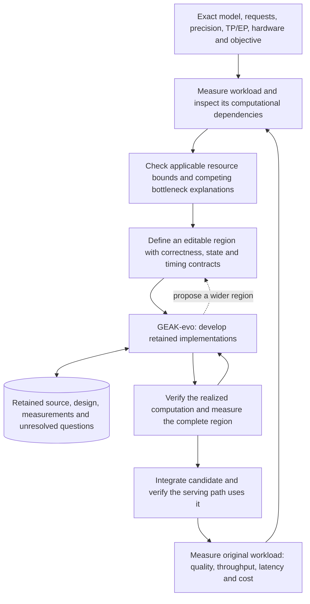

# GEAK-evo in a full workload optimization loop

GEAK-evo supplies the persistent engineering search inside Hyperloom or GEAK's
end-to-end workflow. The outer workflow retains responsibility for the workload
objective, serving configuration, task boundaries and final acceptance.

The outer workflow supplies the workload and task contract. The inner kernel
workflow returns a source change and its evaluation records for integration.
See [using candidate evidence](evidence-to-policy.md) for how source, hypotheses
and measurements support continued engineering.

Each trajectory uses the complete GEAK engineering loop. Its starting hypothesis
may concern dataflow, decomposition, hardware mapping or scheduling; it can change
that hypothesis after experiments. Retaining an alternative makes it available.
Giving it a sustained development budget is a separate allocation decision.

An existing kernel boundary must not silently become the limit of discovery.
The task may need to encompass several producers and consumers, workspace,
layout conversion, synchronization and state updates. A persistent megakernel is
one possible result; partial fusion or a better multi-kernel schedule may win.
Any wider task needs an explicit executable contract and appropriate resources.
The current single-GPU extraction lane does not establish arbitrary multi-rank
region support.

The integration preserves GEAK's task/result interface. The GEAK links below
refer to this checkout; the Hyperloom links pin the inspected integration at
`5fd780a4ef04d9b432ebd2e27602a156db4f7720`.

| Boundary | Implementation | Source |
|---|---|---|
| Hyperloom installation | `GEAK_REF` selects a branch or commit; the installer resolves the checkout and exports `GEAK_E2E_RUNNER`. | [Installer](https://github.com/AMD-AGI/Hyperloom/blob/5fd780a4ef04d9b432ebd2e27602a156db4f7720/src/hyperloom/inference_optimizer/assets/install_kernel_tools.sh#L161), [installation contract](../../interface/run_e2e.md#hyperloom-checkout-compatibility) |
| Hyperloom to GEAK | The kernel-agent phase invokes `interface/run_e2e.py handoff.json result.json`. The handoff carries the workload protocol and client, accepted server configuration, metric and GPU identity. | [Runner](https://github.com/AMD-AGI/Hyperloom/blob/5fd780a4ef04d9b432ebd2e27602a156db4f7720/src/hyperloom/orchestrator/kernel/geak_runner.py#L33), [handoff](https://github.com/AMD-AGI/Hyperloom/blob/5fd780a4ef04d9b432ebd2e27602a156db4f7720/src/hyperloom/orchestrator/phases/kernel_geak_dispatch.py#L595), [GEAK mapping](../../interface/run_e2e.py) |
| GEAK e2e to kernel worker | The workflow calls `kernel_workflow/kernel_lane.js` directly. It supplies the task, search options, budget and devices; the result carries a patch, evaluation location, score and validation status. Omitted optimizer selects EVO. | [Single-kernel route](../../e2e_workflow/src/e2e_workflow/10_single_kernel_passthrough.js), [head-kernel route](../../e2e_workflow/src/e2e_workflow/16_head_kernel.js), [kernel result](../../kernel_workflow/src/kernel_lane/17_writeback_return.js) |
| Kernel result to workload result | Parallel engineering feeds serial patch integration and workload A/B measurements. Hyperloom revalidates returned candidates through the applicable workload harness. | [Integration](../../e2e_workflow/src/e2e_workflow/16_head_kernel.js), [GEAK finalization](../../e2e_workflow/src/e2e_workflow/18_finalize.js), [Hyperloom revalidation](https://github.com/AMD-AGI/Hyperloom/blob/5fd780a4ef04d9b432ebd2e27602a156db4f7720/src/hyperloom/orchestrator/phases/kernel_geak_promotion.py#L146) |

The installed entrypoint uses the shared Node runtime and forwards EVO options to
the kernel lane. The Python package remains `geak`, and callers retain the same
two-JSON command. Explicit `optimizer: "greedy"` selects the incumbent-focused
policy through the same engineers, tools and evaluator. See the
[architecture](architecture.md) and [external contract](../../interface/run_e2e.md).

The e2e path calls a kernel lane directly. The public standalone kernel entrypoint
also provides language dispatch; it is not a population launcher. For checkpoint
migration, the caller launches compatible peer lineages and supplies their shared
directory and identities with `evolution_start: "search_start"`. The default
first-stall continuation uses a local archive. See
[migration configuration](configuration.md#checkpoint-migration).

There are two relevant limits in the inspected code. First, isolated speedup above
one gates an integration attempt in the cited path. An individually slower
operation that enables a faster enclosing schedule therefore needs evaluation as
part of the appropriate larger region. Second, GEAK can
[carry an earlier accepted A/B result](../../e2e_workflow/src/e2e_workflow/18_finalize.js)
when its final Director measurement is unavailable. A returned speedup alone does
not prove that fresh final validation completed. The canonical AgentX path
[cannot substitute a GEAK proxy result](https://github.com/AMD-AGI/Hyperloom/blob/5fd780a4ef04d9b432ebd2e27602a156db4f7720/src/hyperloom/orchestrator/phases/geak_rebench.py#L39)
for workload validation.

The [Cohere megakernel article](https://cohere.com/blog/megakernels) illustrates
the desired engineering process. For its single-H100, BF16, batch-one, 8K-context
example, the stated model is approximately
`3,350 GB/s / (6.6 GB weights + 0.5 GB KV) = 472 tokens/s`.
The reported decode rate increases from 185 to 292 tokens/s, roughly 39% to 62%
of that conditional model. Its separate full-server batch-eight experiments
report 1.25–1.41× average decode throughput, with differing generated-token counts
and separate quality tests. The decode microbenchmark disables prefill and uses
synthetic KV; these are different measurement scopes.

The lesson is to investigate actual dependencies, tile scheduling, memory movement
and serving state, then test the explanation. The article describes filling partial
waves, removing false dependencies and prefetching immutable weights, beyond
reducing launches. Its parallel-transformer structure and H100 implementation
are specific premises, not an AMD optimization recipe. Its multi-GPU and mixed
prefill/decode extensions remain future work in the article.

At workload scale, a useful bound must name its precision, active expert work,
KV lengths, reuse assumptions, batching and per-rank communication. A decode
bandwidth estimate is not a universal maximum for a mixed serving workload.
Report the measured rate and the conditional model fraction separately. Recompute
the same model for every comparison arm if an assumption is corrected, and
reprofile after integration because the bottleneck may move.

For a workload integration:

1. Bind the exact model, configuration and request distribution; measure the
   original serving performance and quality.
2. Inspect the workload and select a region with an executable state and
   correctness contract.
3. Run the selected kernel optimizer through the shared engineering and
   evaluation interfaces, retaining source and measurement records.
4. Integrate the exact tested source, verify dispatch engagement and measure
   throughput, latency, quality and costs on the same workload.
5. Reprofile the deployed result to guide the next investigation.
