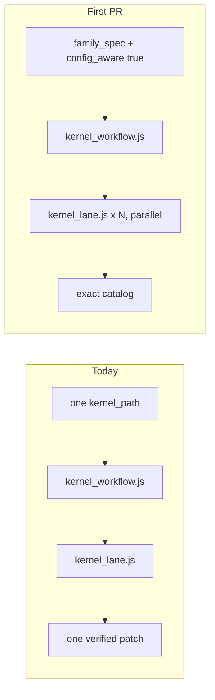
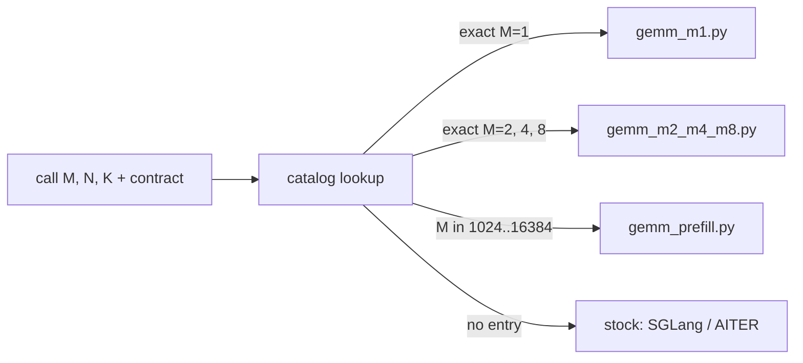
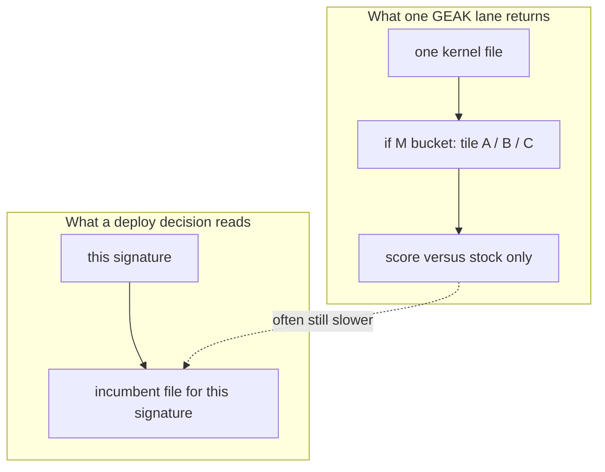
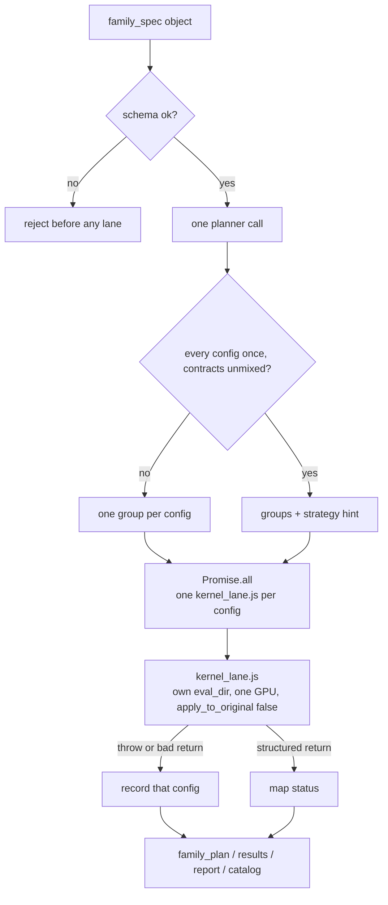
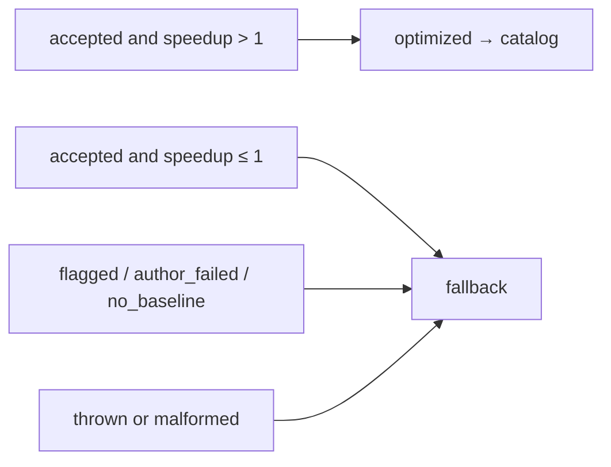
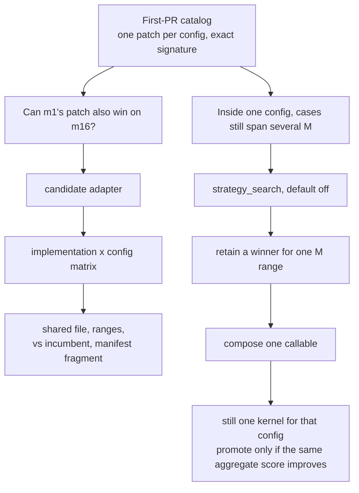
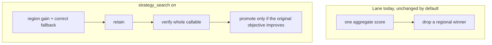

# Change review: config-aware operator family

**Ask:** mark [D1–D4](#decisions). Spec: [`geak_config_aware_opt.md`](geak_config_aware_opt.md). GEAK `1f4d7fc`, Artemis `05a1a9c`. Proposed, not implemented.

## Today → first PR

`config_aware` defaults to off. Off keeps today's `optimize`, `author`, and `bakeoff` paths. `kernel_lane.js`, learned-KB keys, and `e2e_workflow` stay unchanged.

## Why

A GEMM call arrives as a signature, for example `M=1, N=2048, K=1024`. Artemis already picks a file before GEAK is involved:

The file the catalog returns for that signature is the **incumbent**. Stock is the path used only when the catalog has no entry. GEAK today does not emit this map. One lane writes one kernel, and that kernel switches tile size inside the file by an M bucket. Its accepted score is latency versus stock.

So the gap is two lookups that do not match:

1. **Dispatch.** Artemis binds one source file and its sha256 to one signature. A different graph contract (for example a different `maximum_context`) is a different entry even at the same M, N, K. GEAK binds one file to the operator.
2. **Baseline.** The catalog is already serving the incumbent file, so a win against stock does not swap that file out. At M=1 the GEAK kernel is 5.07× stock (17.65 µs → 3.48 µs) and still slower than `gemm_m1.py` (2.87 µs). It replaces that file only when both are timed the same way — both graph replay, or both eager — and the GEAK kernel is faster. A graph-replay number divided by an eager number is not a speedup.

The family workflow runs one lane per config in the spec. The first catalog records that config’s own result and exact signature. It does not yet write the Artemis `specializations` manifest.

## First-PR flow

Both plans launch the same set of calls. The unit is the config, not the group. A group that contains several configs still runs one `kernel_lane.js` per config.

Those calls run together, the way bakeoff already does: `Promise.all` plus the GPU semaphore in `kernel_workflow.js`. Concurrency is `min(configs, gpu_ids)`. One GPU runs one `kernel_lane.js`; a single GPU serializes the same code. One failure is caught and does not cancel the others. A lane started at the same time cannot read a sibling's warm-start write. Parallel launch does not reduce the lane count or the token budget: N configs are still N `kernel_lane.js` runs.

The caller writes the configs in `family_spec`. GEAK does not discover them. List the buckets Artemis already uses, not every integer M. For `N=2048, K=1024`: one config for M=1, one for M=2/4/8, separate configs for 16, 32 and 64, one for 128 and 256, and one for prefill. One config is one lane.

Hint goes in the lane `task` string. The TechLead may drop it after the profile.

Catalog coverage is that config’s exact signature. `deployment_ready: false`. `speedup_vs_incumbent: null` until measured. Family aggregate only when every included row shares one `timing_basis`.

This is the end of the first PR: **one result per config**. A group does not merge those results into one kernel.

**Lane args:** `overrides` → family `defaults` → lane default. `target_language` required. `mode` is `optimize` or `author`. `apply_to_original` stays `"false"`. Budget is per config (default 6), so N configs ≈ N lane budgets.

**Edits:** the family loop inside `kernel_workflow.js`, behind `config_aware` (default `"false"`; `"true"` or `"on"` enables it). **New files:** `roles/operator_family_planner.md`, a GPU-free test of that flag, and a README example.

## Later, separate reviews

The catalog still cannot answer two questions. Each question is its own later review:

Upper branch: take a patch the first PR already accepted and run it in a sibling config’s clean workspace. Copying the diff across task directories is not a measurement. The adapter must return absolute latency, `timing_basis`, source digest, and correctness. Until it does, sibling and incumbent cells stay empty.

Lower branch: does not combine configs. One lane’s own cases may already cover M=1 through M=64, and today a candidate that wins only part of that range is dropped because the lane keeps a single aggregate score. `strategy_search` keeps that regional winner, composes one callable, and promotes it only when the whole callable improves the same score. The lane’s output is still one kernel for that one config.

## Decisions

| | Proposal | Agree |
|---|---|---|
| D1 | First PR adds `config_aware` to `kernel_workflow.js`, default off. On runs one `kernel_lane.js` per config and records that config’s exact signature. `kernel_lane.js` and `e2e_workflow` stay unchanged. | [ ] |
| D2 | A group supplies a hint. The first PR still runs one `kernel_lane.js` per config and does not turn a group into one kernel. | [ ] |
| D3 | Configs launch together, one GPU per `kernel_lane.js`, same semaphore as bakeoff. One GPU serializes. | [ ] |
| D4 | Shared files, ranges, incumbent comparisons, and `strategy_search` (default off) are a separate review, not part of the first PR. | [ ] |

D1–D3 unblock the first PR. D4 is scheduled on its own.
