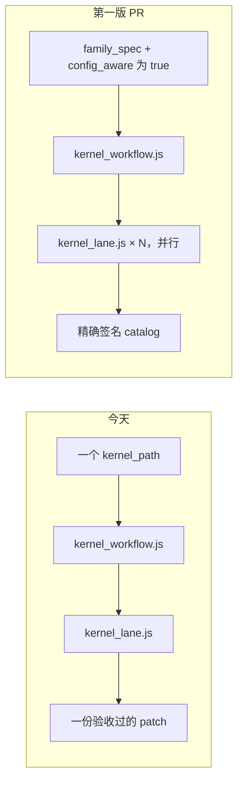
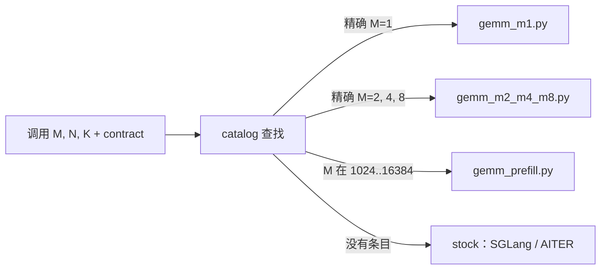
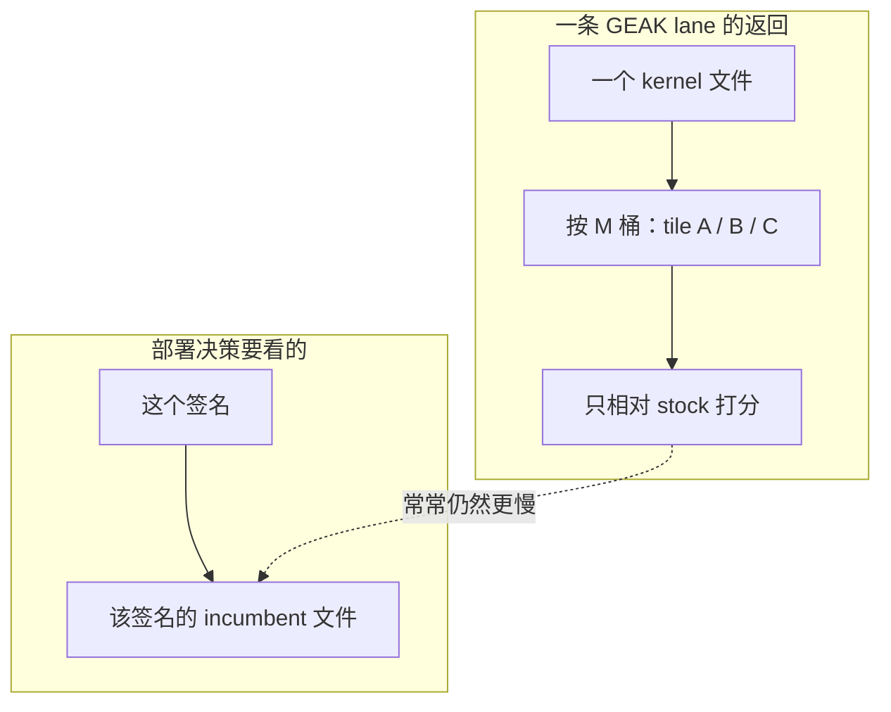
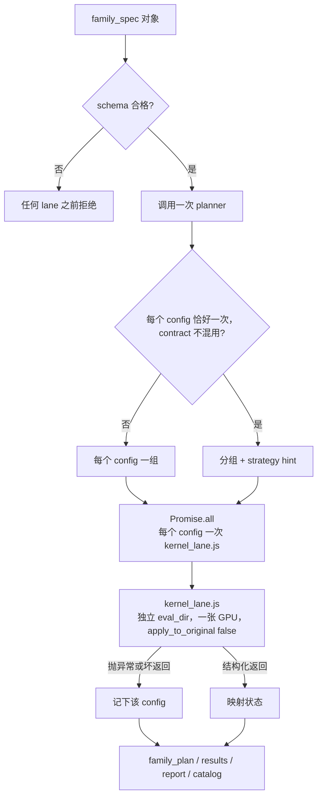
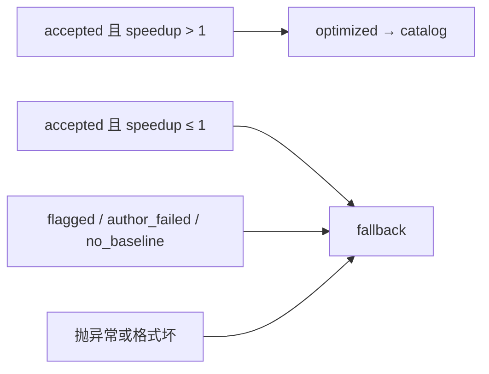
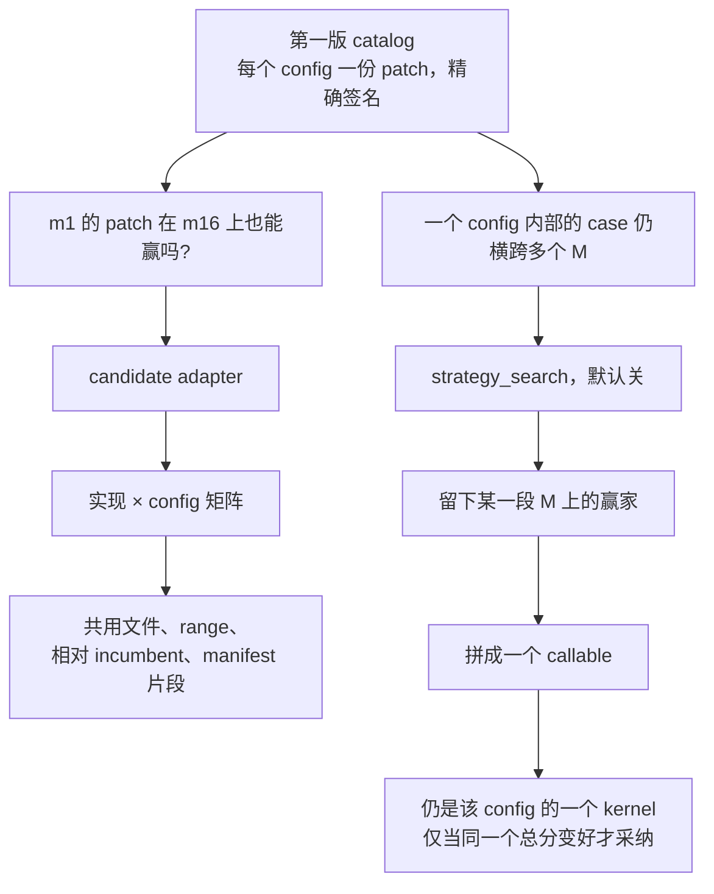
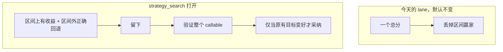

# 按配置感知的算子家族优化

GEAK `1f4d7fc`，Artemis `05a1a9c`。提案，尚未实现。

## 今天 → 第一版 PR

`config_aware` 默认关闭。关闭时今天的 `optimize`、`author`、`bakeoff` 不变。`kernel_lane.js`、learned-KB 的键，以及 `e2e_workflow` 保持原样。

## 为什么

一次 GEMM 调用带着签名到来，例如 `M=1, N=2048, K=1024`。在 GEAK 介入之前，Artemis 已经选好了文件：

Catalog 为这个签名返回的文件就是 **incumbent**（当前已部署的文件）。Stock 是 catalog 没有条目时才走的路径。GEAK 今天不产出这张表。一条 lane 写一个 kernel，并在文件内部按 M 桶切换 tile。它接受的成绩是相对 stock 的延迟。

缺口是两次对不上的查找：

1. **Dispatch。** Artemis 把一个带 sha256 的源文件绑到一个签名。graph contract 不同（例如 `maximum_context` 不同）就是另一条条目，即使 M、N、K 相同。GEAK 把一个文件绑到整个算子。
2. **Baseline。** Catalog 已经在提供 incumbent 文件，所以相对 stock 的胜利不会换掉它。M=1 时 GEAK kernel 相对 stock 是 5.07×（17.65 µs → 3.48 µs），仍然慢于 `gemm_m1.py`（2.87 µs）。只有两边用同一套计时——都是 graph replay，或都是 eager——并且 GEAK kernel 更快，才会替换该文件。

家族 workflow 对 spec 里的每个 config 跑一条 lane。第一份 catalog 只记录该 config 自己的成绩和精确签名，还不写出 Artemis 的 `specializations` manifest。

## 第一版 PR 的流程

两条计划发出同一组调用。单位是 config，不是 group。一组里有多个 config，仍然每个 config 一次 `kernel_lane.js`。

这些调用同时发出，和 bakeoff 已有的做法相同：`Promise.all` 加上 `kernel_workflow.js` 里的 GPU 信号量。并行度是 `min(config 数, gpu_ids 数)`。一张 GPU 只跑一条 `kernel_lane.js`；只有一张 GPU 时，同一段代码会串行。一个失败被接住，不取消其他 config。同时启动的 lane 读不到兄弟刚写的 warm-start。并行启动不减少 lane 次数，也不减少 token：N 个 config 仍然是 N 次 `kernel_lane.js`。

Config 由调用方写进 `family_spec`，GEAK 不自己发现。按 Artemis 已有的桶来列，而不是每个整数 M 一个。例如 `N=2048, K=1024`：M=1 一个，M=2/4/8 一个，16、32、64 分开，128 与 256 一个，prefill 一个。有几个 config 就跑几次 lane。

Hint 写进 lane 的 `task` 字符串。TechLead 做完 profile 之后可以丢掉它。

Catalog 的覆盖范围是该 config 自己的精确签名。`deployment_ready: false`。在真正测到之前，`speedup_vs_incumbent: null`。只有每一行纳入汇总的结果都使用同一种 `timing_basis` 时，才给出家族级合计。

第一版到此结束：**每个 config 一份结果**。Group 不会把这些结果收成一个 kernel。

**Lane 参数：** `overrides` → 家族 `defaults` → lane 默认值。`target_language` 必填。`mode` 是 `optimize` 或 `author`。`apply_to_original` 保持 `"false"`。Budget 按 config 计（默认 6），所以 N 个 config ≈ N 份 lane budget。

**改动：** 家族循环写在 `kernel_workflow.js` 里，由 `config_aware` 控制（默认 `"false"`；`"true"` 或 `"on"` 才进入）。**新文件：** `roles/operator_family_planner.md`、针对该开关的无 GPU 测试，以及 README 中的一段示例。

## 后续优化

上支：把第一版已经接受的 patch 放进兄弟 config 的干净 workspace 里再跑。把 diff 拷到另一个 task 目录不是测量。Adapter 必须返回绝对延迟、`timing_basis`、源码 digest 和正确性。在此之前，兄弟 config 和 incumbent 的格子保持空白。

下支：不合并 config。一条 lane 自己的 case 可能已经从 M=1 覆盖到 M=64。今天只在其中一段上赢的候选会被丢掉，因为 lane 只保留一个总分。`strategy_search` 留下这个区间赢家，拼成一个 callable，并且只有整个 callable 提高了同一个总分才采纳。这条 lane 的输出仍然是这一个 config 的一个 kernel。

## 决策

| | 提案 | 同意 |
|---|---|---|
| D1 | 第一版在 `kernel_workflow.js` 增加 `config_aware`，默认关闭。打开后每个 config 跑一次 `kernel_lane.js`，catalog 只记该 config 的精确签名。不改 `kernel_lane.js`，不改 `e2e_workflow`。 | [ ] |
| D2 | 分组只提供 hint。第一版仍是一个 config 一次 `kernel_lane.js`，不把一组收成一个 kernel。 | [ ] |
| D3 | Config 同时启动，每条 `kernel_lane.js` 一张 GPU，信号量与 bakeoff 相同。只有一张 GPU 时串行。 | [ ] |
| D4 | 共用文件、range、相对 incumbent 的成绩，以及默认关闭的 `strategy_search`，单独评审，不进第一版。 | [ ] |

D1–D3 通过后可以做第一版。D4 单独排期。
