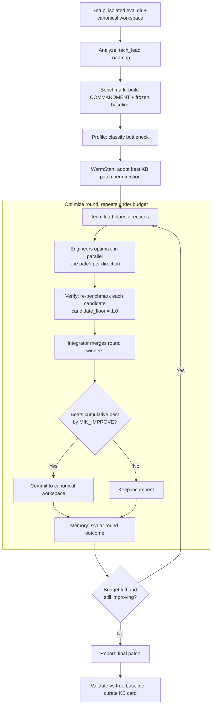
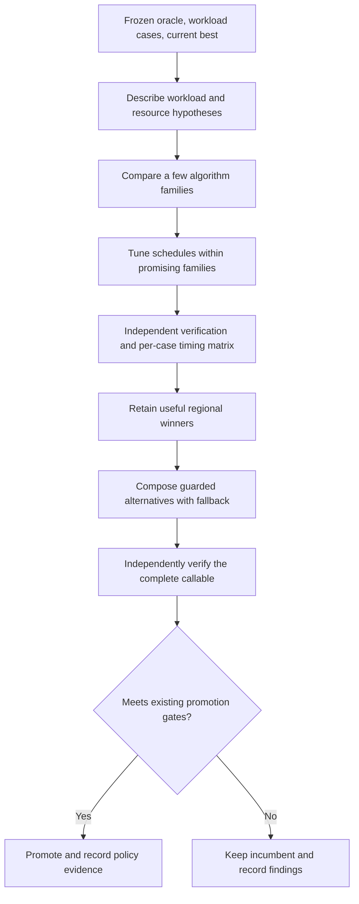
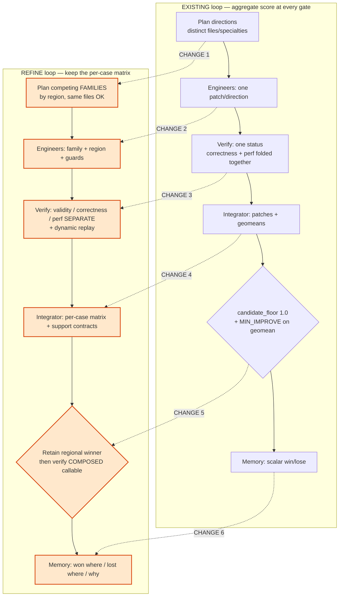

# Implementation Handoff: Config-Aware Operator Optimization in GEAK

## 0. How to Use This Guide

This document is an implementation brief for a coding agent, not a request for another design
proposal. Implement the smallest complete vertical slice described below, preserve the existing
single-kernel paths, and use measured results as the only promotion signal.

### Scope split

There are two related but independent changes in this document:

1. **Config-aware family orchestration (required MVP):** validate an operator-family specification,
   plan groups, invoke one existing `kernel_lane.js` run per config, and aggregate the independently
   verified results. This is Milestones 1–4 and is the first PR.
2. **Regional strategy search inside one lane (follow-up, opt-in):** retain candidates that win only
   part of a lane's case set and compose guarded alternatives. This is Task E / Milestone 5. Do not
   mix it into the first PR.

The MVP must be useful without Task E. It may produce one implementation per config and record
planner groups as hypotheses. Shared-kernel coverage and cross-config candidate reuse are promoted
only after the candidate has actually been evaluated on every claimed config.

### Verified repository facts

This guide was checked against GEAK commit
`1f4d7fc6a51c2caeeb11d1ef73988f44bef7663b`.

- `kernel_workflow.js` is the public dispatcher. `optimize` and `author` delegate to
  `kernel_lane.js`. `bakeoff` already launches several `kernel_lane.js` calls with `Promise.all`
  and `makeSem`: one GPU id per lane, concurrency `min(lanes, gpu_ids)`, one thrown lane caught
  so siblings continue, and exactly one `workflow()` nesting level.
- `kernel_lane.js` is the single-language worker. Its successful return includes
  `eval_dir`, `final_speedup`, `final_weighted`, `final_geomean`, `validation_status`,
  `timing_basis`, `report_path`, `final_patch`, `warm_start`, and `kb_written`.
- The dispatcher requires `args.kernel_path` before it reads `mode`. A `config_aware` call has no
  single kernel path, so that check must run only on the existing path.
- `kernel_workflow_bmk.js` and `e2e_workflow.js` call `kernel_lane.js` directly. They do not pass
  through this flag.
- A workflow script cannot directly read or write arbitrary files. Prefer an inline
  `args.family_spec` for the MVP; use an agent only where an artifact must be persisted.
- Existing GPU-free JS tests execute the real workflow body with stubbed runtime globals. Follow
  `kernel_workflow/scripts/test_mode_dispatch.js` rather than introducing a new test framework.

If the checkout has moved, re-check these facts before editing.

### MVP evidence boundary

The current `kernel_lane.js` return does **not** include final per-case measurements, a separate
correctness verdict, profile summary, source file/entrypoint/digest, implementation contracts, or
verified coverage. Those details may exist inside lane artifacts, but the family workflow must not
scrape arbitrary Markdown or infer them from a patch.

Therefore the first PR must:

- aggregate only the structured return fields listed above;
- use `validation_status` as the Director's gate, without inventing a separate correctness field;
- describe profiling details as unavailable unless the lane later returns them structurally;
- catalog `final_patch` as a lane artifact, not a deployable source file; and
- emit only caller-supplied exact signatures, with `deployment_ready: false`.

If richer family reporting is required, add fields to the lane return additively in a separate,
tested change. Do not make that expansion a hidden prerequisite of the orchestration MVP.

### Required MVP deliverables

Edit `kernel_workflow/kernel_workflow.js`. Add:

- `kernel_workflow/roles/operator_family_planner.md` — family planning role.
- `kernel_workflow/scripts/test_config_aware.js` — GPU/agent-free tests of the flag on the real dispatcher body.
- A small inline family-spec example in `kernel_workflow/README.md`.

Do not add `operator_family_workflow.js`. A new workflow file called from the dispatcher would be a second nesting level. The family loop belongs in `kernel_workflow.js`, the same place bakeoff already calls `kernel_lane.js`.

Add `args.config_aware`, default `"false"`. Only the strings `"true"` and `"on"` (case-insensitive) take the family path. Absent, `"false"`, `"off"`, and every other value keep today's `optimize`, `author`, and `bakeoff` behavior, including the `kernel_path` requirement and the mode contract in `test_mode_dispatch.js`. Do not add a `mode` value.

When the flag is on, branch before the `kernel_path` throw. Require `args.family_spec` and `args.workflow_dir`. Ignore a parent `mode` of `optimize` or `author`; each config carries its own. Reject parent `mode=bakeoff` in this PR. The family path must:

1. validate synchronously before starting a lane;
2. call the planner once, validate its response, and fall back to singleton groups on failure;
3. launch every config together with `Promise.all` and the existing `makeSem`, one acquired GPU id per `kernel_lane.js`;
4. call `kernel_lane.js` with a unique `eval_dir` and `apply_to_original: "false"`;
5. catch a lane failure, record it, and let siblings finish;
6. treat a lane as an optimized candidate only when `validation_status === "accepted"` and its
   finite primary speedup is greater than `1.0`;
7. write `family_plan.json`, `family_results.json`, `family_report.md`, and
   `implementation_catalog.json`; and
8. return the same information structurally so callers do not need to parse Markdown.

With one GPU, `makeSem` serializes the same code. Concurrency is `min(configs, gpu_ids)`. Pass that one GPU id as the lane's `gpu_ids`. Do not hand every lane the whole pool: each `kernel_lane.js` already fans its own engineers across the ids it receives. Sort the returned results by the recorded `execution_order` so the report is stable. That order is not a start sequence. Parallel launch does not reduce the number of lanes or the token budget.

### Non-negotiable safety rules

- Never mutate an input `kernel_path` in the family workflow.
- Never treat planner confidence, a KB hit, or a lane-reported speedup as proof of correctness.
- Never compare or aggregate numbers with incompatible `timing_basis` values.
- Never claim shared exact/range coverage from config similarity alone.
- Never let one config failure erase completed sibling results.
- Never invent an incumbent comparison. If the incumbent cannot be executed under the same oracle
  and timing basis, report `speedup_vs_incumbent: null` with a reason.

### Definition of done for the first PR

The first PR is done when the GPU-free tests prove validation, fallback planning, argument
inheritance, direct lane routing, unique eval directories, failure isolation, accepted-result
filtering, and deterministic catalog coverage; the existing dispatcher tests still pass; and the
README contains a runnable invocation. A GPU run and regional strategy search are explicitly not
required for that PR.

## 1. Objective

Repository: https://github.com/AMD-AGI/GEAK

Implement an Operator-Family Optimization capability that extends GEAK from optimizing individual kernel configurations to optimizing a family of configurations belonging to the same operator.

The target system should combine three capabilities:

1. **LLM Agent Intelligence:** Understand operator configurations, reason about workload differences, select implementation strategies, and generate specialized kernels.
2. **Architecture-Aware Optimization:** Use AMD GPU architecture knowledge, profiling results, hardware constraints, and bottleneck analysis to guide implementation decisions.
3. **Auto-Tuning and Knowledge Reuse:** Search implementation strategies and kernel parameters, evaluate candidates on real hardware, and reuse verified optimization results across configurations.

### Desired behavior

Given an operator family, such as FMHA, MLA, GEMM, or MoE, and a set of workload configurations, GEAK should:

1. Analyze the configurations.
2. Identify configurations with similar workload characteristics.
3. Develop implementation strategies for different configuration groups.
4. Generate and optimize specialized implementations.
5. Independently verify each implementation.
6. Record the mapping between configurations and their best verified implementations.
7. Reuse applicable optimization knowledge when processing subsequent configurations.

The desired relationship is:

`Operator Family → Workload Configurations → Config Groups → Implementation Strategies → Specialized Kernels`

The system should learn which implementation strategies work for which workload configurations and hardware architectures.

---

## 2. Repository Constraints and Existing Infrastructure

Before implementing anything, inspect the current GEAK checkout and identify the exact APIs, schemas, and workflow conventions. Do not assume that proposed module names or directory structures already exist.

The current architecture already provides the following capabilities:

| Existing component | Existing responsibility | How to reuse it |
|---|---|---|
| `kernel_workflow.js` | Entry-point dispatcher for optimize, author, and bakeoff | Preserve existing behavior |
| `kernel_lane.js` | Complete single-language optimization workflow | Execute one lane per configuration |
| `kernel_workflow_bmk.js` | Batch orchestration across multiple kernels | Reuse its orchestration patterns |
| Director / TechLead | Setup, strategy planning, optimization planning, final validation | Extend planning with family-level context |
| Algorithm / Memory / Compute / Host Runtime Engineers | Specialized kernel optimization | Reuse without creating duplicate roles |
| Profile Engineer | Hardware profiling and bottleneck analysis | Use measured performance to guide optimization |
| `perf_knowledge/` | Reference knowledge for AMD operators, architectures, and backends | Reuse as technical references |
| `knowledge/learned/` | Curated optimization experience cards | Reuse as advisory optimization knowledge |
| `kb_artifacts/` / experience store | Persistent kernel implementations and measured results | Reuse existing warm-start mechanism |

Important implementation constraints:

- Keep the existing `kernel_workflow.js` behavior backward compatible.
- Do not replace the existing specialist-agent architecture.
- Do not create a parallel profiling or benchmark framework.
- Do not introduce another persistent knowledge database unless an actual missing capability is demonstrated.
- Existing knowledge is advisory; measured correctness and performance always determine whether an implementation is accepted.
- Every candidate must be independently verified against an immutable correctness oracle and the original performance baseline.

### Workflow nesting constraint

GEAK uses deterministic JS Workflows with a limited nesting depth.

`kernel_workflow.js` is a dispatcher that calls `kernel_lane.js`. Therefore, a new family-level workflow must NOT call `kernel_workflow.js` if it then needs to call `kernel_lane.js` through that dispatcher.

Instead, follow the existing `kernel_workflow_bmk.js` pattern and invoke `kernel_lane.js` directly as the child workflow.

Inspect the current workflow runtime before making changes to orchestration, parallelism, or imports.

### Downstream consumer: Artemis operator-family kernel packs

`artemis-kernel-integrations` is the first production consumer of GEAK kernels (SGLang on MI355X / gfx950). Its runtime already deploys an operator family as a set of per-configuration kernels. The output of this workflow should be shaped so it can feed that model directly.

How Artemis represents an operator family (`src/artemis_runtime/profile.py`, `catalog.py`, `contracts.py`):

- A **profile** fixes the deployment target: model architecture, `hardware_arch`, TP/EP size, quantization, attention backend, and optionally Torch/Triton versions. It lists one **manifest** per family.
- A **variant** fixes the family's semantic contract (precision, quantization groups, weight layout, KV-cache dtype) and its graph contract (`capture_safe`, `dynamic_sequence_lengths`, `maximum_context`, `supports_padded_requests`, `mutates_state`).
- Each manifest **specialization** maps an integer `signature` (rank defined per family, e.g. `[M, N, K]` for GEMM) to one `source_file` with a pinned `source_sha256`. Optionally, `signature_ranges` declares an inclusive verified interval on one or more axes.
- At runtime, an exact signature takes precedence over a range. Overlapping ranges for the same operation are rejected at load time. An uncovered signature falls back to the stock SGLang path. A covered signature whose semantic or graph contract does not match fails loudly instead of falling back.

Example from `qwen3_next_fp8_tp4_gfx950/fp8_block_scaled_gemm.json`: decode signatures M=1, M=2 and M=16 each have their own source file per N/K. One file (`gemm_n2048_k1024_m2_m4_m8.py`) is reused for M=2, 4 and 8, and one prefill file covers M in `[1024, 16384]` through a range. The same signature can also map to different kernels by graph contract alone: the paged-attention output family has separate variants for context capacities 8192, 16384, 65536 and 131072.

Observed gap between GEAK output and this model:

- GEAK currently produces **one kernel per operator** that switches tile configs internally by M bucket. See, for example, the "Per-bucket configs" section of the `02_dsr1_qkv_a_norm_quant_m16` report.
- When those kernels are benchmarked against the incumbent per-config Artemis kernels, a single kernel often wins at the production shape and loses at sibling shapes. `outputs/geak-summary_1022.md` shows a 0.975x overall geomean across 38 cases. For example, `18_qwen3coder_bf16_fp8_block_scaled_gemm_m16` is 5.07x vs stock at M=1 but 0.83x vs the incumbent Artemis kernel.
- GEAK reports speedup vs stock (AITER), while the deployment decision is made vs the incumbent specialization. For example, `02_dsr1_qkv_a_norm_quant_m16` is 2.77x vs stock in the GEAK report but 0.88x vs the incumbent at M=16.

Implications for this design, detailed in the sections below:

1. A configuration's identity is its dispatch key (signature, plus the semantic and graph contract), not just a shape description (Section 4).
2. A config group should express its **coverage** as exact signatures and/or verified ranges, so one implementation can legitimately serve several configs (Task A).
3. Accepted implementations should eventually be cross-evaluated on sibling configs before deciding how many distinct kernels the family needs (post-MVP Task D).
4. Deployment decisions require comparison against both stock and the incumbent. The MVP reports
   incumbent comparison as unavailable unless an executable incumbent adapter is supplied (Phase 4).
5. A post-MVP deployment-ready catalog should carry enough provenance (source digest, entrypoint,
   contracts, coverage) for mechanical manifest export. The MVP patch catalog cannot make that
   claim (Phase 6).
6. Inside one lane, the search should compare algorithm families by workload region, rather than only stacking edits onto one kernel (Task E).

### Strategy selection inside Artemis kernels

The runtime catalog selects a source file per signature. Within one source file, Artemis kernels also select strategies at three levels:

| Level | What changes | Example |
|---|---|---|
| Algorithm family | Computation decomposition or sequence of kernel launches | Packed GEMV versus MFMA GEMM; fused versus staged MoE |
| Schedule within a family | Tile size, wave count, traversal, buffering, split count | FP8 GEMM's batch-dependent tile and pipeline settings |
| Device-side adaptation | Useful work changes while launch metadata stays fixed | Attention partitions adapt to live sequence lengths |

Concrete examples (source references at the end of this document):

| Artemis implementation | Observed strategy | Performance interpretation |
|---|---|---|
| BF16 LM-head GEMM (A1), `N=37984`, `K=2048` | `M=1` uses packed GEMV. Supported `M=2..64` values use a full-batch MFMA tile with streamed weight panels. Wave count and traversal also vary. | At one row, packed products avoid an unsuitable matrix tile. Additional rows create weight reuse that can justify MFMA. This is a family decision followed by schedule tuning. |
| FP8 prefill GEMM (A2) | `_async_tuning` selects tile sizes, grouping, swizzles, and copy/scale timing across token-count ranges. | Rebalances reuse, resource consumption, and available parallel work within one asynchronous MFMA family. Each branch is not a new algorithm. |
| Paged attention + gate + quantization (A3) | Batch size and layout determine head grouping and a split budget. The GPU reads live lengths and selects partition work and attention paths. | Small batches need more independent work; short sequences should avoid excessive partition overhead. The same captured launch can serve changing lengths. |
| GDN prefill (A4) | Total tokens and sequence count select snapshot/scan-and-emit, hierarchical block propagation, or chunk recurrence paths. | Long state dependencies and the number of independent sequences change the best decomposition. Total token count alone is insufficient. |
| Complete MoE prefill (A5) | Up to 2048 rows, a fused W13/W2 path avoids separate routed-activation work. Larger batches use staged grouped computation; actual routes generate GPU expert jobs. | Fusion saves launches and intermediates for smaller workloads. Staging supports a different reuse/scheduling tradeoff as work grows. The code does not establish a general skew-based family selector. |

The BF16 LM-head file is the clearest case: one wrapper covers seven tested batch sizes with **two algorithm families** plus several schedule settings, and its support assertions restrict it to those dense shapes. Its `M=1` crossover should not be copied into every GEMM; `N`, `K`, layout, and resource use also determine it.

Why this helps on MI355X: the Gluon implementations explicitly control MFMA operand layouts, lane/wave organization, LDS layouts, asynchronous global-to-LDS transfers, and synchronization. Strategy selection decides whether those mechanisms pay off. Larger tiles improve reuse but reduce available work or raise register/LDS pressure. Split reductions expose parallelism but add scratch traffic and a finishing launch. Fusion removes intermediates but enlarges the working set.

Limits of this evidence:

- Artemis contains explicit policies and thresholds, but the source does not show how they were discovered, nor an automatic learned cost model. GEAK should reproduce the measured decision process, not treat Artemis's constants as universal rules.
- The extracted-operator report (A6; 33 passing cases, one MI355X, October 9, 2026) shows both gains (3.14x for DeepSeek QKV-A norm/quant, 1.71x for Qwen3-Next attention/gate/quant) and regressions (0.31x for DeepSeek MLA at maximum context, 0.46x for Qwen3.5 prefill attention at Q8192).
- These are isolated synthetic operator measurements. Graph and cold-cache timings use different procedures and must stay separate. They show gains are workload-dependent; they do not isolate the contribution of strategy selection or predict GEAK's improvement.

---

## 3. Proposed Architecture

Put the family orchestration inside `kernel_workflow.js`, behind `config_aware`. Off is the current dispatcher. On is an orchestration layer above individual kernel optimization lanes, at the same nesting level as bakeoff.

Conceptually:

```text
             Operator Family Input
                       |
                       v
            Operator-Family Workflow
                       |
                       v
                Config Analyzer
                       |
                       v
               Config Clustering
                       |
                       v
              Strategy Planning
                       |
                       v
          Existing GEAK Kernel Lanes
                       |
             +---------+---------+
             |         |         |
             v         v         v
           Lane A    Lane B    Lane C
             |         |         |
             v         v         v
          Profiling + Optimization
             |         |         |
             v         v         v
          Verification and Benchmark
             |         |         |
             +---------+---------+
                       |
                       v
              Family Result Aggregator
                       |
                       v
           Implementation Catalog
                       |
                       v
             Existing Knowledge Base
```

### Design principle

The family workflow owns cross-configuration planning and orchestration.

Each existing `kernel_lane.js` owns the actual kernel optimization process for its assigned configuration.

Do not duplicate the single-kernel optimization loop inside the dispatcher. Each config still runs the existing `kernel_lane.js`.

---

## 4. Input Interface

Introduce a structured Operator Family Specification.

Suggested schema:

```json
{
  "schema_version": 1,
  "family_id": "fmha",
  "operator": "fmha",
  "description": "FMHA operator optimization across workload configurations",

  "target": {
    "expected_gfx": "gfx942",
    "expected_target": "unknown"
  },

  "deployment": {
    "architecture": "Qwen3NextForCausalLM",
    "tensor_parallel_size": 4,
    "expert_parallel_size": 1,
    "signature_axes": ["M", "N", "K"]
  },

  "defaults": {
    "mode": "author",
    "target_language": "flydsl",
    "budget": 4,
    "gpu_ids": "0",
    "gpu_mode": "pool",
    "use_learned_kb": "true",
    "update_experience": "true",
    "apply_to_original": "false"
  },

  "configs": [
    {
      "id": "prefill_bf16_hd128",
      "kernel_path": "/absolute/path/to/config_001",
      "op_spec": {
        "op_kind": "attn",
        "dtype": "bf16",
        "regime": "prefill",
        "shapes": {
          "seqlen_q": 8192,
          "seqlen_k": 8192,
          "num_heads": 32,
          "head_dim": 128
        }
      },
      "signature": [8192, 8192, 32, 128],
      "signature_ranges": {"0": [4096, 16384]},
      "contract": {
        "semantics": {"precision": "bf16", "kv_cache_dtype": null},
        "graph": {"capture_safe": false, "maximum_context": 16384}
      },
      "incumbent": {"source_file": "attention/prefill_4096_16384.py", "source_sha256": "..."},
      "workload_weight": 0.6,
      "tags": ["prefill", "long-sequence"],
      "priority": 1
    },
    {
      "id": "decode_bf16_hd192",
      "kernel_path": "/absolute/path/to/config_002",
      "op_spec": {
        "op_kind": "attn",
        "dtype": "bf16",
        "regime": "decode",
        "shapes": {
          "seqlen_q": 1,
          "seqlen_k": 8192,
          "num_heads": 32,
          "head_dim": 192
        }
      },
      "tags": ["decode", "long-kv"],
      "priority": 2
    }
  ]
}
```

This is a proposed interface, not a claim that these fields already match all GEAK task metadata.

Use existing `op_spec` conventions wherever possible.

### MVP input contract

For the first PR, accept only `args.family_spec` as an already-parsed object. Loading a JSON path
inside the workflow would require delegating basic input parsing to an agent and would make
validation non-deterministic. A caller can parse a file before invoking the workflow; file loading
can be added later if the Workflow runtime gains a native JSON input mechanism.

Normalize into this internal shape before calling the planner:

```json
{
  "schema_version": 1,
  "family_id": "dense_gemm",
  "operator": "gemm",
  "defaults": {
    "mode": "optimize",
    "target_language": "triton",
    "budget": 6,
    "gpu_ids": "0",
    "gpu_mode": "pool",
    "apply_to_original": "false"
  },
  "configs": [
    {
      "id": "m1_n4096_k4096",
      "kernel_path": "/absolute/task/path",
      "op_spec": {"op_kind": "gemm", "dtype": "bf16", "shapes": {"M": 1, "N": 4096, "K": 4096}},
      "overrides": {}
    }
  ]
}
```

Keep dispatch metadata (`deployment`, `signature`, `contract`, `incumbent`) when supplied, but do
not require it for orchestration-only runs.

Argument precedence is:

`config.overrides[field] → family_spec.defaults[field] → current kernel_lane default`

Exception: `target_language` must resolve explicitly for every config. In `author` mode it is the
language to create; in `optimize` mode it must identify the editable implementation's real
language. Do not silently inherit the lane's `triton` default, because language participates in
warm-start KB identity and can route reads/writes to the wrong page.

Only forward fields already understood by `kernel_lane.js`. In particular, do not pass arbitrary
family-spec metadata into a lane as top-level arguments. Put the validated family context into the
lane's `task` string until a typed lane context is introduced in a separate change.

The family workflow itself also requires `args.workflow_dir`. Derive the worker as
`${workflow_dir}/kernel_lane.js`, with an optional `args.kernel_lane_script` test override matching
the dispatcher convention.

### Required fields

- `family_id`: Stable identity for the operator family.
- `operator`: Operator name or kind.
- `configs`: Non-empty list of configurations.
- `configs[].id`: Unique configuration identifier.
- `configs[].kernel_path`: Absolute path to an existing GEAK-compatible task directory.
- `configs[].op_spec`: Configuration metadata used for planning and kernel authoring.

### Dispatch-key fields (optional in the schema, required for deployment export)

These fields mirror the Artemis profile/manifest model described in Section 2:

- `deployment`: Model architecture, TP/EP size, and the ordered names of the signature axes. Configs from different deployment targets must not be grouped or compared.
- `configs[].signature`: Integer tuple used as the runtime dispatch key. Its rank must match `deployment.signature_axes`.
- `configs[].signature_ranges`: Optional inclusive intervals, keyed by axis index, that the config is expected to cover. A range is a coverage claim that must be verified (Task D), not just a tag.
- `configs[].contract.semantics`: Precision, quantization groups, weight layout, KV-cache dtype, and other values that must match exactly for an implementation to be reusable.
- `configs[].contract.graph`: Graph-capture safety, dynamic sequence lengths, maximum context, padded-request support, and state mutation. Two configs with the same signature but different graph contracts (for example, different `maximum_context`) are different configs.
- `configs[].incumbent`: The currently deployed implementation for this signature, if any. It becomes a second baseline (Phase 4).
- `configs[].workload_weight`: Relative importance in the target workload (for example, share of serving time). Benchmarks currently mark this only implicitly as "(prod)" cases; make it explicit so weighted and unweighted aggregates stay distinct.

Two configs whose `contract.semantics` differ must never share an implementation, regardless of shape similarity.

### Optional fields

Allow per-config overrides of global settings, including:

- Optimization mode.
- Target backend.
- Budget.
- Task description.
- GPU assignment.
- Optimization priorities.

For the initial implementation, support `optimize` and `author` modes. Reject unsupported modes explicitly rather than silently falling back.

Reject rather than coerce:

- a non-object `family_spec`;
- unknown `schema_version`;
- an empty/invalid `family_id` or empty `configs`;
- duplicate or unsafe config IDs (use IDs in output paths only after validation);
- non-absolute `kernel_path`;
- missing/non-object `op_spec`;
- `mode` other than `optimize` or `author`;
- a config for which `target_language` does not resolve explicitly;
- non-positive/non-integer `budget`;
- invalid `gpu_mode`;
- malformed signature rank, contract, range, workload weight, or priority when present; and
- `apply_to_original` other than false. The family workflow owns this invariant.

Path existence cannot be checked synchronously by the JS workflow. Let lane setup classify a
missing path as a per-config setup failure; do not ask the planner to validate filesystem state.

---

## 5. Implementation Tasks

### Task A — Config Analyzer and Family Planner

Create a family-level planning step.

Suggested role:

`roles/operator_family_planner.md`

The planner receives:

- Operator family metadata.
- All input configurations.
- Available hardware target information.
- Existing optimization knowledge references.
- Overall optimization objective.

Its responsibilities:

1. Analyze the characteristics of each configuration.
2. Identify similarities and important differences.
3. Group configurations that are likely to benefit from similar implementation strategies.
4. Recommend an implementation strategy for each group.
5. Provide config-specific strategy hints where necessary.
6. Record a report order. Launch does not wait on it: sibling lanes overlap, so one config's knowledge write is not visible to another config in the same run.

Example analysis:

| Config group | Characteristics | Candidate strategy |
|---|---|---|
| Prefill | Large M, long Q/K sequence | Tiled FlashAttention / pipeline |
| Decode | Small M, long KV sequence | Decode-specialized execution |
| Small head dimension | Small D | Specialized tile and mapping |
| Large head dimension | Large D | Alternative memory/MFMA mapping |

These are optimization hypotheses, not hard-coded routing rules.

The planner must not assume that a small M necessarily means GPU underutilization. It should consider N, arithmetic intensity, matrix dimensions, memory traffic, and actual hardware utilization.

### Planner output

Return structured JSON:

```json
{
  "family_id": "fmha",
  "groups": [
    {
      "group_id": "prefill_long_sequence",
      "config_ids": ["prefill_bf16_hd128"],
      "coverage": {
        "exact": [],
        "ranges": [{"anchor": [8192, 8192, 32, 128], "ranges": {"0": [4096, 16384]}}]
      },
      "implementation_form": "shared_kernel",
      "strategy": "Tiled FlashAttention with pipelined execution",
      "reasoning": "Large sequence workload with sufficient parallel work",
      "confidence": 0.85
    },
    {
      "group_id": "decode_long_kv",
      "config_ids": ["decode_bf16_hd192"],
      "strategy": "Decode-specialized execution",
      "reasoning": "Small query dimension with long KV context",
      "confidence": 0.80
    }
  ]
}
```

Planner validation requirements:

- Every input config must appear exactly once.
- No unknown config IDs.
- No duplicate group assignments.
- No invalid or empty group identifiers.
- Missing or invalid planner output must not silently discard configurations.
- A group must not mix configs whose `contract.semantics` or `contract.graph` differ.
- Group coverage ranges for the same operation must not overlap; exact entries may sit inside another group's range (exact takes precedence at runtime).

`implementation_form` records the planner's hypothesis about how the group should be realized:

- `shared_kernel`: One source serves every signature in the group, for example `gemm_n2048_k1024_m2_m4_m8.py` serving M=2, 4 and 8.
- `per_signature`: Each signature gets its own source, produced by its own lane.
- `internal_buckets`: One source dispatches internally by bucket (the current GEAK default).

This is a hypothesis to test, not a commitment. The cross-config evaluation in Task D decides the final form from measurements.

If planning fails, fall back to one independent group per configuration and continue the workflow without custom strategy hints.

Save the validated plan in the family experiment directory.

### Task B — Strategy Selection and Kernel Generation

Do not implement a second kernel generator.

For each config, invoke the existing `kernel_lane.js` with the appropriate configuration-specific arguments.

Pass:

- Original `kernel_path`.
- `op_spec`.
- Optimization mode.
- Target language.
- Budget.
- GPU configuration.
- Family-level strategy hints.
- Family-level objective and relevant sibling-config context.

The family strategy hint should be appended to the existing `task` instruction or passed through a new optional context field if the existing role contract supports it.

The TechLead and specialist engineers must remain free to override the initial strategy based on actual profiling evidence.

The implementation process should continue to use the existing:

- Algorithm Engineer.
- Memory Engineer.
- Compute Engineer.
- Host Runtime Engineer.
- Deep Explore track when applicable.
- Integrator.
- Director verification.

An implementation strategy is not accepted simply because the LLM recommends it.

### Task C — Architecture-Aware Optimization

Reuse the architecture-awareness capabilities already implemented inside `kernel_lane.js`.

Relevant inputs include:

- Actual GPU identity detected on-box.
- GPU family and ISA.
- Physical CU count.
- Architecture-specific knowledge.
- HBM and cache behavior.
- MFMA/WMMA characteristics.
- VGPR/LDS constraints.
- Occupancy and wave utilization.
- Arithmetic intensity.
- Profiling bottleneck classification.

Relevant existing knowledge:

- `knowledge/amd_instinct.md`
- `knowledge/amd_rdna4.md`
- `knowledge/profiling_guide.md`
- `perf_knowledge/`

Do not assume gfx942 and gfx950 share identical tuning parameters or execution strategies.

Each lane must independently validate the actual hardware identity. The family manifest's expected GPU information is an expectation/guard, not proof of the detected device.

Do not introduce hard-coded peak performance values or a second roofline estimator in this first implementation.

The expected decision process is:

```text
Workload Config
      |
      v
Actual GPU Architecture
      |
      v
Baseline Benchmark and Profiling
      |
      v
Bottleneck Classification
      |
      v
Architecture-Aware Optimization Hypothesis
      |
      v
Kernel Candidate Generation
```

### Task D — Auto-Tuning and Cross-Config Knowledge Reuse

Reuse the current optimization budget loop inside `kernel_lane.js`.

The existing workflow already supports:

- Multi-round optimization.
- Specialist parallel exploration.
- Independent candidate verification.
- Integration of compatible patches.
- Re-profiling.
- Optimization stopping conditions.

The family workflow should allocate a budget per configuration or allow per-config overrides.

Do not spend the entire family budget independently and without control on every config. The family manifest should make the budget policy explicit.

#### Levels of optimization

**Level 1: Implementation Strategy (algorithm family)**

Examples:

- Tiled vs persistent.
- Single-stage vs multi-stage.
- Pipeline vs non-pipeline.
- Fused vs non-fused.
- Alternative memory layouts.
- Alternative block mappings.

**Level 2: Kernel Parameters**

Examples:

- `BLOCK_M`
- `BLOCK_N`
- `BLOCK_K`
- `num_waves`
- Pipeline stages.
- Backend-specific launch and layout parameters.

**Level 3: Device-side adaptation**

Examples:

- Attention split/partition work chosen from live sequence lengths inside one captured launch.
- Expert jobs generated on the GPU from actual routes.

The strategy planner proposes candidate directions; the existing optimization loop tunes and measures them. Task E describes how the lane should search Level 1 before Level 2 and keep regional winners.

#### Knowledge reuse

Use existing mechanisms:

1. `knowledge/learned/` for curated optimization principles.
2. The current warm-start mechanism for retrieving reusable implementations.
3. `kb_artifacts/` and the existing experience store for patch artifacts and verified performance history.
4. Existing TechLead cross-round insight and hypothesis memory.

The family path must not bypass warm-start verification.

A retrieved implementation is only a candidate. It must pass the current configuration's immutable correctness and performance verification before adoption.

Configs launch together, so a lane cannot read a sibling's write from the same run. Leave each lane's `update_experience` at its own default: these are different kernels, unlike bakeoff, which turns curation off and writes one shared card at the end. The current warm-start identity is based primarily on canonical kernel name, language, and GPU architecture, with precision as a filter. Different config directory names may resolve to different pages even when they belong to one family.

Pass the real target language and stable kernel naming consistently, and report each lane's `warm_start`/`kb_written` outcome. Do not claim family knowledge transfer from this run. Do not change persistent KB identity or ranking semantics in the MVP; family-aware identity needs a separate migration design.

#### Cross-config evaluation and family selection (post-MVP)

A lane optimizes for its own config's oracle, so its winner can regress at sibling configs. Artemis benchmarks show this pattern: GEAK kernels that win at the production M lose to the incumbent at neighboring M values. After the candidate-adapter contract in Phase 3b exists, run a family selection step:

1. For every accepted implementation, run the correctness oracle and benchmark on every other config with a compatible contract. This produces an implementation × config matrix of (correct, latency).
2. For each config, choose the fastest correct implementation from the matrix, including the incumbent and "stock fallback" (no specialization).
3. Collapse adjacent configs to one implementation when the shared kernel is within a stated tolerance of each per-config winner. This trades a small loss for fewer kernels, compile time and binary size; record the tolerance in `family_plan.json`.
4. For a claimed range, verify at least both endpoints plus representative interior and ragged points (for example, non-power-of-two M or mixed sequence lengths). Only then record it as a range; otherwise record exact signatures only.

These are measurement-only steps that reuse the existing benchmark and oracle commands. They do not start new optimization rounds. Budget for them separately from the per-lane optimization budget.

Correctness must be checked per signature, including replay determinism where the operator has it. A kernel can pass at the production shape and fail at a sibling: Artemis records a complete-MoE M=128 source failing 2 of 4 replays (`docs/validation-qwen3.5-mi355x-operator-limitations.json`).

### Task E — Workload-Aware Strategy Search Inside the Lane

Tasks A–D decide which configs share an implementation. Task E changes how one `kernel_lane.js` run searches when its own case set spans several workload regions (for example, M=1..64 for one GEMM). Today that search returns a single patch that must win on average.

Extend the existing lane to search over **algorithm families, workload regions, and schedules**. Retain candidates that win in a useful region, and compose a small guarded callable whose complete performance is independently verified. The unit of search becomes:

> A performance hypothesis, a candidate algorithm family, a supported workload region, and measured evidence.

Several configurations can share a family, one family can have several schedules, and a captured kernel can adapt to changing device data. Start within one backend and one lane. Preserve the frozen oracle, correctness requirements, source-binding checks, workload objective, and acceptance gates. Gate the behavior behind an opt-in `strategy_search` setting, which does not exist yet.

**Relationship to the family workflow.** The guarded callable composed here is a single lane's output (the `internal_buckets` form in Task A). It is not the cross-lane production dispatcher that Section 7 keeps out of scope. The family selection in Task D then compares this composed callable against per-signature kernels from sibling lanes. Region-specific evidence from Task E should also feed the planner's `implementation_form` hypothesis.

#### The existing loop and its gap

The lane runs a once-per-run preamble (setup, analyze, benchmark, profile, optional warm-start) and then repeats one **Optimize** round under the budget. The round is where strategy search would live.



Every gate in this loop is driven by a **single aggregate score** (geomean, or the workload-weighted ratio-of-sums): candidate admission (`candidate_floor`, default 1.0), commit (`MIN_IMPROVE`), and memory. The per-case timing matrix exists but is collapsed to one number before any decision is made. There is no notion of "this patch owns the small-`M` region", so **local strategy wins are not first-class inputs to retention and composition**.

| Current behavior | Consequence for strategy search | Proposed change |
|---|---|---|
| Planning favors distinct specialties and distinct primary files. | Competing decompositions of the same operator are discouraged. | Allow explicit family comparisons in isolated workspaces, including on the same files. |
| Candidate saving, verification admission, and retention depend on aggregate scores; default `candidate_floor` is 1.0. | A useful regional winner may disappear before composition. | Retain independently verified regional gains under a bounded portfolio policy. |
| Verifier status also reflects aggregate regression. | Correctness, measurement validity, and performance eligibility are not separated. | Report those decisions independently. Harness violations remain disqualifying. |
| Integrator inputs include patches and aggregate geomeans, but omit the verified per-case matrix and explicit support guards. | Integration stacks or reconciles edits rather than preserving alternative families. | Pass verified evidence and support contracts; support conditional composition. |
| Round history records scalar outcomes. | A regional success can be remembered as an unsuccessful general strategy. | Store where a family won, where it lost, and why. |

Lowering `candidate_floor` alone is insufficient. Engineer save rules, verifier classification, candidate filtering, integrator inputs, and memory must agree on the new retention semantics.

GEAK's [deployment-regime parser](../../e2e_workflow/scripts/parse_regime.py) already describes quantization, KV dtype, compilation, and graph mode. Preserve this meaning. A **performance region** here is an additional partition inside a compatible deployment regime.

#### Proposed search loop



**1. Describe workloads by their performance mechanisms.**

| Operator | Useful features | Questions for family selection |
|---|---|---|
| GEMM | `M/N/K`, dtype, strides, quantization blocks, tile count, estimated register/LDS demand | Is there enough independent work? Is weight reuse valuable? Can split-K repay its reduction cost? |
| Attention | Batch, heads, head dimension, page layout, length distribution, graph mode | Should heads be grouped? How much splitting is useful? Does length variability require device adaptation? |
| GDN | Total tokens, number of sequences, per-sequence lengths, state layout | Is serial recurrence limiting throughput? Can hierarchical propagation expose useful work? |
| MoE | Tokens, top-k, expert count, observed expert-load distribution | Does fusion save more than it costs? Can grouped jobs improve utilization? |

Use resource estimates as hypotheses, then measure. For example, `ceil(M/BM) * ceil(N/BN)` estimates ordinary GEMM workgroups; a small `M` does not imply underutilization when `N` is large.

Keep three feature sources explicit:

1. **Host-visible metadata:** dimensions, strides, dtypes, deployment mode. Suitable for cheap wrapper dispatch.
2. **Device-resident values:** live lengths and routes. Consume them in device code or an existing graph-compatible preparation stage.
3. **Offline observations:** length histograms, route skew, profile counters. These guide search but do not authorize new host synchronization on the hot path.

**2. Search families first, schedules second.** For each important region, compare a small number of mechanistically distinct families, including the incumbent. A GEMM comparison might consider packed GEMV, ordinary MFMA tiling, and split-K when insufficient parallelism makes it plausible. Only promising families receive a wider tile, wave, split, and pipeline search.

Start with two or three families per comparison and a configurable portfolio cap; these are budget choices, not architectural constants. Charge family and schedule experiments to the existing time/round/GPU budget, and preserve deep-exploration constraints where applicable. Each direction should state its target region, bottleneck hypothesis, family, tunable parameters, support guards, and expected tradeoffs. File ownership remains an implementation constraint, not the definition of strategy diversity.

**3. Separate validity, retention, and promotion.**

| Decision | Required evidence |
|---|---|
| Valid experiment | Correct source was executed; immutable harness respected; full-suite correctness and required execution contracts pass. |
| Retain for composition | A repeatable gain over the current best in a meaningful region, even if aggregate performance loses elsewhere. |
| Promote | The complete composed callable passes independent verification and improves the existing primary objective by the configured margin. |

A retained candidate must be a valid full callable, with a correct fallback outside its specialized support. Retention never excuses incorrect outputs, graph failures, or invalid measurements.

Hypothetical unweighted example:

| Candidate | Small-case speedup | Large-case speedup | Geomean |
|---|---:|---:|---:|
| Family A | 2.0x | 0.4x | 0.894x |
| Family B | 0.4x | 2.0x | 0.894x |
| Ideal conditional selection | 2.0x | 2.0x | 2.0x |

Both candidates fail the default aggregate floor, although they contain complementary improvements. The last row is only an optimistic bound: dispatch, scratch, compilation choices, and code interaction change the actual result.

Keep a bounded set of candidates that provide distinct, verified regional benefits. Prune candidates that are no faster in any comparable case and provide no coverage or resource advantage. Compare timings only under matching semantics, baseline, hardware/compiler environment, and measurement mode.

**4. Compose and measure a small policy.** The integrator chooses between stacking compatible improvements and preserving alternatives behind guards. In the first version, combine candidates from the same round and base revision. Later cross-round reuse must track base/source hashes and reverify after rebasing or reimplementation.

- Dispatch predicates describe supported workload properties: shape ranges or shape sets, dtype, layout, quantization, and execution contracts. Benchmark case IDs, random seeds, and input hashes are not dispatch features. Prefer shared regions when evidence supports them; keep exact guards when broader coverage has not been established.
- For dynamic attention, select a static launch/scratch budget from metadata and let device code adapt to changing lengths. Do not freeze live lengths during capture or introduce `.item()`/`.cpu()` to choose a kernel. Validate replay with changed device metadata, including inactive partitions and scratch reuse.
- Always retain a supported fallback, define predicate precedence, and report coverage gaps.
- The measured latency of the **complete callable**, including dispatch, preparation, reductions, and scratch behavior, determines promotion. Summing the best cells of a timing matrix is insufficient.

#### Evidence contracts



Extend existing records rather than create a separate optimization system. These are proposed fields, not current APIs:

| Record | Minimum content |
|---|---|
| Performance region | Stable ID; member cases; semantic prerequisites; feature provenance; bottleneck hypothesis; measured coverage |
| Strategy candidate | Family and schedule; target regions; support guards; fallback; base revision and source/patch hash |
| Verified measurement | Case ID; absolute baseline/current-best/candidate latencies; repeats or uncertainty; mode; environment identity; correctness, source, and graph verdicts |
| Dispatch policy | Ordered guards; candidate references; fallback; scratch/graph contracts; coverage and boundary checks |
| Search memory | Regional wins/losses; mechanism; tested scope; measurement identity; confidence and unresolved questions |

Absolute timings are necessary because speedups from different baselines are not directly composable. Store graph and cold/eager results separately. Extend archival metadata consistently with the existing [archive contract](eval_archive_contract.md), without retaining build trees or compiled artifacts. The family catalog's `coverage` and `contract` fields (Phase 6) should be derived from the dispatch-policy record.

Keep the existing primary objective. With workload counts `c_i`, baseline times `b_i`, and composed times `t_i`, workload speedup is:

```text
S = sum(c_i * b_i) / sum(c_i * t_i)
```

This is equivalent to GEAK's `sum(w_i) / sum(w_i / speedup_i)` when weights represent baseline-time contributions. Unweighted runs keep their geomean objective. Existing critical-regime and memory gates remain additional constraints; local retention does not override them at promotion.

#### Integration points

| Location | Design change |
|---|---|
| [kernel_lane.js](../kernel_lane.js) | Extend plan/result schemas; pass structured family/region data to engineers; save and verify regional candidates; retain a bounded portfolio; pass the verified matrix to integration; independently verify the composed result before promotion. |
| [tech_lead.md](../roles/tech_lead.md) | Plan competing families by mechanism and region; allow same-file alternatives in isolated workspaces; budget outer family search separately from inner tuning. |
| [engineer.md](../roles/engineer.md), [deep_engineer.md](../roles/deep_engineer.md) | Save useful regional candidates with support/fallback metadata even when the whole-suite aggregate is below baseline. |
| [verify_engineer.md](../roles/verify_engineer.md) | Separate invalidity from correct-but-slower results; return complete comparable measurements; add dynamic replay checks for adaptive candidates. |
| [integrator.md](../roles/integrator.md) | Accept verified per-case evidence and guards; support conditional alternatives; emit the actual dispatcher and coverage report. |
| [kernel_workflow.js](../kernel_workflow.js) | When `config_aware` is on, forward the opt-in setting to each config's `kernel_lane.js`. Bakeoff winner selection stays unchanged, and the first PR rejects combining the flag with `mode=bakeoff`. |
| [e2e_workflow.js](../../e2e_workflow/e2e_workflow.js) | Later phase: forward settings to its direct `kernel_lane.js` calls, preserving extraction, deployment-regime matching, overlay engagement, and serving-performance gates. |

`e2e_workflow.js` calls the lane directly, so updating only the standalone dispatcher would leave those calls unchanged. Cross-backend conditional routing is a later feature, because backend environments and bindings may not compose safely or cheaply.

---

## 6. Workflow Orchestration

Implement the family workflow as a deterministic orchestration layer.

### Control-flow contract

Keep decisions in JS and judgments in agents, following the existing workflow pattern. The
orchestrator should be structurally equivalent to:

```js
const spec = validateAndNormalize(args.family_spec);
const evalDir = await createFamilyEvalDir(spec, args.eval_dir, args.exp_root);

let plan = await planFamily(spec, evalDir);
plan = validatePlan(plan, spec) || singletonFallbackPlan(spec);
await persistPlan(evalDir, plan);

const sem = makeSem(gpuList); // already in kernel_workflow.js; size 1 serializes
const results = await Promise.all(plan.execution_order.map(configId => sem.with(1, async ([gpu]) => {
  const config = configById[configId];
  try {
    const lane = await workflow(
      {scriptPath: `${workflowDir}/kernel_lane.js`},
      makeLaneArgs(spec, config, plan, evalDir, gpu) // gpu_ids is this one id
    );
    return normalizeLaneResult(config, lane);
  } catch (error) {
    return failedLaneResult(config, error);
  }
})));
results.sort(byRecordedOrder);

const family = aggregate(spec, plan, results);
await persistFamilyArtifacts(evalDir, family);
return family;
```

The names above are conceptual. Pure validation, normalization, ordering, status mapping, and
aggregation functions should remain deterministic and testable. Agent calls may create directories,
render Markdown, and provide the initial planning judgment; they must not decide whether a lane
result is accepted.

Because workflow scripts do not have native filesystem access or a usable wall clock, use one
small setup/persistence agent boundary:

- honor `args.eval_dir` exactly when supplied (tests and callers need deterministic paths);
- otherwise create a collision-safe directory under `args.exp_root` or the existing sibling `exp/`
  default;
- return the actual path in the workflow result; and
- persist JSON from the already-computed JS object verbatim. The persistence agent must not
  reinterpret statuses or metrics.

### Lane argument construction

For each config, pass:

```js
{
  kernel_path: config.kernel_path,
  workflow_dir: WORKFLOW_DIR,
  eval_dir: `${EVAL_DIR}/configs/${config.id}`,
  mode,
  target_language,
  budget,
  gpu_ids,
  gpu_mode,
  op_spec: config.op_spec,
  task: familyTaskContext,
  apply_to_original: "false",
  // forward recognized KB/research knobs only when explicitly configured
}
```

`familyTaskContext` must be concise and deterministic: family/operator identity, group ID, sibling
config summaries, planner strategy/reasoning, and a reminder that measurements override the hint.
Do not paste the entire family spec, contracts, or incumbent source into every lane prompt.

This is the bakeoff pattern already in `kernel_workflow.js` (`Promise.all`, `makeSem`, `gpu_ids` set to the one acquired id, per-lane `catch`). `kernel_lane.js` still manages its own engineer pool over that single id. Do not pass the full `gpu_ids` list into every lane.

### Result normalization

Map each lane return to one of these family statuses:

- `optimized`: `validation_status === "accepted"` and finite `final_speedup > 1.0`;
- `accepted_no_improvement`: `validation_status === "accepted"` and finite
  `final_speedup <= 1.0`;
- `flagged`: the Director returned `validation_status === "flagged"`; preserve its arbitration
  details and do not promote it;
- `author_failed`, `no_baseline`, or another explicit lane terminal status;
- `lane_failed`: the child workflow threw;
- `invalid_result`: missing or malformed required return fields.

Preserve the raw lane status separately as `lane_validation_status`. Do not infer correctness from a
positive speedup. Preserve `timing_basis`, `workload_aligned`, `final_speedup`, `final_weighted`,
`final_geomean`, `report_path`, `final_patch`, `warm_start`, and `kb_written`.

The MVP family catalog selects only each config's own `optimized` lane result. Cross-config candidate
selection replaces that choice only after Phase 3b exists and has real sibling measurements.

Return at least:

```json
{
  "schema_version": 1,
  "family_id": "dense_gemm",
  "eval_dir": "/abs/exp/family_dense_gemm_...",
  "plan_path": "/abs/exp/family_dense_gemm_.../family_plan.json",
  "results_path": "/abs/exp/family_dense_gemm_.../family_results.json",
  "report_path": "/abs/exp/family_dense_gemm_.../family_report.md",
  "catalog_path": "/abs/exp/family_dense_gemm_.../implementation_catalog.json",
  "plan": {},
  "configs": [],
  "summary": {
    "total": 0,
    "optimized": 0,
    "accepted_no_improvement": 0,
    "flagged": 0,
    "failed": 0
  },
  "aggregate": {
    "value": null,
    "kind": null,
    "timing_basis": null,
    "reason": "not all successful results are comparable"
  },
  "catalog": {}
}
```

Set an aggregate only when every included result uses the same metric kind and compatible timing
basis. List excluded configs and the reason. Do not silently aggregate only the winners.

Recommended stages:

### Phase 1 — Validate Input

- Validate the family specification.
- Check config IDs for uniqueness.
- Validate required paths and fields.
- Resolve global defaults and per-config overrides.
- Validate supported optimization modes.
- Create a unique family experiment directory.

### Phase 2 — Plan

- Call the family planner.
- Validate its structured JSON response.
- Generate `family_plan.json`.
- Record `execution_order` for the report. It does not delay launch.

### Phase 3 — Execute Kernel Lanes

For each config:

1. Construct the lane arguments.
2. Create a unique config-specific `eval_dir`.
3. Invoke `kernel_lane.js` directly.
4. Preserve the immutable input task and baseline.
5. Set `apply_to_original=false`.
6. Capture the complete structured lane result.
7. Continue to other configs even if one config fails.

Launch every config in one `Promise.all`, gated by `makeSem(gpu_ids)`. One acquired GPU per `kernel_lane.js`. A thrown lane is recorded and does not cancel the others.

Do not add a second workflow file. The family path is inline in `kernel_workflow.js`, so nesting stays dispatcher → `kernel_lane.js`.

### Phase 3b — Cross-Config Evaluation and Selection (post-MVP)

Run the cross-config evaluation described in Task D on the accepted implementations, the incumbents, and the stock fallback. Produce `family_selection.json`, which contains the implementation × config matrix, the chosen implementation per config, the collapse tolerance, and the verified coverage (exact signatures and ranges).

Do not implement this as “apply every patch to every sibling directory.” A lane patch is relative to
its own isolated workspace and is not automatically a portable implementation artifact. Phase 3b
requires an explicit candidate adapter that can:

1. materialize a candidate in a clean sibling evaluation workspace;
2. bind the expected entrypoint without modifying the immutable oracle;
3. prove the intended candidate source was executed;
4. run the sibling's correctness and benchmark commands; and
5. return absolute latency, timing basis, source digest, and correctness status.

Until that adapter exists for the operator/backend, emit exact per-config coverage only. Record
cross-config evaluation as `unsupported` with a reason; never synthesize a matrix from lane summary
speedups. Ratios from different lane baselines are not comparable.

### Phase 4 — Aggregate Results

Collect the following from each lane:

- Config ID.
- Implementation ID.
- Execution mode.
- Eval directory.
- Validation status.
- Final verified speedup.
- Weighted speedup, if applicable.
- Geomean speedup.
- Timing basis.
- Final patch path.
- Report path.
- Knowledge references.

Prefer the lane's structured return values over parsing arbitrary text from its logs.

Report every speedup against two baselines, and keep them in separate fields:

- `speedup_vs_stock`: Against the original stock path (what lane reports measure today).
- `speedup_vs_incumbent`: Against the currently deployed specialization for the same signature, when `configs[].incumbent` is given.

A config is only a deployment candidate if it beats the incumbent. Beating stock is not enough.
However, the current lane does not natively execute an arbitrary incumbent descriptor. In the MVP,
`speedup_vs_stock` comes from the lane and `speedup_vs_incumbent` is `null` unless a real incumbent
adapter measured both in the same session with the same timing basis (for example, graph replay).
The catalog must label such a result `optimization_candidate`, not `deployment_candidate`.

The family workflow must distinguish:

- `optimized` configurations.
- `accepted_no_improvement` configurations.
- Director-`flagged` results without guessing whether the underlying cause was correctness,
  compilation, source binding, timing, or arbitration.
- Explicit lane terminal statuses such as `author_failed` and `no_baseline`.
- Thrown child-workflow failures.
- Missing or malformed child results.

One failed configuration must not invalidate completed results from other configurations.

### Phase 5 — Generate Family Report

Produce:

`family_report.md`

`family_results.json`

The report should contain:

1. Operator family summary.
2. Input configuration table.
3. Config grouping and strategy plan.
4. Per-config optimization results.
5. Selected implementation for each config.
6. Performance comparisons.
7. Correctness and validation status.
8. Profiling bottleneck summaries only when a future lane return exposes them structurally;
   otherwise state that they remain in the per-lane report.
9. Learned knowledge references.
10. Failed configurations and recommended next actions.

For aggregate performance:

- Use a geometric mean only when the per-config speedup metrics are comparable.
- Report the aggregation rule explicitly.
- Keep workload-weighted and unweighted metrics distinct.
- Do not mix incompatible timing bases.
- Do not report an incomplete family result as a fully verified family-wide speedup.

### Phase 6 — Implementation Catalog

Generate a machine-readable catalog that links each config to its implementation.

MVP format:

```json
{
  "schema_version": 1,
  "family_id": "fmha",
  "implementations": [
    {
      "implementation_id": "fmha_prefill_v1",
      "group_id": "prefill_long_sequence",
      "config_ids": ["prefill_bf16_hd128"],
      "artifact": {
        "kind": "lane_patch",
        "path": "configs/prefill_bf16_hd128/final_patch.diff"
      },
      "backend": "flydsl",
      "contract": {
        "semantics": {"precision": "bf16"},
        "graph": {"capture_safe": false, "maximum_context": 16384}
      },
      "coverage": {
        "exact": [[8192, 8192, 32, 128]],
        "ranges": []
      },
      "validation": "accepted",
      "verified_speedup": 1.35,
      "timing_basis": "clean",
      "speedup_vs_incumbent": null,
      "deployment_ready": false,
      "report_path": "config_001/tech_lead_report.md"
    }
  ],
  "fallback": [
    {"config_id": "decode_bf16_hd192", "selected": "stock", "reason": "lane not accepted"}
  ]
}
```

The example values are illustrative only.

An implementation must not list configurations that have not passed their own validation.

Catalog rules:

- Every config appears exactly once, either under an implementation's coverage or in `fallback` with `selected` set to `incumbent` or `stock`.
- MVP implementations cover only their own exact signature. If no signature was supplied, use the
  config ID as orchestration identity and leave deployment coverage empty.
- A lane patch is an optimization artifact, not an Artemis-loadable source file. Therefore every
  MVP entry has `deployment_ready: false`.
- A post-MVP deployment-ready entry must identify the exact standalone `source_file`, its
  `source_sha256`, and entrypoint that were measured. Artemis rejects digest mismatches.
- Post-MVP coverage ranges for the same operation must not overlap across implementations.

#### Optional deployment export (post-MVP)

Once the post-MVP catalog carries a materialized source, signature, verified coverage, contract,
entrypoint, and digest, a separate exporter can mechanically emit an Artemis manifest fragment,
one `specializations` entry per covered signature or range:

```json
{
  "schema_version": 2,
  "variant": "<family>.<target>.v1",
  "specializations": [
    {
      "signature": [1024, 2560, 2048],
      "signature_ranges": {"0": [1024, 16384]},
      "variant": "<family>.<target>.v1",
      "candidate_id": "<implementation_id>:<signature>",
      "sample_id": "<implementation_id>",
      "run_id": "<run_id>",
      "source_file": "<family>/<file>.py",
      "source_sha256": "<sha256>"
    }
  ]
}
```

The exporter is a reporting convenience, not a deployment step. It must not edit an existing Artemis profile. Adopting the fragment still requires Artemis's own serving validation (the stock → optimized → stock run and GSM8K check).

In this initial version, the catalog is a mapping and reporting artifact. Do not automatically merge all resulting patches into one dispatchable production kernel.

---

## 7. Important Scope Boundaries

Keep the initial implementation focused.

### In scope

- Family orchestration inside `kernel_workflow.js`, behind `config_aware` (default off).
- Structured family specification.
- Family-level config analysis and planning.
- Config grouping and strategy hints.
- Reuse of existing kernel optimization lanes.
- Architecture-aware profiling through existing capabilities.
- Existing auto-tuning and knowledge reuse.
- Family-level reporting and implementation catalog.
- Signature/contract-keyed configs with exact per-config coverage.
- GPU-free unit tests and workflow regression tests.
- Usage documentation.

### Explicitly out of scope for the first implementation

1. Replacing the current single-kernel workflow.
2. Rebuilding a new GPU profiler or performance model.
3. Creating a new independent persistent knowledge database.
4. Automatically merging different kernel patches into one production dispatcher, or editing a downstream deployment profile (for example, an Artemis kernel pack). Selection by signature belongs to the downstream runtime; GEAK only emits the catalog and, optionally, an exported manifest fragment.
5. Implementing a new general-purpose autotuning algorithm.
6. Replacing the existing specialist agents.
7. Modifying `e2e_workflow` or its integration contracts. Forwarding `strategy_search` to its lane calls is a later Task E phase.
8. Implementing automatic cross-backend bakeoff for every config if it requires duplicating the current bakeoff orchestration.
9. Changing the lane's default search behavior. Task E is opt-in and delivered as Milestone 5, after the family workflow is stable. Its later phases (dynamic attention, GDN/MoE, cross-round reuse) and cross-backend conditional routing are follow-up work.
10. Cross-config candidate execution, range promotion, incumbent execution, collapse-tolerance
    selection, or Artemis manifest export. These require the post-MVP candidate adapter.

The existing `kernel_workflow.js` bakeoff mode can continue to serve individual configurations independently. Family-level bakeoff orchestration can be added in a later phase after the initial workflow is stable.

---

## 8. Testing Requirements

Tests must be GPU-free wherever possible.

### Unit tests

Test:

- Family specification validation.
- Duplicate config IDs.
- Missing/non-absolute `kernel_path` values; a nonexistent absolute path is classified from the
  stubbed lane/setup result rather than checked with JS filesystem access.
- Invalid modes.
- Missing `op_spec`.
- Config ordering.
- Strategy-plan JSON validation.
- Missing/unknown/duplicate config assignments.
- Planner failure fallback.
- Per-config argument inheritance and override precedence.
- Unique experiment-directory generation.
- Result aggregation.
- Geomean calculation.
- Incompatible metric handling.
- Failed-config accounting.
- Signature rank matching `deployment.signature_axes`.
- Rejection of groups that mix semantic or graph contracts.
- Separate `speedup_vs_stock` and `speedup_vs_incumbent` fields.
- Every config appears exactly once in the catalog (covered or in `fallback`).
- Exact per-config coverage in the MVP catalog.

Post-MVP extension tests:

- Overlapping coverage ranges rejected; exact-inside-range accepted with exact precedence.
- Selection from an implementation × config matrix, including incumbent and stock fallback.
- Collapse-tolerance behavior.
- Manifest export round-trips through Artemis's profile loader rules (schema version, digest, no overlap).
- Task E (with `strategy_search` enabled): a candidate with a verified regional gain is retained even when its aggregate is below `candidate_floor`; an invalid or incorrect candidate is never retained; candidates with no regional, coverage, or resource advantage are pruned; the portfolio cap is enforced; promotion uses the measured composed callable, not the best cells of the matrix.
- Task E is a no-op when `strategy_search` is disabled.

### Workflow regression tests

Verify:

- With `config_aware` off or absent, optimize, author, and bakeoff are unchanged, including the `kernel_path` requirement.
- With `config_aware` `"true"` or `"on"`, the dispatcher calls `kernel_lane.js` once per config and does not require a parent `kernel_path`.
- `"false"`, `"off"`, and any other value stay on the current path.
- Parent `mode=bakeoff` combined with the flag on is rejected.
- Every child lane receives a separate `eval_dir` and exactly one GPU id.
- Every lane retains independent correctness verification.
- One lane failure does not abort unrelated configs.
- The default behavior never writes patches into the original source directories.
- Child calls are issued together. `execution_order` only sorts the report.
- On one GPU the semaphore runs those calls one at a time.
- `apply_to_original` is forced to `"false"` even if a config override attempts to enable it.
- The workflow return contains normalized results and artifact paths; callers never need to scrape
  `family_report.md`.

Use the repository's existing test conventions and workflow runtime self-tests. Do not introduce a new testing framework unnecessarily.

### Hardware integration test

Use a small FMHA or GEMM family containing 2–3 representative configurations. One listed GPU must serialize the same code. With several GPUs, concurrency is `min(configs, gpu_ids)`.

Verify:

1. Family specification can be loaded.
2. The planner generates a valid config grouping.
3. Each config runs through the existing kernel lane.
4. Correctness verification is performed independently.
5. Results are collected.
6. A valid implementation catalog is generated.
7. Every lane's `warm_start` and `kb_written` outcome is recorded.

A same-run warm-start handoff is not required and is not expected: the lanes overlap. A retrieved candidate from an earlier run does not count as successful reuse unless it is independently validated.

---

## 9. Acceptance Criteria

Use two gates. The first gate defines the required config-aware MVP. The second gate applies only
when cross-config candidate evaluation is implemented.

**A. Functional — MVP**

- GEAK accepts an Operator Family Specification containing multiple configs.
- It produces a family-level strategy plan.
- It invokes the existing kernel optimization workflow for every config.
- Different configs can produce different specialized implementations.
- It records the config-to-implementation relationship.
- Planner failure produces deterministic singleton groups and does not drop configs.
- A lane failure is recorded without aborting unrelated configs.
- Only `optimized` lane results enter the implementation catalog.
- The MVP records exact per-config coverage only.

**A2. Functional — cross-config extension**

- Each config's final selection is chosen from real cross-config measurements and may be a sibling's kernel, the incumbent, or stock.
- The candidate adapter proves source binding and correctness independently on every selected config.
- Recorded range coverage has been verified at its endpoints and at representative interior and ragged points.
- Unsupported cross-config evaluation is reported as unsupported, never estimated from unrelated speedup ratios.

**B. Architecture awareness**

- Actual hardware detection remains authoritative.
- Existing AMD architecture knowledge and profiling are reused.
- The selected optimization direction is grounded in measured bottlenecks.
- Architecture and dtype compatibility are respected.

**C. Knowledge reuse**

- Existing warm-start and learned knowledge mechanisms are reused.
- Reuse remains advisory.
- Every reused patch is independently verified.
- No duplicate or unverified persistent knowledge is created.

**D. Reliability**

- Existing workflows remain backward compatible.
- One failed config does not destroy other results.
- All accepted implementations have independent validation evidence.
- GPU-free tests pass.
- No original source is modified by default.

**E. Reporting**

- Both JSON and Markdown family reports are generated.
- All configurations have explicit execution statuses.
- Results include validated performance and artifact references.
- Family aggregate metrics are only reported when comparable.
- Speedup is reported against stock. Incumbent speedup is either measured under a comparable basis
  or explicitly `null`; it is never inferred.

**F. Strategy search (Milestone 5, opt-in)**

- GEAK produces a small, explainable, independently verified dispatch policy with a repeatable gain over the incumbent under the original workload objective. Source analysis alone cannot establish that gain.
- Complementary regional candidates survive retention, and the composed callable is measured as a whole.
- Adaptive candidates stay correct across graph replays with changed device metadata, without host synchronization or stale scratch dependence.

---

## 10. Suggested Implementation Sequence

Implement incrementally, keeping changes reviewable.

**Milestone 1 — Workflow Skeleton**

- Inspect existing workflow APIs and test infrastructure.
- Add the family specification schema and validation.
- Add the `config_aware` branch to `kernel_workflow.js`, default off, before the `kernel_path` check.
- Invoke `kernel_lane.js` once per config, in parallel, one GPU id each.
- Collect results into a family report.

Deliverable: Multiple configurations can run through one family-level workflow.

**Milestone 2 — Family-Level Intelligence**

- Add `operator_family_planner.md`.
- Analyze and group configurations.
- Generate strategy hints.
- Pass family-level context into existing TechLead planning.
- Add fallback behavior for invalid planner output.

Deliverable: Different configs receive different implementation strategies.

**Milestone 3 — Knowledge and Performance Integration**

- Reuse existing warm-start and learned KB.
- Capture each lane's structured warm-start, learned-card, and KB-write outcomes.
- Report each lane's knowledge result. Do not wait for one lane's write before starting the next.
- Generate the implementation catalog.
- Test that family orchestration forwards real language/KB settings and preserves lane KB outcomes.

Deliverable: The family workflow preserves and reports existing knowledge behavior without
claiming that different config names resolve to one KB identity.

The MVP catalog contains exact per-config coverage and reports incumbent comparison as unavailable
unless it was actually measured.

**Milestone 4 — Documentation and Validation**

- Add invocation documentation.
- Add an example FMHA operator-family manifest.
- Run GPU-free tests.
- Run a small AMD GPU integration test.
- Prepare an implementation summary and PR.

**Post-MVP extension — Portable candidate evaluation**

- Add the candidate adapter from Phase 3b.
- Add cross-config correctness/benchmark evaluation, incumbent comparison, and range verification.
- Add family selection and collapse-tolerance tests.
- Optionally add the Artemis manifest-fragment exporter.

**Milestone 5 — Workload-Aware Strategy Search in the Lane (Task E, opt-in)**

| Phase | Deliverable | Acceptance evidence |
|---|---|---|
| 1. Evidence plumbing | Region descriptors, candidate identity, comparable timing matrix, separate validity and performance results | Existing behavior remains the default; unsupported or invalid measurements cannot enter the portfolio. |
| 2. GEMM pilot | Same-backend, same-round family comparison, regional retention, and guarded composition | Complementary candidates survive retention; the independently measured dispatcher beats the incumbent under the original objective. |
| 3. Dynamic attention | Static launch contracts with device-side adaptation | One captured graph remains correct across changed lengths; no host synchronization or stale scratch dependence. |
| 4. Broader operators | GDN/MoE families and carefully controlled cross-round reuse | Regional evidence transfers only within matching contracts; end-to-end gates confirm deployment benefit. |

Use a variable-`M`, fixed-`N/K` dense BF16 GEMM workload as the first pilot; it makes the family-versus-schedule distinction easy to inspect. Include enough `N/K` variation in later evaluation to test whether the reasoning generalizes beyond a single LM head.

Compare the current and redesigned lane under the same search budget, hardware/software environment, frozen baseline, cases, and weights. Repeat independent runs and report variance, verified aggregate gain, per-region regressions, search cost, variant count, compilation cost, and scratch memory. An ablation with regional retention disabled tests whether that mechanism contributes beyond changes in prompts or candidate families.

Keep the scored benchmark frozen. Add separate oracle-based checks near policy boundaries and on supported unseen shapes, irregular lengths, and route distributions. Where the oracle cannot validate a broader region, keep narrow support and record the gap. Benchmark GPU work under the existing locking discipline.

---

## 11. Development Instructions for the Coding Agent

Implement in this order:

1. Inspect the current branch and working tree.
2. Read `kernel_workflow/README.md`.
3. Read `kernel_workflow/kernel_workflow.js`.
4. Read `kernel_workflow/kernel_lane.js`.
5. Read `kernel_workflow/kernel_workflow_bmk.js`.
6. Read `kernel_workflow/roles/tech_lead.md`, `director.md`,
   `benchmark_engineer.md`, and `update_experience.md`.
7. Read `kernel_workflow/scripts/test_mode_dispatch.js` and the L0 CI entries that invoke it.
8. Confirm the lane's current return object and accepted validation status; do not copy the field
   list from this document if code has changed.
9. Search existing issues and PRs for duplicate work when repository access is available.

Then implement the first vertical slice:

1. Add synchronous normalization and validation on the `config_aware` branch of `kernel_workflow.js`, before the existing `kernel_path` throw.
2. Add the family setup/planner schemas and singleton fallback.
3. Add parallel `kernel_lane.js` calls through `Promise.all` and `makeSem`, one GPU id each, with forced non-mutation.
4. Normalize lane results and build exact-only catalog entries in JS.
5. Persist the four family artifacts without allowing the writer to change computed values.
6. Add the GPU-free test harness around the real workflow source.
7. Add the README invocation.

The test harness must stub `phase`, `log`, `agent`, and `workflow`, capture child calls, and exercise
the real `kernel_workflow.js` body with `config_aware` set. At minimum test:

- validation occurs before any planner/lane call;
- unknown modes and `apply_to_original=true` are rejected;
- planner output with missing, duplicate, or unknown IDs falls back to singleton groups;
- `execution_order` is stored and used only to sort the report; the child calls are issued together;
- absent and `"false"` leave the current optimize/author/bakeoff path in place, and still require `kernel_path`;
- `"true"` and `"on"` enter the family path and do not require a parent `kernel_path`;
- defaults and config overrides use the documented precedence;
- each lane receives `${family_eval_dir}/configs/<id>`;
- the child script is `kernel_lane.js`, never `kernel_workflow.js`;
- thrown and malformed lane results do not abort sibling configs;
- only `optimized` results enter `implementations`;
- every other config enters `fallback` exactly once; and
- all artifact payloads and returned results use the same normalized object.

Run at least:

```text
node kernel_workflow/scripts/test_config_aware.js
node kernel_workflow/scripts/test_mode_dispatch.js
node kernel_workflow/scripts/test_candidate_floor.js
```

Also run any repository lint/parse checks that cover changed JS and Markdown.

Follow GEAK's contribution conventions:

- Use a feature branch.
- Keep changes narrowly scoped.
- Add tests for behavioral changes.
- Preserve existing workflow contracts.
- Run relevant lint and test commands.
- Do not push directly to the protected `main` branch.

At completion, provide:

1. Summary of changes.
2. Files added and modified.
3. Architecture and workflow decisions.
4. Tests executed and their results.
5. Known limitations.
6. Example command or invocation with `config_aware` `"true"`.
7. A sample family report and implementation catalog structure.

Do not:

- edit `kernel_lane.js` for the MVP;
- add `operator_family_workflow.js` or a `mode` value for this path;
- give every lane the full GPU pool;
- claim incumbent or sibling measurements that did not run;
- emit range coverage;
- edit an Artemis profile; or
- stop after producing another design proposal.

Implement the working MVP and report only blockers that genuinely prevent completion.

---

## 12. Final Design Principle

The key objective is not to generate one kernel for every independent input configuration.

It is to make GEAK understand the relationship between:

- Workload configuration.
- GPU architecture.
- Implementation strategy.
- Specialized kernel.
- Measured performance.
- Reusable optimization knowledge.

The intended evolution is:

`Single Kernel Optimization`

→ `Config-Aware Kernel Generation`

→ `Operator-Family Optimization`

→ `Architecture-Aware, Cross-Config Learning`

The first implementation should establish the Operator-Family Workflow while preserving GEAK's existing reliable kernel optimization and verification infrastructure.

The most important success criterion is that optimizing one configuration can provide useful, verified knowledge that helps GEAK generate or optimize a different configuration of the same operator more effectively.

---

## Source references

The Artemis examples were reviewed in the separate `artemis-kernel-integrations` repository at
commit `05a1a9c53f8d6aca1985dda05e1da423e45e9bf1`. GEAK was reviewed at
`1f4d7fc6a51c2caeeb11d1ef73988f44bef7663b`. No new GPU benchmarks were run for this design.
Artemis is supporting evidence, not a build-time or test-time dependency of the MVP.

- A1 — `src/kernel_packs/gfx950/qwen3_next/bf16_gemm/gemm_n37984_k2048_m1.py`:
  packed GEMV versus streamed MFMA family selection.
- A2 — `src/kernel_packs/gfx950/qwen3_next/fp8_block_scaled_gemm/gemm_n3072_k2048_prefill_1024_16384.py`:
  `_async_tuning` schedule selection.
- A3 — `src/kernel_packs/gfx950/qwen3_next/paged_attention_output_gate_group_fp8_quant/attention_output_m16.py`:
  device-side adaptation and launch/allocation policy.
- A4 — `src/kernel_packs/gfx950/qwen3_next/gdn_prefill_group_fp8_quant/gdn_prefill_m3072_16384.py`:
  decomposition selection and execution paths.
- A5 — `src/kernel_packs/gfx950/qwen3_next/qwen_router_complete_moe/fused_moe_prefill_1024_32768.py`:
  fused/staged MoE selection.
- A6 — `tests/extracted_operators/test_results.md`: measurement procedure and full results.
- A7 — `src/artemis_runtime/catalog.py`: exact/range lookup and contract checks.
