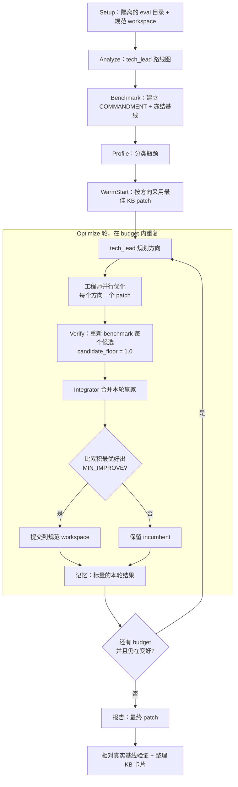
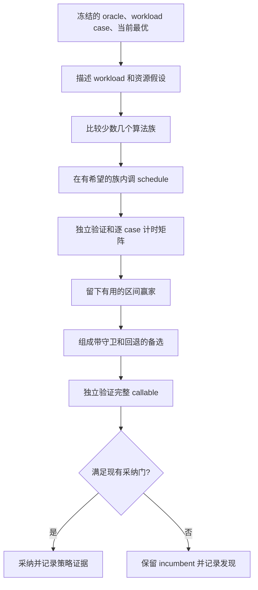
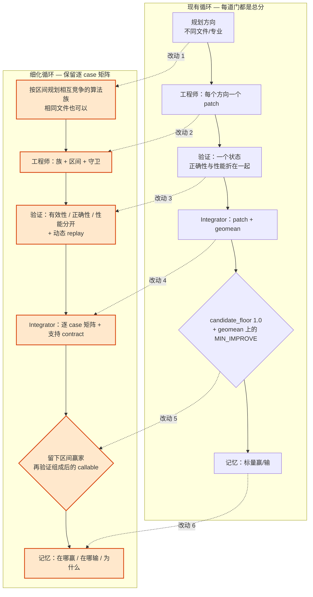

# 实现交接：GEAK 中按配置感知的算子优化

## 0. 如何使用本指南

本文是给编码代理的实现说明，不是再要一份设计提案。按下面描述实现最小的完整垂直切片，保留现有的单 kernel 路径，并且只把实测结果当作采纳信号。

### 范围拆分

本文有两项相关但独立的改动：

1. **按配置感知的家族编排（必需的 MVP）：** 校验算子家族规格，规划分组，每个 config 调用一次现有的 `kernel_lane.js`，并汇总各自独立验收的结果。这是里程碑 1–4，也是第一个 PR。
2. **一条 lane 内部的区间策略搜索（后续，可选）：** 留下只在 lane 的一部分 case 上获胜的候选，并组成带守卫的备选实现。这是 Task E / 里程碑 5。不要混进第一个 PR。

没有 Task E，MVP 也必须有用。它可以每个 config 产出一个实现，并把 planner 的分组记为假设。共用 kernel 的覆盖范围，以及跨 config 复用候选，只有在该候选确实在每一个声称覆盖的 config 上评估过之后才能提升。

### 已核对的仓库事实

本指南对照 GEAK 提交 `1f4d7fc6a51c2caeeb11d1ef73988f44bef7663b` 核对过。

- `kernel_workflow.js` 是公开的 dispatcher。`optimize` 和 `author` 委托给 `kernel_lane.js`。`bakeoff` 已经用 `Promise.all` 和 `makeSem` 同时启动多条 `kernel_lane.js`：每条 lane 一个 GPU id，并行度是 `min(lane 数, gpu_ids 数)`，一条 lane 抛出的异常被接住，兄弟继续，并且 `workflow()` 嵌套恰好一层。
- `kernel_lane.js` 是单语言 worker。成功返回包含 `eval_dir`、`final_speedup`、`final_weighted`、`final_geomean`、`validation_status`、`timing_basis`、`report_path`、`final_patch`、`warm_start` 和 `kb_written`。
- Dispatcher 在读取 `mode` 之前就要求 `args.kernel_path`。`config_aware` 调用没有单一的 kernel 路径，所以这个检查只能留在现有路径上。
- `kernel_workflow_bmk.js` 和 `e2e_workflow.js` 直接调用 `kernel_lane.js`。它们不经过这个开关。
- Workflow 脚本不能直接任意读写文件。MVP 优先使用内联的 `args.family_spec`；只在必须把产物落盘时才使用 agent。
- 现有的无 GPU JS 测试用打过桩的运行时全局变量执行真正的 workflow 正文。沿用 `kernel_workflow/scripts/test_mode_dispatch.js`，不要引入新的测试框架。

如果检出的版本已经移动，改代码前重新核对这些事实。

### MVP 的证据边界

当前 `kernel_lane.js` 的返回**不**包含最终的逐 case 测量、单独的正确性结论、profile 摘要、源文件/入口/digest、实现 contract，或已验证的覆盖范围。这些细节可能存在于 lane 的产物里，但家族 workflow 不得去刮任意 Markdown，也不得从 patch 推断它们。

因此第一个 PR 必须：

- 只汇总上面列出的结构化返回字段；
- 用 `validation_status` 作为 Director 的门，不另造一个正确性字段；
- 除非 lane 以后以结构化字段返回，否则把 profiling 细节记为不可用；
- 把 `final_patch` 编目为 lane 产物，而不是可部署的源文件；
- 只发出调用方提供的精确签名，并且 `deployment_ready: false`。

如果需要更丰富的家族报告，在单独的、带测试的改动里向 lane 返回追加字段。不要把这次扩展当成编排 MVP 的隐藏前提。

### MVP 必须交付的内容

改 `kernel_workflow/kernel_workflow.js`。新增：

- `kernel_workflow/roles/operator_family_planner.md` — 家族规划角色。
- `kernel_workflow/scripts/test_config_aware.js` — 在真实 dispatcher 正文上、不依赖 GPU 和 agent 的开关测试。
- 在 `kernel_workflow/README.md` 里放一小段内联 family-spec 示例。

不要新增 `operator_family_workflow.js`。从 dispatcher 再调用一个新 workflow 文件会变成第二层嵌套。家族循环放在 `kernel_workflow.js` 里，和 bakeoff 调用 `kernel_lane.js` 的位置相同。

增加 `args.config_aware`，默认 `"false"`。只有字符串 `"true"` 和 `"on"`（忽略大小写）才走家族路径。缺省、`"false"`、`"off"` 以及其他任何值都保持今天的 `optimize`、`author`、`bakeoff`，包括 `kernel_path` 要求和 `test_mode_dispatch.js` 锁住的模式契约。不要新增 `mode` 取值。

开关打开时，在 `kernel_path` 抛错之前分支。要求 `args.family_spec` 和 `args.workflow_dir`。父级 `mode` 为 `optimize` 或 `author` 时忽略它；每个 config 自带自己的 mode。本 PR 拒绝父级 `mode=bakeoff`。家族路径必须：

1. 在启动任何 lane 之前同步校验；
2. 调用一次 planner，校验其响应，失败时退回成每个 config 一组；
3. 用 `Promise.all` 和现有的 `makeSem` 同时启动全部 config，每条 `kernel_lane.js` 拿到一个 GPU id；
4. 调用 `kernel_lane.js`，使用唯一的 `eval_dir`，并且 `apply_to_original: "false"`；
5. 接住 lane 失败，记下来，让兄弟跑完；
6. 只有 `validation_status === "accepted"` 且有限的主 speedup 大于 `1.0` 时，才把该 lane 当作优化候选；
7. 写出 `family_plan.json`、`family_results.json`、`family_report.md` 和 `implementation_catalog.json`；
8. 以同样的结构返回这些信息，使调用方不必解析 Markdown。

只有一张 GPU 时，`makeSem` 会把同一段代码串行化。并行度是 `min(config 数, gpu_ids 数)`。把这一张 GPU 的 id 作为该 lane 的 `gpu_ids`。不要把整份池交给每一条 lane：每条 `kernel_lane.js` 已经会在它收到的 id 上再展开工程师。返回结果按记录的 `execution_order` 排序，报告才稳定。这个顺序不是启动顺序。并行启动不减少 lane 次数，也不减少 token。

### 不可协商的安全规则

- 家族 workflow 绝不修改输入的 `kernel_path`。
- 绝不把 planner 的 confidence、一次 KB 命中，或 lane 报告的 speedup 当作正确性证明。
- 绝不比较或汇总 `timing_basis` 不兼容的数字。
- 绝不只凭 config 相似就声称精确覆盖或 range 覆盖。
- 绝不让一个 config 的失败抹掉已经完成的兄弟结果。
- 绝不编造 incumbent 对比。如果 incumbent 不能在同一 oracle 和同一计时基准下执行，报告 `speedup_vs_incumbent: null` 并给出原因。

### 第一个 PR 的完成定义

当无 GPU 测试证明了校验、规划回退、参数继承、直接路由到 lane、唯一的 eval 目录、失败隔离、accepted 结果过滤，以及确定的 catalog 覆盖；现有 dispatcher 测试仍然通过；并且 README 里有可运行的调用示例时，第一个 PR 完成。该 PR 明确不要求 GPU 运行，也不要求区间策略搜索。

## 1. 目标

仓库：https://github.com/AMD-AGI/GEAK

实现算子家族优化能力，把 GEAK 从优化单个 kernel 配置，扩展到优化属于同一算子的一组配置。

目标系统应结合三种能力：

1. **LLM Agent 判断：** 理解算子配置，推理 workload 差异，选择实现策略，并生成专用 kernel。
2. **面向架构的优化：** 用 AMD GPU 架构知识、profiling 结果、硬件约束和瓶颈分析指导实现决策。
3. **自动调优与知识复用：** 搜索实现策略和 kernel 参数，在真实硬件上评估候选，并在配置之间复用已验证的优化结果。

### 期望行为

给定一个算子家族，例如 FMHA、MLA、GEMM 或 MoE，以及一组 workload 配置，GEAK 应该：

1. 分析这些配置。
2. 找出 workload 特征相近的配置。
3. 为不同的配置组制定实现策略。
4. 生成并优化专用实现。
5. 独立验证每个实现。
6. 记录配置与其最佳已验证实现之间的映射。
7. 在处理后续配置时复用适用的优化知识。

期望的关系是：

`算子家族 → Workload 配置 → Config 分组 → 实现策略 → 专用 Kernel`

系统应学会哪些实现策略适用于哪些 workload 配置和硬件架构。

---

## 2. 仓库约束与现有基础设施

实现任何东西之前，先检查当前 GEAK 检出，确认确切的 API、schema 和 workflow 约定。不要假设提议的模块名或目录结构已经存在。

当前架构已经提供这些能力：

| 现有组件 | 现有职责 | 如何复用 |
|---|---|---|
| `kernel_workflow.js` | optimize、author、bakeoff 的入口 dispatcher | 保持现有行为 |
| `kernel_lane.js` | 完整的单语言优化 workflow | 每个配置执行一条 lane |
| `kernel_workflow_bmk.js` | 跨多个 kernel 的批编排 | 复用它的编排模式 |
| Director / TechLead | 搭建、策略规划、优化规划、最终验收 | 用家族级上下文扩展规划 |
| Algorithm / Memory / Compute / Host Runtime 工程师 | 专用 kernel 优化 | 复用，不复制角色 |
| Profile 工程师 | 硬件 profiling 与瓶颈分析 | 用实测性能指导优化 |
| `perf_knowledge/` | AMD 算子、架构和后端的参考知识 | 作为技术参考复用 |
| `knowledge/learned/` | 整理过的优化经验卡片 | 作为建议性优化知识复用 |
| `kb_artifacts/` / experience store | 持久化的 kernel 实现和实测结果 | 复用现有 warm-start 机制 |

重要的实现约束：

- 保持现有 `kernel_workflow.js` 行为向后兼容。
- 不要替换现有的专家 agent 架构。
- 不要另建一套并行的 profiling 或 benchmark 框架。
- 除非证明确实缺一种能力，不要再引入一个持久化知识库。
- 现有知识是建议；实测的正确性和性能始终决定一个实现是否被接受。
- 每个候选都必须相对不可变的正确性 oracle 和原始性能基线独立验证。

### Workflow 嵌套约束

GEAK 使用嵌套深度有限的确定性 JS Workflow。

`kernel_workflow.js` 是调用 `kernel_lane.js` 的 dispatcher。因此，如果新的家族级 workflow 还要通过该 dispatcher 调用 `kernel_lane.js`，它就不能再调用 `kernel_workflow.js`。

改为遵循现有的 `kernel_workflow_bmk.js`：把 `kernel_lane.js` 直接当作子 workflow 调用。

在改编排、并行或 import 之前，先检查当前的 workflow 运行时。

### 下游消费者：Artemis 算子家族 kernel 包

`artemis-kernel-integrations` 是 GEAK kernel 的第一个生产消费者（MI355X / gfx950 上的 SGLang）。它的运行时已经把一个算子家族部署成一组按配置区分的 kernel。本 workflow 的输出应能直接喂给这个模型。

Artemis 如何表示一个算子家族（`src/artemis_runtime/profile.py`、`catalog.py`、`contracts.py`）：

- **profile** 固定部署目标：模型架构、`hardware_arch`、TP/EP 大小、量化、attention 后端，以及可选的 Torch/Triton 版本。每个家族列一份 **manifest**。
- **variant** 固定该家族的语义 contract（精度、量化分组、权重布局、KV-cache dtype）和 graph contract（`capture_safe`、`dynamic_sequence_lengths`、`maximum_context`、`supports_padded_requests`、`mutates_state`）。
- 每条 manifest **specialization** 把一个整数 `signature`（秩按家族定义，例如 GEMM 的 `[M, N, K]`）映射到一个带有固定 `source_sha256` 的 `source_file`。可选的 `signature_ranges` 在一个或多个轴上声明闭区间。
- 运行时，精确签名优先于 range。同一操作上重叠的 range 在加载时被拒绝。未覆盖的签名回退到 stock SGLang 路径。已覆盖但语义或 graph contract 不匹配的签名会大声失败，而不是回退。

来自 `qwen3_next_fp8_tp4_gfx950/fp8_block_scaled_gemm.json` 的例子：decode 签名 M=1、M=2 和 M=16 在每个 N/K 上各有自己的源文件。一个文件（`gemm_n2048_k1024_m2_m4_m8.py`）被 M=2、4、8 复用，一个 prefill 文件用 range 覆盖 M ∈ `[1024, 16384]`。同一个签名也可以只因 graph contract 不同而映射到不同 kernel：paged-attention 输出家族对上下文容量 8192、16384、65536 和 131072 有各自的 variant。

GEAK 输出现在和这个模型之间的缺口：

- GEAK 目前为**每个算子产一个 kernel**，并在内部按 M 桶切换 tile 配置。例如见 `02_dsr1_qkv_a_norm_quant_m16` 报告里的 “Per-bucket configs”。
- 当这些 kernel 与 incumbent 的按配置 Artemis kernel 对比时，单个 kernel 常常在生产形状上赢、在兄弟形状上输。`outputs/geak-summary_1022.md` 在 38 个 case 上的总 geomean 是 0.975x。例如 `18_qwen3coder_bf16_fp8_block_scaled_gemm_m16` 在 M=1 相对 stock 是 5.07x，相对 incumbent Artemis kernel 是 0.83x。
- GEAK 报告的是相对 stock（AITER）的 speedup，而部署决策是相对 incumbent specialization 做的。例如 `02_dsr1_qkv_a_norm_quant_m16` 在 GEAK 报告里相对 stock 是 2.77x，在 M=16 相对 incumbent 是 0.88x。

对本设计的含义，详见后面各节：

1. 一个配置的身份是它的 dispatch key（签名，加上语义 contract 和 graph contract），不只是形状描述（第 4 节）。
2. 一个 config 组应把它的**覆盖**表达成精确签名和/或已验证的 range，这样一个实现才能合法地服务多个 config（Task A）。
3. 被接受的实现最终应在兄弟 config 上交叉评估，再决定这个家族需要多少个不同的 kernel（MVP 之后的 Task D）。
4. 部署决策需要同时相对 stock 和 incumbent 比较。除非提供了可执行的 incumbent adapter，MVP 把 incumbent 比较报告为不可用（阶段 4）。
5. MVP 之后、可部署的 catalog 应带有足够的出处（源码 digest、入口、contract、覆盖），以便机械地导出 manifest。MVP 的 patch catalog 不能做这个声明（阶段 6）。
6. 在一条 lane 内部，搜索应按 workload 区间比较算法族，而不是只把修改堆到一个 kernel 上（Task E）。

### Artemis kernel 内部的策略选择

运行时 catalog 按签名选择源文件。在一个源文件内部，Artemis kernel 还在三个层次上选择策略：

| 层次 | 改变什么 | 例子 |
|---|---|---|
| 算法族 | 计算分解或 kernel 启动序列 | Packed GEMV 对 MFMA GEMM；融合对分阶段的 MoE |
| 族内 schedule | Tile 大小、wave 数、遍历、缓冲、split 数 | FP8 GEMM 随 batch 变化的 tile 和 pipeline 设置 |
| 设备侧适配 | 有用的工作在变，启动元数据保持不变 | Attention 分区适应实时序列长度 |

具体例子（源码引用见文末）：

| Artemis 实现 | 观察到的策略 | 性能解释 |
|---|---|---|
| BF16 LM-head GEMM（A1），`N=37984`，`K=2048` | `M=1` 使用 packed GEMV。支持的 `M=2..64` 使用带流式权重面板的整批 MFMA tile。Wave 数和遍历也会变。 | 一行时，packed 乘积避开不合适的矩阵 tile。更多行带来权重复用，才值得用 MFMA。这是先选族、再调 schedule。 |
| FP8 prefill GEMM（A2） | `_async_tuning` 在 token 数区间上选择 tile 大小、分组、swizzle，以及 copy/scale 时机。 | 在同一个异步 MFMA 族内重新平衡复用、资源占用和可用并行工作。每个分支不是新算法。 |
| Paged attention + gate + 量化（A3） | Batch 大小和布局决定 head 分组和 split 预算。GPU 读取实时长度，并选择分区工作和 attention 路径。 | 小 batch 需要更多独立工作；短序列应避免过多的分区开销。同一次捕获的 launch 可以服务变化的长度。 |
| GDN prefill（A4） | 总 token 数和序列数选择 snapshot/scan-and-emit、层次化 block 传播，或 chunk 递推路径。 | 长的状态依赖和独立序列的数量改变最佳分解。只看总 token 数不够。 |
| 完整 MoE prefill（A5） | 最多 2048 行时，融合的 W13/W2 路径避免单独的 routed-activation 工作。更大的 batch 使用分阶段的分组计算；实际路由在 GPU 上生成 expert job。 | 融合为较小 workload 省下启动和中间结果。随着工作变大，分阶段支持另一种复用/调度权衡。这段代码没有建立通用的、基于倾斜的族选择器。 |

BF16 LM-head 文件是最清楚的例子：一个 wrapper 覆盖七个测过的 batch 大小，里面有**两个算法族**加若干 schedule 设置，支持断言把它限制在这些稠密形状上。它的 `M=1` 交叉点不应抄进每一个 GEMM；`N`、`K`、布局和资源占用也会决定这个交叉点。

这在 MI355X 上有用的原因：Gluon 实现显式控制 MFMA 操作数布局、lane/wave 组织、LDS 布局、异步的 global-to-LDS 传输，以及同步。策略选择决定这些机制是否划算。更大的 tile 提高复用，但减少可用工作，或提高寄存器/LDS 压力。Split reduction 暴露并行性，但增加 scratch 流量和一次收尾 launch。融合去掉中间结果，但扩大工作集。

这些证据的限度：

- Artemis 含有明确的策略和阈值，但源码没有展示它们是如何发现的，也没有自动学到的代价模型。GEAK 应复现这个靠测量做决定的过程，不要把 Artemis 的常数当成普遍规则。
- 抽出的算子报告（A6；33 个通过的 case，一块 MI355X，2026 年 10 月 9 日）同时有收益（DeepSeek QKV-A norm/quant 3.14x，Qwen3-Next attention/gate/quant 1.71x）和回退（最大上下文的 DeepSeek MLA 0.31x，Q8192 的 Qwen3.5 prefill attention 0.46x）。
- 这些是孤立的合成算子测量。Graph 和冷 cache 计时使用不同的过程，必须分开。它们说明收益依赖 workload；它们没有分离出策略选择的贡献，也不能预测 GEAK 的改进。

---

## 3. 提议的架构

把家族编排放进 `kernel_workflow.js`，由 `config_aware` 控制。关闭时就是现在的 dispatcher。打开时是各条 kernel 优化 lane 之上的编排层，嵌套层数与 bakeoff 相同。

概念上：

```text
             算子家族输入
                       |
                       v
              算子家族 Workflow
                       |
                       v
                 Config 分析
                       |
                       v
                 Config 聚类
                       |
                       v
                  策略规划
                       |
                       v
            现有 GEAK Kernel Lane
                       |
             +---------+---------+
             |         |         |
             v         v         v
           Lane A    Lane B    Lane C
             |         |         |
             v         v         v
            Profiling + 优化
             |         |         |
             v         v         v
            验证与 Benchmark
             |         |         |
             +---------+---------+
                       |
                       v
               家族结果汇总
                       |
                       v
               实现 Catalog
                       |
                       v
               现有知识库
```

### 设计原则

家族 workflow 拥有跨配置的规划和编排。

每条现有的 `kernel_lane.js` 拥有分配给它的那个配置的实际 kernel 优化过程。

不要在 dispatcher 里复制单 kernel 优化循环。每个 config 仍然跑现有的 `kernel_lane.js`。

---

## 4. 输入接口

引入结构化的算子家族规格。

建议的 schema：

```json
{
  "schema_version": 1,
  "family_id": "fmha",
  "operator": "fmha",
  "description": "FMHA operator optimization across workload configurations",

  "target": {
    "expected_gfx": "gfx942",
    "expected_target": "unknown"
  },

  "deployment": {
    "architecture": "Qwen3NextForCausalLM",
    "tensor_parallel_size": 4,
    "expert_parallel_size": 1,
    "signature_axes": ["M", "N", "K"]
  },

  "defaults": {
    "mode": "author",
    "target_language": "flydsl",
    "budget": 4,
    "gpu_ids": "0",
    "gpu_mode": "pool",
    "use_learned_kb": "true",
    "update_experience": "true",
    "apply_to_original": "false"
  },

  "configs": [
    {
      "id": "prefill_bf16_hd128",
      "kernel_path": "/absolute/path/to/config_001",
      "op_spec": {
        "op_kind": "attn",
        "dtype": "bf16",
        "regime": "prefill",
        "shapes": {
          "seqlen_q": 8192,
          "seqlen_k": 8192,
          "num_heads": 32,
          "head_dim": 128
        }
      },
      "signature": [8192, 8192, 32, 128],
      "signature_ranges": {"0": [4096, 16384]},
      "contract": {
        "semantics": {"precision": "bf16", "kv_cache_dtype": null},
        "graph": {"capture_safe": false, "maximum_context": 16384}
      },
      "incumbent": {"source_file": "attention/prefill_4096_16384.py", "source_sha256": "..."},
      "workload_weight": 0.6,
      "tags": ["prefill", "long-sequence"],
      "priority": 1
    },
    {
      "id": "decode_bf16_hd192",
      "kernel_path": "/absolute/path/to/config_002",
      "op_spec": {
        "op_kind": "attn",
        "dtype": "bf16",
        "regime": "decode",
        "shapes": {
          "seqlen_q": 1,
          "seqlen_k": 8192,
          "num_heads": 32,
          "head_dim": 192
        }
      },
      "tags": ["decode", "long-kv"],
      "priority": 2
    }
  ]
}
```

这是提议的接口，不是说这些字段已经匹配全部 GEAK task 元数据。

尽可能使用现有的 `op_spec` 约定。

### MVP 输入契约

第一个 PR 只接受已经解析好的对象 `args.family_spec`。在 workflow 内部加载 JSON 路径，需要把基本的输入解析委托给 agent，并使校验不确定。调用方可以在调用 workflow 之前解析文件；如果 Workflow 运行时以后有了原生 JSON 输入机制，再增加文件加载。

调用 planner 之前，规范化成这个内部形状：

```json
{
  "schema_version": 1,
  "family_id": "dense_gemm",
  "operator": "gemm",
  "defaults": {
    "mode": "optimize",
    "target_language": "triton",
    "budget": 6,
    "gpu_ids": "0",
    "gpu_mode": "pool",
    "apply_to_original": "false"
  },
  "configs": [
    {
      "id": "m1_n4096_k4096",
      "kernel_path": "/absolute/task/path",
      "op_spec": {"op_kind": "gemm", "dtype": "bf16", "shapes": {"M": 1, "N": 4096, "K": 4096}},
      "overrides": {}
    }
  ]
}
```

提供了 dispatch 元数据（`deployment`、`signature`、`contract`、`incumbent`）就保留，但只做编排的运行不要求它们。

参数优先级是：

`config.overrides[field] → family_spec.defaults[field] → 当前 kernel_lane 默认值`

例外：每个 config 的 `target_language` 必须显式解析出来。在 `author` 模式里它是要创建的语言；在 `optimize` 模式里它必须标识可编辑实现的真实语言。不要静默继承 lane 的 `triton` 默认值，因为语言参与 warm-start KB 的身份，错误的语言会把读写路由到错误的页面。

只转发 `kernel_lane.js` 已经理解的字段。尤其不要把任意的家族规格元数据作为顶层参数传进 lane。在单独的改动引入有类型的 lane 上下文之前，把校验过的家族上下文放进 lane 的 `task` 字符串。

家族 workflow 本身还需要 `args.workflow_dir`。worker 派生为 `${workflow_dir}/kernel_lane.js`，并可用可选的 `args.kernel_lane_script` 做测试覆盖，与 dispatcher 的约定一致。

### 必填字段

- `family_id`：算子家族的稳定身份。
- `operator`：算子名称或种类。
- `configs`：非空的配置列表。
- `configs[].id`：唯一的配置标识。
- `configs[].kernel_path`：已有的、GEAK 兼容的 task 目录的绝对路径。
- `configs[].op_spec`：用于规划和 kernel 编写的配置元数据。

### Dispatch-key 字段（schema 中可选，部署导出时必需）

这些字段对应第 2 节描述的 Artemis profile/manifest 模型：

- `deployment`：模型架构、TP/EP 大小，以及签名轴的有序名称。来自不同部署目标的 config 不得分组或比较。
- `configs[].signature`：用作运行时 dispatch key 的整数元组。它的秩必须匹配 `deployment.signature_axes`。
- `configs[].signature_ranges`：可选的闭区间，以轴下标为键，表示该 config 预期覆盖的范围。Range 是必须验证的覆盖声明（Task D），不只是一个标签。
- `configs[].contract.semantics`：精度、量化分组、权重布局、KV-cache dtype，以及其他必须精确匹配才能复用一个实现的值。
- `configs[].contract.graph`：图捕获安全性、动态序列长度、最大上下文、填充请求支持，以及状态变更。签名相同但 graph contract 不同的两个 config（例如不同的 `maximum_context`）是不同的 config。
- `configs[].incumbent`：该签名当前已部署的实现，如果有的话。它成为第二条基线（阶段 4）。
- `configs[].workload_weight`：在目标 workload 中的相对重要性（例如服务时间占比）。Benchmark 目前只隐式地把这标成 “(prod)” case；把它显式化，使加权与不加权的汇总保持区分。

`contract.semantics` 不同的两个 config 绝不能共用一个实现，无论形状多么相似。

### 可选字段

允许按 config 覆盖全局设置，包括：

- 优化模式。
- 目标后端。
- Budget。
- 任务描述。
- GPU 分配。
- 优化优先级。

初始实现支持 `optimize` 和 `author`。不支持的模式要明确拒绝，不要静默回退。

拒绝，不要强行转换：

- 非对象的 `family_spec`；
- 未知的 `schema_version`；
- 空的或非法的 `family_id`，或空的 `configs`；
- 重复或不安全的 config ID（只有校验之后才把 ID 用在输出路径里）；
- 非绝对路径的 `kernel_path`；
- 缺失或非对象的 `op_spec`；
- `optimize` 和 `author` 以外的 `mode`；
- `target_language` 不能显式解析的 config；
- 非正或非整数的 `budget`；
- 非法的 `gpu_mode`；
- 存在但格式错误的签名秩、contract、range、workload weight 或 priority；
- 不是 false 的 `apply_to_original`。家族 workflow 拥有这条不变量。

JS workflow 不能同步检查路径是否存在。让 lane 的 setup 把缺失路径归类为该 config 的 setup 失败；不要让 planner 去校验文件系统状态。

---

## 5. 实现任务

### Task A — Config 分析与家族 Planner

建立一个家族级规划步骤。

建议的角色：

`roles/operator_family_planner.md`

Planner 收到：

- 算子家族元数据。
- 全部输入配置。
- 可用的硬件目标信息。
- 现有优化知识的引用。
- 总体优化目标。

它的职责：

1. 分析每个配置的特征。
2. 识别相似点和重要差异。
3. 把可能从相似实现策略中受益的配置分到一组。
4. 为每组推荐一个实现策略。
5. 在需要时提供针对单个 config 的策略提示。
6. 记录一份报告顺序。启动不等待它：兄弟 lane 重叠，所以同一次运行里，一个 config 的知识写入对另一个 config 不可见。

分析示例：

| Config 组 | 特征 | 候选策略 |
|---|---|---|
| Prefill | 大 M，长 Q/K 序列 | Tiled FlashAttention / pipeline |
| Decode | 小 M，长 KV 序列 | 面向 decode 的执行 |
| 小 head 维 | 小 D | 专用 tile 和映射 |
| 大 head 维 | 大 D | 另一种内存/MFMA 映射 |

这些是优化假设，不是写死的路由规则。

Planner 不得假设小 M 就意味着 GPU 利用率不足。它应考虑 N、算术强度、矩阵维度、内存流量，以及实际的硬件利用率。

### Planner 输出

返回结构化 JSON：

```json
{
  "family_id": "fmha",
  "groups": [
    {
      "group_id": "prefill_long_sequence",
      "config_ids": ["prefill_bf16_hd128"],
      "coverage": {
        "exact": [],
        "ranges": [{"anchor": [8192, 8192, 32, 128], "ranges": {"0": [4096, 16384]}}]
      },
      "implementation_form": "shared_kernel",
      "strategy": "Tiled FlashAttention with pipelined execution",
      "reasoning": "Large sequence workload with sufficient parallel work",
      "confidence": 0.85
    },
    {
      "group_id": "decode_long_kv",
      "config_ids": ["decode_bf16_hd192"],
      "strategy": "Decode-specialized execution",
      "reasoning": "Small query dimension with long KV context",
      "confidence": 0.80
    }
  ]
}
```

Planner 校验要求：

- 每个输入 config 恰好出现一次。
- 没有未知的 config ID。
- 没有重复的分组分配。
- 没有非法或空的 group 标识。
- 缺失或非法的 planner 输出不得静默丢掉配置。
- 一个组不得混入 `contract.semantics` 或 `contract.graph` 不同的 config。
- 同一操作上的组覆盖 range 不得重叠；精确条目可以落在另一组的 range 之内（运行时精确项优先）。

`implementation_form` 记录 planner 关于该组应如何实现的假设：

- `shared_kernel`：一个源文件服务组内每个签名，例如 `gemm_n2048_k1024_m2_m4_m8.py` 服务 M=2、4 和 8。
- `per_signature`：每个签名有自己的源文件，由自己的 lane 产出。
- `internal_buckets`：一个源文件在内部按桶分发（当前 GEAK 的默认做法）。

这是待检验的假设，不是承诺。Task D 的跨 config 评估根据测量决定最终形式。

如果规划失败，退回成每个配置独立一组，并在没有自定义策略提示的情况下继续 workflow。

把校验后的计划保存在家族实验目录里。

### Task B — 策略选择与 Kernel 生成

不要实现第二个 kernel 生成器。

对每个 config，用该配置自己的参数调用现有的 `kernel_lane.js`。

传入：

- 原始 `kernel_path`。
- `op_spec`。
- 优化模式。
- 目标语言。
- Budget。
- GPU 配置。
- 家族级策略提示。
- 家族级目标，以及相关的兄弟 config 上下文。

家族策略提示应追加到现有的 `task` 指令上；如果现有角色契约支持，也可以通过一个新的可选上下文字段传递。

TechLead 和专家工程师必须仍然可以根据实际 profiling 证据推翻初始策略。

实现过程继续使用现有的：

- Algorithm 工程师。
- Memory 工程师。
- Compute 工程师。
- Host Runtime 工程师。
- 适用时的 Deep Explore 轨道。
- Integrator。
- Director 验证。

一个实现策略不会仅仅因为 LLM 推荐它就被接受。

### Task C — 面向架构的优化

复用已经实现在 `kernel_lane.js` 内部的架构感知能力。

相关输入包括：

- 在机器上实际检测到的 GPU 身份。
- GPU 家族和 ISA。
- 物理 CU 数量。
- 架构专用知识。
- HBM 和 cache 行为。
- MFMA/WMMA 特性。
- VGPR/LDS 约束。
- 占用率和 wave 利用率。
- 算术强度。
- Profiling 瓶颈分类。

相关的现有知识：

- `knowledge/amd_instinct.md`
- `knowledge/amd_rdna4.md`
- `knowledge/profiling_guide.md`
- `perf_knowledge/`

不要假设 gfx942 和 gfx950 共用相同的调优参数或执行策略。

每条 lane 必须独立验证实际的硬件身份。家族 manifest 里期望的 GPU 信息是预期/守卫，不是检测到的设备的证明。

这次初始实现不要引入写死的峰值性能，也不要做第二个 roofline 估计器。

期望的决策过程是：

```text
Workload Config
      |
      v
实际 GPU 架构
      |
      v
基线 Benchmark 与 Profiling
      |
      v
瓶颈分类
      |
      v
面向架构的优化假设
      |
      v
Kernel 候选生成
```

### Task D — 自动调优与跨 Config 知识复用

复用 `kernel_lane.js` 内部现有的优化 budget 循环。

现有 workflow 已经支持：

- 多轮优化。
- 专家并行探索。
- 独立的候选验证。
- 合并兼容的 patch。
- 重新 profiling。
- 优化停止条件。

家族 workflow 应按配置分配 budget，或允许按 config 覆盖。

不要把整个家族 budget 不受控制地、独立地花在每一个 config 上。家族 manifest 应把 budget 策略写明确。

#### 优化的层次

**第 1 层：实现策略（算法族）**

例子：

- Tiled 对 persistent。
- 单阶段对多阶段。
- Pipeline 对非 pipeline。
- 融合对非融合。
- 另一种内存布局。
- 另一种 block 映射。

**第 2 层：Kernel 参数**

例子：

- `BLOCK_M`
- `BLOCK_N`
- `BLOCK_K`
- `num_waves`
- Pipeline 级数。
- 后端专用的 launch 和布局参数。

**第 3 层：设备侧适配**

例子：

- 在一次捕获的 launch 内部，根据实时序列长度选择 attention 的 split/partition 工作。
- 根据实际路由在 GPU 上生成 expert job。

策略 planner 提出候选方向；现有优化循环调优并测量它们。Task E 描述 lane 应如何先搜索第 1 层、再搜索第 2 层，并留下区间赢家。

#### 知识复用

使用现有机制：

1. `knowledge/learned/` 存放整理过的优化原则。
2. 当前的 warm-start 机制检索可复用的实现。
3. `kb_artifacts/` 和现有 experience store 存放 patch 产物和已验证的性能历史。
4. 现有的 TechLead 跨轮洞察和假设记忆。

家族路径不得绕过 warm-start 验证。

检索到的实现只是候选。它必须通过当前配置的不可变正确性和性能验证，才能被采用。

Config 同时启动，所以一条 lane 读不到同一次运行里兄弟刚写的内容。每条 lane 的 `update_experience` 保持它自己的默认：这些是不同的 kernel。Bakeoff 则关掉整理，并在结束时写一张共享卡片。当前 warm-start 身份主要基于规范 kernel 名、语言和 GPU 架构，精度是过滤器。不同的 config 目录名即使属于同一家族，也可能解析到不同页面。

一致地传入真实目标语言和稳定的 kernel 命名，并报告每条 lane 的 `warm_start`/`kb_written` 结果。不要用这一次运行声称发生了家族知识迁移。MVP 不改变持久 KB 的身份或排序语义；面向家族的身份需要单独的迁移设计。

#### 跨 config 评估与家族选择（MVP 之后）

一条 lane 针对自己 config 的 oracle 优化，所以它的赢家可能在兄弟 config 上变差。Artemis 的 benchmark 显示了这个模式：在生产 M 上获胜的 GEAK kernel，在相邻 M 上输给 incumbent。阶段 3b 的候选 adapter 契约存在之后，运行一步家族选择：

1. 对每个已接受的实现，在每一个 contract 兼容的其他 config 上运行正确性 oracle 和 benchmark。这产出一张实现 × config 的（是否正确，延迟）矩阵。
2. 对每个 config，从矩阵中选择最快且正确的实现，包括 incumbent 和 “stock 回退”（不做专用化）。
3. 当共享 kernel 相对每个 config 自己的赢家都落在声明的容差内时，把相邻 config 收成一个实现。这用一点性能损失换更少的 kernel、编译时间和二进制大小；把容差记在 `family_plan.json` 里。
4. 对声称的 range，至少验证两个端点，加上有代表性的内部点和不规则点（例如非 2 的幂的 M，或混合序列长度）。只有这时才把它记为 range；否则只记精确签名。

这些只是测量步骤，复用现有的 benchmark 和 oracle 命令。它们不开始新的优化轮次。它们的 budget 与每条 lane 的优化 budget 分开。

正确性必须按签名检查，包括该算子具有的 replay 确定性。一个 kernel 可以在生产形状上通过、在兄弟形状上失败：Artemis 记录了一个完整 MoE 的 M=128 源文件在 4 次 replay 中失败 2 次（`docs/validation-qwen3.5-mi355x-operator-limitations.json`）。

### Task E — Lane 内部面向 Workload 的策略搜索

Task A–D 决定哪些 config 共用一个实现。Task E 改变一次 `kernel_lane.js` 在自己的 case 集合横跨多个 workload 区间时如何搜索（例如一个 GEMM 的 M=1..64）。今天这次搜索返回一个必须在平均意义上获胜的 patch。

扩展现有 lane，使其在**算法族、workload 区间和 schedule** 上搜索。留下在有用区间上获胜的候选，并组成一个小型的、带守卫的 callable，其完整性能被独立验证。搜索单位变成：

> 一个性能假设、一个候选算法族、一个受支持的 workload 区间，以及实测证据。

多个配置可以共用一个族，一个族可以有多个 schedule，一个被捕获的 kernel 可以适应变化的设备数据。从同一个后端、同一条 lane 开始。保留冻结的 oracle、正确性要求、源码绑定检查、workload 目标和验收门。用一个尚不存在的可选设置 `strategy_search` 把这个行为关在门后。

**与家族 workflow 的关系。** 这里组成的带守卫 callable 是单条 lane 的输出（Task A 里的 `internal_buckets` 形式）。它不是第 7 节排除在范围外的、跨 lane 的生产 dispatcher。Task D 的家族选择再把这个组成的 callable 与兄弟 lane 的按签名 kernel 比较。Task E 的区间证据也应反馈给 planner 的 `implementation_form` 假设。

#### 现有循环及其缺口

Lane 先跑一轮只执行一次的前导（setup、analyze、benchmark、profile、可选的 warm-start），然后在 budget 内重复一轮 **Optimize**。策略搜索就活在这一轮里。



这个循环里的每一道门都由**一个总分**驱动（geomean，或 workload 加权的 ratio-of-sums）：候选准入（`candidate_floor`，默认 1.0）、提交（`MIN_IMPROVE`）和记忆。逐 case 的计时矩阵存在，但在任何决定之前被收成一个数。没有“这个 patch 拥有小 `M` 区间”这个概念，所以**局部策略胜利不是保留和组合的一等输入**。

| 当前行为 | 对策略搜索的后果 | 提议的改动 |
|---|---|---|
| 规划偏向不同的专业和不同的主文件。 | 同一算子上相互竞争的分解被抑制。 | 允许在隔离的 workspace 里显式比较算法族，包括在相同文件上。 |
| 候选保存、验证准入和保留都依赖总分；默认 `candidate_floor` 是 1.0。 | 有用的区间赢家可能在组合之前消失。 | 在有界的组合策略下保留独立验证过的区间收益。 |
| 验证者的状态也反映总分回退。 | 正确性、测量有效性和性能资格没有分开。 | 分别报告这些决定。破坏 harness 仍然一票否决。 |
| Integrator 的输入包含 patch 和总分 geomean，但省略已验证的逐 case 矩阵和显式支持守卫。 | 集成是把修改叠起来或调和，而不是保留备选算法族。 | 传入已验证的证据和支持 contract；支持条件组合。 |
| 轮次历史记录标量结果。 | 一次区间成功可能被记成一次不成功的通用策略。 | 存储一个族在哪里赢、在哪里输、为什么。 |

只降低 `candidate_floor` 不够。工程师的保存规则、验证者分类、候选过滤、integrator 输入和记忆必须在新的保留语义上一致。

GEAK 的 [部署 regime 解析器](../../e2e_workflow/scripts/parse_regime.py) 已经描述量化、KV dtype、编译和 graph 模式。保留这个含义。这里的**性能区间**是兼容的部署 regime 内部的又一层划分。

#### 提议的搜索循环



**1. 按性能机制描述 workload。**

| 算子 | 有用的特征 | 选族时的问题 |
|---|---|---|
| GEMM | `M/N/K`、dtype、stride、量化块、tile 数、估计的寄存器/LDS 需求 | 独立工作够不够？权重复用有没有价值？split-K 能不能抵上它的规约成本？ |
| Attention | Batch、head、head 维、page 布局、长度分布、graph 模式 | head 要不要分组？split 多少有用？长度变化是否需要设备侧适配？ |
| GDN | 总 token、序列数、每条序列长度、状态布局 | 串行递推是否限制吞吐？层次化传播能不能露出有用的工作？ |
| MoE | Token、top-k、expert 数、观察到的 expert 负载分布 | 融合省下的是否多于它的成本？分组 job 能不能提高利用率？ |

把资源估计当作假设，然后测量。例如 `ceil(M/BM) * ceil(N/BN)` 估计普通 GEMM 的 workgroup 数；`N` 很大时，小 `M` 并不意味着利用率不足。

明确保留三种特征来源：

1. **主机可见的元数据：** 维度、stride、dtype、部署模式。适合廉价的 wrapper 分发。
2. **驻留在设备上的值：** 实时长度和路由。在设备代码里消费，或在现有的、与图兼容的准备阶段消费。
3. **离线观察：** 长度直方图、路由倾斜、profile 计数器。它们指导搜索，但不授权在热路径上新增主机同步。

**2. 先搜索族，再搜索 schedule。** 对每个重要区间，比较少数几个机制上不同的族，包括 incumbent。一次 GEMM 比较可以考虑 packed GEMV、普通 MFMA tiling，以及在并行不足时才合理的 split-K。只有有希望的族才接受更宽的 tile、wave、split 和 pipeline 搜索。

每次比较从两到三个族开始，并设一个可配置的组合上限；这些是 budget 选择，不是架构常数。族实验和 schedule 实验都计入现有的时间/轮次/GPU budget，并在适用时保留 deep-exploration 约束。每个方向应声明目标区间、瓶颈假设、算法族、可调参数、支持守卫和预期权衡。文件归属仍是实现约束，不是策略多样性的定义。

**3. 把有效性、保留和采纳分开。**

| 决定 | 需要的证据 |
|---|---|
| 有效实验 | 执行的是正确的源码；不可变 harness 被遵守；全套正确性和必需的执行 contract 通过。 |
| 留下以供组合 | 在一个有意义的区间上，相对当前最优有可重复的收益，即使总分在别处是输的。 |
| 采纳 | 完整组成的 callable 通过独立验证，并且把现有主目标提高了配置的幅度。 |

被留下的候选必须是一个有效的完整 callable，在其专用支持范围之外有正确的回退。保留绝不宽恕错误输出、图失败或无效测量。

假设的不加权例子：

| 候选 | 小 case speedup | 大 case speedup | Geomean |
|---|---:|---:|---:|
| 族 A | 2.0x | 0.4x | 0.894x |
| 族 B | 0.4x | 2.0x | 0.894x |
| 理想的条件选择 | 2.0x | 2.0x | 2.0x |

两个候选都过不了默认的总分门槛，尽管它们含有互补的改进。最后一行只是乐观上界：分发、scratch、编译选择和代码相互作用会改变实际结果。

保留一个有界集合，其中的候选提供彼此不同的、已验证的区间收益。剪掉在任何可比较 case 上都不更快、也没有覆盖或资源优势的候选。只在语义、基线、硬件/编译器环境和测量模式都匹配时比较计时。

**4. 组成并测量一个小策略。** Integrator 在“把兼容的改进叠起来”和“把备选留在守卫后面”之间选择。第一版只组合同一轮、同一基线版本的候选。以后的跨轮复用必须跟踪基线/源码哈希，并在 rebase 或重新实现之后再次验证。

- 分发谓词描述受支持的 workload 属性：形状范围或形状集合、dtype、布局、量化，以及执行 contract。Benchmark 的 case ID、随机种子和输入哈希不是分发特征。证据支持时优先共用区间；更宽的覆盖还没建立时，保持精确守卫。
- 对动态 attention，从元数据选择静态的 launch/scratch 预算，让设备代码适应变化的长度。不要在捕获期间冻住实时长度，也不要引入 `.item()`/`.cpu()` 来选择 kernel。用改变后的设备元数据验证 replay，包括不活跃的分区和 scratch 复用。
- 始终保留一条受支持的回退，定义谓词优先级，并报告覆盖缺口。
- **完整 callable** 的实测延迟决定采纳，包括分发、准备、规约和 scratch 行为。把计时矩阵里最好的格子加起来是不够的。

#### 证据契约



扩展现有记录，不要另建一套优化系统。这些是提议的字段，不是当前 API：

| 记录 | 最少内容 |
|---|---|
| 性能区间 | 稳定 ID；成员 case；语义前提；特征来源；瓶颈假设；测到的覆盖 |
| 策略候选 | 算法族和 schedule；目标区间；支持守卫；回退；基线版本和源码/patch 哈希 |
| 已验证测量 | Case ID；基线/当前最优/候选的绝对延迟；重复次数或不确定度；模式；环境身份；正确性、源码和图的结论 |
| 分发策略 | 有序守卫；候选引用；回退；scratch/图 contract；覆盖和边界检查 |
| 搜索记忆 | 区间上的赢/输；机制；测过的范围；测量身份；信心和未解决问题 |

绝对计时是必要的，因为来自不同基线的 speedup 不能直接组合。Graph 结果和冷/eager 结果分开存放。归档元数据与现有 [归档契约](eval_archive_contract.md) 一致地扩展，不保留构建树或编译产物。家族 catalog 的 `coverage` 和 `contract` 字段（阶段 6）应从分发策略记录派生。

保留现有主目标。设 workload 计数为 `c_i`，基线时间为 `b_i`，组成后的时间为 `t_i`，workload speedup 是：

```text
S = sum(c_i * b_i) / sum(c_i * t_i)
```

当权重表示基线时间贡献时，这等价于 GEAK 的 `sum(w_i) / sum(w_i / speedup_i)`。不加权的运行保持 geomean 目标。现有的关键 regime 门和内存门仍然是额外约束；局部保留在采纳时不能覆盖它们。

#### 接入点

| 位置 | 设计改动 |
|---|---|
| [kernel_lane.js](../kernel_lane.js) | 扩展 plan/result schema；把结构化的族/区间数据传给工程师；保存并验证区间候选；保留有界组合；把已验证矩阵传给集成；在采纳前独立验证组成结果。 |
| [tech_lead.md](../roles/tech_lead.md) | 按机制和区间规划相互竞争的族；允许在隔离 workspace 里做同文件备选；把外层族搜索的 budget 与内层调优分开。 |
| [engineer.md](../roles/engineer.md)、[deep_engineer.md](../roles/deep_engineer.md) | 即使全套总分低于基线，也保存有用的区间候选，并带上支持/回退元数据。 |
| [verify_engineer.md](../roles/verify_engineer.md) | 把无效与“正确但更慢”分开；返回完整的、可比较的测量；为自适应候选增加动态 replay 检查。 |
| [integrator.md](../roles/integrator.md) | 接受已验证的逐 case 证据和守卫；支持条件备选；发出实际的分发器和覆盖报告。 |
| [kernel_workflow.js](../kernel_workflow.js) | `config_aware` 打开时，把这个可选项转发给每个 config 的 `kernel_lane.js`。Bakeoff 的赢家选择保持不变，第一版拒绝把该开关和 `mode=bakeoff` 合在一起。 |
| [e2e_workflow.js](../../e2e_workflow/e2e_workflow.js) | 后续阶段：转发给它直接的 `kernel_lane.js` 调用，同时保留抽取、部署 regime 匹配、overlay 接入和服务性能门。 |

`e2e_workflow.js` 直接调用 lane，所以只更新独立 dispatcher 会让这些调用保持不变。跨后端的条件路由是以后的功能，因为后端环境和绑定未必能安全或便宜地组合。

---

## 6. Workflow 编排

把家族 workflow 实现为确定的编排层。

### 控制流契约

决定放在 JS 里，判断放在 agent 里，遵循现有 workflow 模式。编排器在结构上应等价于：

```js
const spec = validateAndNormalize(args.family_spec);
const evalDir = await createFamilyEvalDir(spec, args.eval_dir, args.exp_root);

let plan = await planFamily(spec, evalDir);
plan = validatePlan(plan, spec) || singletonFallbackPlan(spec);
await persistPlan(evalDir, plan);

const sem = makeSem(gpuList); // kernel_workflow.js 里已有；size 为 1 时串行
const results = await Promise.all(plan.execution_order.map(configId => sem.with(1, async ([gpu]) => {
  const config = configById[configId];
  try {
    const lane = await workflow(
      {scriptPath: `${workflowDir}/kernel_lane.js`},
      makeLaneArgs(spec, config, plan, evalDir, gpu) // gpu_ids 就是这一个 id
    );
    return normalizeLaneResult(config, lane);
  } catch (error) {
    return failedLaneResult(config, error);
  }
})));
results.sort(byRecordedOrder);

const family = aggregate(spec, plan, results);
await persistFamilyArtifacts(evalDir, family);
return family;
```

上面的名字是概念性的。纯校验、规范化、排序、状态映射和汇总函数应保持确定且可测。Agent 调用可以创建目录、渲染 Markdown，并提供初始规划判断；它们不得决定一个 lane 结果是否被接受。

因为 workflow 脚本没有原生文件系统访问，也没有可用的墙钟，使用一个小的 setup/落盘 agent 边界：

- 提供了 `args.eval_dir` 时严格使用它（测试和调用方需要确定的路径）；
- 否则在 `args.exp_root` 下，或在现有的、与 workflow 同级的 `exp/` 默认位置，创建一个避免冲突的目录；
- 在 workflow 结果里返回实际路径；
- 把已经算好的 JS 对象原样落成 JSON。落盘 agent 不得重新解释状态或指标。

### Lane 参数构造

对每个 config，传入：

```js
{
  kernel_path: config.kernel_path,
  workflow_dir: WORKFLOW_DIR,
  eval_dir: `${EVAL_DIR}/configs/${config.id}`,
  mode,
  target_language,
  budget,
  gpu_ids,
  gpu_mode,
  op_spec: config.op_spec,
  task: familyTaskContext,
  apply_to_original: "false",
  // 只有显式配置时才转发已识别的 KB/研究开关
}
```

`familyTaskContext` 必须简短且确定：家族/算子身份、group ID、兄弟 config 摘要、planner 的策略/理由，以及一条“测量覆盖提示”的提醒。不要把整份家族规格、contract 或 incumbent 源码贴进每一次 lane 提示。

这就是 `kernel_workflow.js` 里 bakeoff 已有的写法（`Promise.all`、`makeSem`、`gpu_ids` 设成刚拿到的那一个 id、每条 lane 自己 `catch`）。`kernel_lane.js` 仍然在这一个 id 上管理自己的工程师池。不要把完整的 `gpu_ids` 列表传给每一条 lane。

### 结果规范化

把每次 lane 返回映射为下列家族状态之一：

- `optimized`：`validation_status === "accepted"` 且有限的 `final_speedup > 1.0`；
- `accepted_no_improvement`：`validation_status === "accepted"` 且有限的 `final_speedup <= 1.0`；
- `flagged`：Director 返回 `validation_status === "flagged"`；保留其仲裁细节，不提升它；
- `author_failed`、`no_baseline`，或其他明确的 lane 终态；
- `lane_failed`：子 workflow 抛出异常；
- `invalid_result`：缺少或格式错误的必需返回字段。

把原始 lane 状态另外存为 `lane_validation_status`。不要从正的 speedup 推断正确性。保留 `timing_basis`、`workload_aligned`、`final_speedup`、`final_weighted`、`final_geomean`、`report_path`、`final_patch`、`warm_start` 和 `kb_written`。

MVP 家族 catalog 只选择每个 config 自己的 `optimized` lane 结果。只有阶段 3b 存在并且有真实的兄弟测量之后，跨 config 的候选选择才替换这个选择。

至少返回：

```json
{
  "schema_version": 1,
  "family_id": "dense_gemm",
  "eval_dir": "/abs/exp/family_dense_gemm_...",
  "plan_path": "/abs/exp/family_dense_gemm_.../family_plan.json",
  "results_path": "/abs/exp/family_dense_gemm_.../family_results.json",
  "report_path": "/abs/exp/family_dense_gemm_.../family_report.md",
  "catalog_path": "/abs/exp/family_dense_gemm_.../implementation_catalog.json",
  "plan": {},
  "configs": [],
  "summary": {
    "total": 0,
    "optimized": 0,
    "accepted_no_improvement": 0,
    "flagged": 0,
    "failed": 0
  },
  "aggregate": {
    "value": null,
    "kind": null,
    "timing_basis": null,
    "reason": "not all successful results are comparable"
  },
  "catalog": {}
}
```

只有每一个被纳入的结果都使用同一种指标、并且计时基准兼容时，才设置合计。列出被排除的 config 和原因。不要静默地只汇总赢家。

建议的阶段：

### 阶段 1 — 校验输入

- 校验家族规格。
- 检查 config ID 唯一。
- 校验必需的路径和字段。
- 解析全局默认值和按 config 的覆盖。
- 校验支持的优化模式。
- 创建唯一的家族实验目录。

### 阶段 2 — 规划

- 调用家族 planner。
- 校验其结构化 JSON 响应。
- 生成 `family_plan.json`。
- 记录 `execution_order`，只用于报告。它不推迟启动。

### 阶段 3 — 执行 Kernel Lane

对每个 config：

1. 构造 lane 参数。
2. 创建唯一的、该 config 自己的 `eval_dir`。
3. 直接调用 `kernel_lane.js`。
4. 保持输入 task 和基线不可变。
5. 设置 `apply_to_original=false`。
6. 捕获完整的结构化 lane 结果。
7. 即使一个 config 失败，也继续其他 config。

用一次 `Promise.all` 启动全部 config，由 `makeSem(gpu_ids)` 限流。每条 `kernel_lane.js` 拿到一张 GPU。抛出的 lane 被记下，不取消其他 lane。

不要再加一个 workflow 文件。家族路径内联在 `kernel_workflow.js` 里，嵌套保持为 dispatcher → `kernel_lane.js`。

### 阶段 3b — 跨 Config 评估与选择（MVP 之后）

对已接受的实现、incumbent 和 stock 回退，运行 Task D 描述的跨 config 评估。产出 `family_selection.json`，其中包含实现 × config 矩阵、每个 config 选中的实现、合并容差，以及已验证的覆盖（精确签名和 range）。

不要把这实现成“把每个 patch 应用到每个兄弟目录”。Lane 的 patch 相对于它自己的隔离 workspace，不会自动成为可移植的实现产物。阶段 3b 需要一个明确的候选 adapter，它能够：

1. 在一个干净的兄弟评估 workspace 里物化候选；
2. 绑定期望的入口，且不修改不可变 oracle；
3. 证明执行的是预期的候选源码；
4. 运行兄弟的正确性和 benchmark 命令；
5. 返回绝对延迟、计时基准、源码 digest 和正确性状态。

在该算子/后端的 adapter 存在之前，只发出精确的、按 config 的覆盖。把跨 config 评估记为 `unsupported` 并给出原因；绝不要用 lane 摘要 speedup 合成矩阵。来自不同 lane 基线的比值不可比较。

### 阶段 4 — 汇总结果

从每条 lane 收集：

- Config ID。
- 实现 ID。
- 执行模式。
- Eval 目录。
- 验收状态。
- 最终已验证 speedup。
- 加权 speedup，如果适用。
- Geomean speedup。
- 计时基准。
- 最终 patch 路径。
- 报告路径。
- 知识引用。

优先使用 lane 的结构化返回值，而不是解析日志里的任意文本。

每个 speedup 相对两条基线报告，并放在不同字段里：

- `speedup_vs_stock`：相对原始 stock 路径（lane 报告今天测量的对象）。
- `speedup_vs_incumbent`：当给出 `configs[].incumbent` 时，相对该签名当前已部署的 specialization。

一个 config 只有打败 incumbent 才是部署候选。打败 stock 不够。然而当前 lane 不能原生执行任意的 incumbent 描述。在 MVP 中，`speedup_vs_stock` 来自 lane，`speedup_vs_incumbent` 为 `null`，除非一个真实的 incumbent adapter 在同一次会话、同一计时基准下测量了两者（例如 graph replay）。Catalog 必须把这样的结果标成 `optimization_candidate`，而不是 `deployment_candidate`。

家族 workflow 必须区分：

- `optimized` 的配置。
- `accepted_no_improvement` 的配置。
- Director 的 `flagged` 结果，且不去猜测根因是正确性、编译、源码绑定、计时还是仲裁。
- 明确的 lane 终态，例如 `author_failed` 和 `no_baseline`。
- 抛出的子 workflow 失败。
- 缺失或格式错误的子结果。

一个失败的配置不得使其他配置已经完成的结果失效。

### 阶段 5 — 生成家族报告

产出：

`family_report.md`

`family_results.json`

报告应包含：

1. 算子家族摘要。
2. 输入配置表。
3. Config 分组和策略计划。
4. 每个 config 的优化结果。
5. 每个 config 选中的实现。
6. 性能比较。
7. 正确性和验收状态。
8. 只有未来的 lane 返回以结构化方式暴露 profiling 瓶颈摘要时才写入；否则说明它们仍在每条 lane 的报告里。
9. 学到的知识引用。
10. 失败的配置和建议的下一步。

关于合计性能：

- 只有各 config 的 speedup 指标可比较时才用几何平均。
- 明确报告汇总规则。
- 保持 workload 加权与不加权指标的区分。
- 不要混合不兼容的计时基准。
- 不要把不完整的家族结果报告成完全验证过的家族级 speedup。

### 阶段 6 — 实现 Catalog

生成一份机器可读的 catalog，把每个 config 连到它的实现。

MVP 格式：

```json
{
  "schema_version": 1,
  "family_id": "fmha",
  "implementations": [
    {
      "implementation_id": "fmha_prefill_v1",
      "group_id": "prefill_long_sequence",
      "config_ids": ["prefill_bf16_hd128"],
      "artifact": {
        "kind": "lane_patch",
        "path": "configs/prefill_bf16_hd128/final_patch.diff"
      },
      "backend": "flydsl",
      "contract": {
        "semantics": {"precision": "bf16"},
        "graph": {"capture_safe": false, "maximum_context": 16384}
      },
      "coverage": {
        "exact": [[8192, 8192, 32, 128]],
        "ranges": []
      },
      "validation": "accepted",
      "verified_speedup": 1.35,
      "timing_basis": "clean",
      "speedup_vs_incumbent": null,
      "deployment_ready": false,
      "report_path": "config_001/tech_lead_report.md"
    }
  ],
  "fallback": [
    {"config_id": "decode_bf16_hd192", "selected": "stock", "reason": "lane not accepted"}
  ]
}
```

示例数值只是说明。

一个实现不得列出没有通过自己验收的配置。

Catalog 规则：

- 每个 config 恰好出现一次，要么在某个实现的覆盖下，要么在 `fallback` 里，且 `selected` 为 `incumbent` 或 `stock`。
- MVP 实现只覆盖自己的精确签名。如果没有提供签名，用 config ID 作为编排身份，部署覆盖留空。
- Lane patch 是优化产物，不是 Artemis 可加载的源文件。因此每条 MVP 条目都是 `deployment_ready: false`。
- MVP 之后、可部署的条目必须标识实际测过的独立 `source_file`、它的 `source_sha256` 和入口。Artemis 拒绝 digest 不匹配。
- MVP 之后，同一操作上各实现的覆盖 range 不得重叠。

#### 可选的部署导出（MVP 之后）

一旦 MVP 之后的 catalog 带有物化的源码、签名、已验证覆盖、contract、入口和 digest，一个单独的导出器可以机械地发出一份 Artemis manifest 片段，每个被覆盖的签名或 range 一条 `specializations`：

```json
{
  "schema_version": 2,
  "variant": "<family>.<target>.v1",
  "specializations": [
    {
      "signature": [1024, 2560, 2048],
      "signature_ranges": {"0": [1024, 16384]},
      "variant": "<family>.<target>.v1",
      "candidate_id": "<implementation_id>:<signature>",
      "sample_id": "<implementation_id>",
      "run_id": "<run_id>",
      "source_file": "<family>/<file>.py",
      "source_sha256": "<sha256>"
    }
  ]
}
```

导出器是报告上的便利，不是部署步骤。它不得编辑已有的 Artemis profile。采用这份片段仍然需要 Artemis 自己的服务验证（stock → optimized → stock 运行和 GSM8K 检查）。

在这个初始版本里，catalog 是映射和报告产物。不要自动把所有得到的 patch 合并成一个可分发的生产 kernel。

---

## 7. 重要的范围边界

让初始实现保持聚焦。

### 范围内

- 家族编排放在 `kernel_workflow.js` 里，由 `config_aware` 控制（默认关闭）。
- 结构化的家族规格。
- 家族级的 config 分析与规划。
- Config 分组和策略提示。
- 复用现有 kernel 优化 lane。
- 通过现有能力做面向架构的 profiling。
- 现有的自动调优和知识复用。
- 家族级报告和实现 catalog。
- 以签名/contract 为键的 config，以及精确的按 config 覆盖。
- 无 GPU 的单元测试和 workflow 回归测试。
- 使用文档。

### 第一次实现明确不做

1. 替换当前的单 kernel workflow。
2. 重建一个新的 GPU profiler 或性能模型。
3. 建立一个新的、独立的持久化知识库。
4. 自动把不同的 kernel patch 合并成一个生产 dispatcher，或编辑下游部署 profile（例如一份 Artemis kernel 包）。按签名选择属于下游运行时；GEAK 只发出 catalog，以及可选的导出 manifest 片段。
5. 实现一个新的通用自动调优算法。
6. 替换现有专家 agent。
7. 修改 `e2e_workflow` 或其集成契约。把 `strategy_search` 转发给它的 lane 调用是以后的 Task E 阶段。
8. 如果需要复制当前 bakeoff 编排，就不要为每个 config 实现自动的跨后端 bakeoff。
9. 改变 lane 的默认搜索行为。Task E 是可选的，在家族 workflow 稳定之后作为里程碑 5 交付。它的后续阶段（动态 attention、GDN/MoE、跨轮复用）和跨后端条件路由是后续工作。
10. 跨 config 的候选执行、range 提升、incumbent 执行、容差合并选择，或 Artemis manifest 导出。这些需要 MVP 之后的候选 adapter。

现有 `kernel_workflow.js` 的 bakeoff 模式可以继续独立服务单个配置。家族级 bakeoff 编排可以在初始 workflow 稳定后的后续阶段加入。

---

## 8. 测试要求

测试应尽可能不使用 GPU。

### 单元测试

测试：

- 家族规格校验。
- 重复的 config ID。
- 缺失或非绝对的 `kernel_path`；不存在的绝对路径从打过桩的 lane/setup 结果归类，而不是用 JS 文件系统访问去检查。
- 非法模式。
- 缺失的 `op_spec`。
- Config 排序。
- 策略计划 JSON 校验。
- 缺失、未知或重复的 config 分配。
- Planner 失败时的回退。
- 按 config 的参数继承和覆盖优先级。
- 唯一的实验目录生成。
- 结果汇总。
- Geomean 计算。
- 不兼容指标的处理。
- 失败 config 的记账。
- 签名秩匹配 `deployment.signature_axes`。
- 拒绝混用语义或 graph contract 的组。
- `speedup_vs_stock` 和 `speedup_vs_incumbent` 分字段。
- 每个 config 在 catalog 里恰好出现一次（被覆盖，或在 `fallback` 里）。
- MVP catalog 中精确的按 config 覆盖。

MVP 之后的扩展测试：

- 拒绝重叠的覆盖 range；接受 range 内的精确项，且精确项优先。
- 从实现 × config 矩阵中选择，包括 incumbent 和 stock 回退。
- 合并容差的行为。
- Manifest 导出能按 Artemis profile 加载器的规则往返（schema 版本、digest、无重叠）。
- Task E（打开 `strategy_search`）：有已验证区间收益的候选即使总分低于 `candidate_floor` 也被留下；无效或不正确的候选永不留下；没有区间、覆盖或资源优势的候选被剪掉；组合上限被执行；采纳使用测得的组成 callable，而不是矩阵里最好的格子。
- `strategy_search` 关闭时，Task E 是空操作。

### Workflow 回归测试

验证：

- `config_aware` 关闭或缺省时，optimize、author、bakeoff 不变，仍然要求 `kernel_path`。
- `config_aware` 为 `"true"` 或 `"on"` 时，dispatcher 对每个 config 调用一次 `kernel_lane.js`，并且不要求父级 `kernel_path`。
- `"false"`、`"off"` 以及其他任何值都留在现有路径上。
- 开关打开时再传父级 `mode=bakeoff` 会被拒绝。
- 每个子 lane 收到单独的 `eval_dir`，以及恰好一个 GPU id。
- 每条 lane 保留独立的正确性验证。
- 一条 lane 失败不会中止无关的 config。
- 默认行为绝不把 patch 写进原始源目录。
- 子调用同时发出。`execution_order` 只用来给报告排序。
- 只有一张 GPU 时，信号量让这些调用一个接一个跑。
- 即使 config 覆盖试图打开，`apply_to_original` 仍被强制为 `"false"`。
- Workflow 返回包含规范化结果和产物路径；调用方永远不需要去刮 `family_report.md`。

使用仓库现有的测试约定和 workflow 运行时自测。不要无必要地引入新测试框架。

### 硬件集成测试

使用一个含 2–3 个代表性配置的小型 FMHA 或 GEMM 家族。只列一张 GPU 时，同一段代码必须串行。列了多张 GPU 时，并行度是 `min(config 数, gpu_ids 数)`。

验证：

1. 可以加载家族规格。
2. Planner 生成合法的 config 分组。
3. 每个 config 都走过现有 kernel lane。
4. 正确性验证是独立进行的。
5. 结果被收集。
6. 生成一份合法的实现 catalog。
7. 每条 lane 的 `warm_start` 和 `kb_written` 结果被记录。

同一次运行里的 warm-start 交接不是要求，也不该发生：这些 lane 是重叠的。从更早一次运行检索到的候选，除非被独立验证，否则不算成功复用。

---

## 9. 验收标准

使用两道门。第一道门定义必需的、按配置感知的 MVP。第二道门只在实现了跨 config 候选评估时适用。

**A. 功能 — MVP**

- GEAK 接受包含多个 config 的算子家族规格。
- 它产出一份家族级策略计划。
- 它为每个 config 调用现有 kernel 优化 workflow。
- 不同 config 可以产出不同的专用实现。
- 它记录 config 到实现的关系。
- Planner 失败产生确定的单元素组，并且不丢 config。
- Lane 失败被记录，且不中止无关 config。
- 只有 `optimized` 的 lane 结果进入实现 catalog。
- MVP 只记录精确的、按 config 的覆盖。

**A2. 功能 — 跨 config 扩展**

- 每个 config 的最终选择来自真实的跨 config 测量，并且可以是兄弟的 kernel、incumbent 或 stock。
- 候选 adapter 在每个被选中的 config 上独立证明源码绑定和正确性。
- 记录下来的 range 覆盖已在端点以及有代表性的内部点和不规则点上验证。
- 不支持的跨 config 评估被报告为不支持，绝不用无关的 speedup 比值去估计。

**B. 架构感知**

- 实际硬件检测仍然是权威。
- 复用现有 AMD 架构知识和 profiling。
- 选出的优化方向基于测到的瓶颈。
- 遵守架构和 dtype 兼容性。

**C. 知识复用**

- 复用现有 warm-start 和 learned 知识机制。
- 复用仍然是建议性的。
- 每个被复用的 patch 都独立验证。
- 不创建重复的或未验证的持久知识。

**D. 可靠性**

- 现有 workflow 保持向后兼容。
- 一个失败的 config 不毁掉其他结果。
- 所有被接受的实现都有独立的验收证据。
- 无 GPU 测试通过。
- 默认不修改原始源码。

**E. 报告**

- 同时生成 JSON 和 Markdown 家族报告。
- 所有配置都有明确的执行状态。
- 结果包含已验证的性能和产物引用。
- 只有可比较时才报告家族合计指标。
- Speedup 相对 stock 报告。Incumbent speedup 要么在可比较的基准下测得，要么明确为 `null`；绝不推断。

**F. 策略搜索（里程碑 5，可选）**

- GEAK 产出一个小的、可解释的、独立验证过的分发策略，并且在原始 workload 目标下相对 incumbent 有可重复的收益。只分析源码不能建立这个收益。
- 互补的区间候选在保留中存活，组成的 callable 被当作整体测量。
- 自适应候选在设备元数据改变后的 graph replay 中保持正确，没有主机同步，也不依赖过期 scratch。

---

## 10. 建议的实现顺序

增量实现，使改动可评审。

**里程碑 1 — Workflow 骨架**

- 检查现有 workflow API 和测试基础设施。
- 增加家族规格 schema 和校验。
- 在 `kernel_workflow.js` 增加 `config_aware` 分支，默认关闭，并且位于 `kernel_path` 检查之前。
- 每个 config 调用一次 `kernel_lane.js`，并行，每条一个 GPU id。
- 把结果收成一份家族报告。

交付：多个配置可以走过一个家族级 workflow。

**里程碑 2 — 家族级判断**

- 增加 `operator_family_planner.md`。
- 分析并分组配置。
- 生成策略提示。
- 把家族级上下文传进现有 TechLead 规划。
- 为非法的 planner 输出增加回退行为。

交付：不同 config 收到不同的实现策略。

**里程碑 3 — 知识与性能集成**

- 复用现有 warm-start 和 learned KB。
- 捕获每条 lane 结构化的 warm-start、learned-card 和 KB 写入结果。
- 报告每条 lane 的知识结果。不要等一条 lane 写完再启动下一条。
- 生成实现 catalog。
- 测试家族编排转发真实的语言/KB 设置，并保留 lane 的 KB 结果。

交付：家族 workflow 保留并报告现有知识行为，同时不声称不同的 config 名会解析到同一个 KB 身份。

MVP catalog 含有精确的按 config 覆盖，并把 incumbent 比较报告为不可用，除非它确实被测过。

**里程碑 4 — 文档与验证**

- 增加调用文档。
- 增加一个 FMHA 算子家族 manifest 示例。
- 运行无 GPU 测试。
- 运行一次小型 AMD GPU 集成测试。
- 准备实现摘要和 PR。

**MVP 之后的扩展 — 可移植的候选评估**

- 增加阶段 3b 的候选 adapter。
- 增加跨 config 的正确性/benchmark 评估、incumbent 比较和 range 验证。
- 增加家族选择和合并容差测试。
- 可选地增加 Artemis manifest 片段导出器。

**里程碑 5 — Lane 内面向 Workload 的策略搜索（Task E，可选）**

| 阶段 | 交付 | 验收证据 |
|---|---|---|
| 1. 证据管道 | 区间描述、候选身份、可比较的计时矩阵、分开的有效性和性能结果 | 现有行为仍是默认；不支持或无效的测量不能进入组合。 |
| 2. GEMM 试点 | 同一后端、同一轮的族比较、区间保留和带守卫的组合 | 互补候选在保留中存活；独立测得的分发器在原始目标下打败 incumbent。 |
| 3. 动态 attention | 静态 launch 契约加设备侧适配 | 一张捕获的图在长度变化后仍然正确；没有主机同步，也不依赖过期 scratch。 |
| 4. 更广的算子 | GDN/MoE 族，以及小心控制的跨轮复用 | 区间证据只在匹配的 contract 内迁移；端到端门确认部署收益。 |

用变 `M`、固定 `N/K` 的稠密 BF16 GEMM workload 做第一个试点；它使“族对 schedule”的区别容易检查。后续评估加入足够的 `N/K` 变化，以检验这个推理是否超出单个 LM head。

在相同的搜索 budget、硬件/软件环境、冻结基线、case 和权重下，比较当前 lane 和重新设计的 lane。重复独立运行，并报告方差、已验证的总收益、各区间回退、搜索成本、变体数量、编译成本和 scratch 内存。关闭区间保留的消融实验用来检验该机制的贡献是否超出提示或候选族本身的变化。

保持被打分的 benchmark 冻结。在策略边界附近，以及受支持的未见形状、不规则长度和路由分布上，另加基于 oracle 的检查。oracle 不能验证更宽区间的地方，保持窄支持并记录缺口。在现有锁定纪律下 benchmark GPU 工作。

---

## 11. 给编码代理的开发说明

按这个顺序实现：

1. 检查当前分支和工作区。
2. 读 `kernel_workflow/README.md`。
3. 读 `kernel_workflow/kernel_workflow.js`。
4. 读 `kernel_workflow/kernel_lane.js`。
5. 读 `kernel_workflow/kernel_workflow_bmk.js`。
6. 读 `kernel_workflow/roles/tech_lead.md`、`director.md`、`benchmark_engineer.md` 和 `update_experience.md`。
7. 读 `kernel_workflow/scripts/test_mode_dispatch.js`，以及调用它的 L0 CI 条目。
8. 确认 lane 当前的返回对象和被接受的 validation 状态；如果代码已经变了，不要照抄本文的字段列表。
9. 在有仓库访问时，搜索现有 issue 和 PR，避免重复工作。

然后实现第一个垂直切片：

1. 在 `kernel_workflow.js` 的 `config_aware` 分支上加入同步规范化和校验，位于现有的 `kernel_path` 抛错之前。
2. 加入家族 setup/planner schema 和单元素回退。
3. 通过 `Promise.all` 和 `makeSem` 并行调用 `kernel_lane.js`，每条一个 GPU id，并强制不修改输入。
4. 在 JS 中规范化 lane 结果，并建立只含精确签名的 catalog 条目。
5. 落盘四份家族产物，且不允许写入者改动已算好的值。
6. 围绕真实 workflow 源码增加无 GPU 测试装置。
7. 增加 README 调用示例。

测试装置必须给 `phase`、`log`、`agent` 和 `workflow` 打桩，捕获子调用，并在设置了 `config_aware` 的情况下执行真正的 `kernel_workflow.js` 正文。至少测试：

- 校验发生在任何 planner/lane 调用之前；
- 未知模式和 `apply_to_original=true` 被拒绝；
- planner 输出有缺失、重复或未知 ID 时退回成单元素组；
- `execution_order` 被保存，并且只用来给报告排序；子调用同时发出；
- 缺省和 `"false"` 留在现有的 optimize/author/bakeoff 路径上，并且仍然要求 `kernel_path`；
- `"true"` 和 `"on"` 进入家族路径，并且不要求父级 `kernel_path`；
- 默认值和 config 覆盖使用文档中的优先级；
- 每条 lane 收到 `${family_eval_dir}/configs/<id>`；
- 子脚本是 `kernel_lane.js`，绝不是 `kernel_workflow.js`；
- 抛出的和格式错误的 lane 结果不中止兄弟 config；
- 只有 `optimized` 结果进入 `implementations`；
- 其他每个 config 恰好进入 `fallback` 一次；
- 所有产物载荷和返回结果使用同一个规范化对象。

至少运行：

```text
node kernel_workflow/scripts/test_config_aware.js
node kernel_workflow/scripts/test_mode_dispatch.js
node kernel_workflow/scripts/test_candidate_floor.js
```

也运行仓库里覆盖所改 JS 和 Markdown 的 lint/解析检查。

遵循 GEAK 的贡献约定：

- 使用功能分支。
- 保持改动范围窄。
- 为行为变化加测试。
- 保留现有 workflow 契约。
- 运行相关的 lint 和测试命令。
- 不要直接推到受保护的 `main` 分支。

完成时提供：

1. 改动摘要。
2. 新增和修改的文件。
3. 架构和 workflow 决定。
4. 执行过的测试及其结果。
5. 已知限制。
6. 带 `config_aware` `"true"` 的示例命令或调用。
7. 一份家族报告和实现 catalog 结构的样例。

不要：

- 为 MVP 编辑 `kernel_lane.js`；
- 增加 `operator_family_workflow.js`，或为这条路径增加一个 `mode` 取值；
- 把整份 GPU 池交给每一条 lane；
- 声称没有跑过的 incumbent 或兄弟测量；
- 发出 range 覆盖；
- 编辑一份 Artemis profile；
- 停在又一份设计提案上。

实现能工作的 MVP，并且只报告真正阻止完成的阻塞点。

---

## 12. 最终设计原则

关键目标不是为每一个独立的输入配置生成一个 kernel。

而是让 GEAK 理解这些东西之间的关系：

- Workload 配置。
- GPU 架构。
- 实现策略。
- 专用 kernel。
- 实测性能。
- 可复用的优化知识。

预期的演进是：

`单 Kernel 优化`

→ `按配置感知的 Kernel 生成`

→ `算子家族优化`

→ `面向架构的、跨配置学习`

第一次实现应建立算子家族 Workflow，同时保留 GEAK 现有的、可靠的 kernel 优化和验证基础设施。

最重要的成功标准是：优化一个配置，能够提供有用的、已验证的知识，帮助 GEAK 更有效地生成或优化同一算子的另一个配置。

---

## 源码引用

Artemis 例子在单独的 `artemis-kernel-integrations` 仓库、提交 `05a1a9c53f8d6aca1985dda05e1da423e45e9bf1` 上审阅。GEAK 在 `1f4d7fc6a51c2caeeb11d1ef73988f44bef7663b` 上审阅。本设计没有新跑 GPU benchmark。Artemis 是支持性证据，不是 MVP 的构建期或测试期依赖。

- A1 — `src/kernel_packs/gfx950/qwen3_next/bf16_gemm/gemm_n37984_k2048_m1.py`：packed GEMV 与流式 MFMA 的族选择。
- A2 — `src/kernel_packs/gfx950/qwen3_next/fp8_block_scaled_gemm/gemm_n3072_k2048_prefill_1024_16384.py`：`_async_tuning` 的 schedule 选择。
- A3 — `src/kernel_packs/gfx950/qwen3_next/paged_attention_output_gate_group_fp8_quant/attention_output_m16.py`：设备侧适配和 launch/分配策略。
- A4 — `src/kernel_packs/gfx950/qwen3_next/gdn_prefill_group_fp8_quant/gdn_prefill_m3072_16384.py`：分解选择和执行路径。
- A5 — `src/kernel_packs/gfx950/qwen3_next/qwen_router_complete_moe/fused_moe_prefill_1024_32768.py`：融合/分阶段 MoE 选择。
- A6 — `tests/extracted_operators/test_results.md`：测量过程和完整结果。
- A7 — `src/artemis_runtime/catalog.py`：精确/range 查找和 contract 检查。
