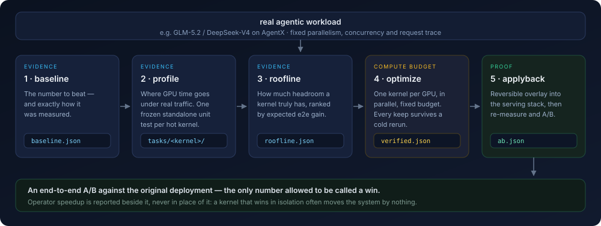

# LLM inference performance optimization for real agentic workloads

*From a serving-level goal, down to kernel-level work, back to a measured end-to-end
number.*

## What it optimizes

Inference throughput under a **real agentic workload** — a model serving an actual agent
trace rather than a synthetic sweep, for example GLM-5.2 or DeepSeek-V4 on AgentX under a
fixed deployment: parallelism layout, concurrency level, request mix.

That distinction is the point. Agentic traffic is bursty, long-context and
decode-dominated, so the kernels that matter are not the ones a fixed-shape benchmark
would nominate, and a kernel that wins in isolation routinely moves the serving number by
nothing at all.

You give the pipeline a reproducible way to measure the workload. It finds where GPU time
actually goes under that traffic, turns the hot kernels into standalone optimization
tasks, spends a fixed compute budget making them faster, puts the survivors back into the
serving stack and re-measures. The deliverable is an end-to-end A/B against the original
deployment — not a collection of microbenchmark speedups.

Nothing here is bound to one model or one benchmark. A scenario is a JSON file in
`config/`.

## The five steps



Steps 1–3 produce evidence. Step 4 spends the compute budget. Only step 5 may claim an
end-to-end gain.

Each step is a **slot**, and each slot holds one or more interchangeable **skills** —
a directory with its own `SKILL.md` and its own code. Steps communicate only through
files on disk.

| Step | Artifact | Default skill | Swap it for |
| --- | --- | --- | --- |
| `baseline` | `baseline.json` | `adopt-measured-receipt` | `agentx-trace-replay` (re-measure from scratch) |
| `profile` | `tasks/<kernel>/` | `agentx-kernel-extraction-standalone` | any skill that emits `tasks/` + a ranking |
| `roofline` | `roofline.json` | `kernel-roofline` | any skill that emits per-case `rows.json` + `fold.py` |
| `optimize` | `verified.json` | `geak-kernel-workflow` | `subagent-raw` (an agent, no GEAK workflow) |
| `applyback` | `ab.json` | `overlay-e2e-ab` | any skill that applies and re-measures |

## Design

**Two contracts, and nothing else.** Modularity here is not a plugin system, a registry
or a DSL.

- *Stage-skill contract* (`stages/CONTRACT.md`): read `$IN` and `$CONFIG`, write artifacts
  to `$OUT`, finish by writing `$OUT/result.json`. A skill is a `run.sh` script when the
  work is deterministic, or a `SKILL.md` procedure when it needs judgement.
- *Runner contract* (`runners/CONTRACT.md`): `runner.sh <prompt> <workdir> <log>`, exit
  `0` on success, `78` on an unmet precondition (do not retry), anything else retryable.

So swapping the roofline, the optimization method or the agent CLI is a one-line config
change — no code edit, nothing to register. `runners/stub.sh`, which calls no agent at
all, exists as executable proof that the scheduler is genuinely agent-agnostic.

**The slot owns the criterion; the skill owns the work.** How artifacts map to
`result.json`, and what counts as ranked or passing, live in the slot (`finalize.py`,
`rank.py`). Replacing an implementation therefore never rewrites the mapping — which is
why the two upstream skills are vendored byte-identical, hash-enforced by
`skill_manifest.py`, down to their own `scripts/` and `tests/`.

**An operator win is not a system win.** This is the failure mode the whole pipeline is
built around: a kernel that is unambiguously faster in isolation can leave the serving
number flat, or slightly worse, and on this class of workload that is the normal outcome
rather than the exception. So kernels are ranked by `pct_gpu_time × (1 − 1/attainable_speedup)` rather than by
achievable speedup, operator and end-to-end numbers are written side by side so neither
can stand in for the other, and only `applyback` may claim e2e.

**No speedup counts until it survives a cold rerun.** `verify.py` re-measures every keep
from cold, takes the **minimum** of N runs, and hashes the source against the original.
Hot measurement is not enough: the unit-test leg allocates from a virgin allocator, so an
output that is never written reads back as zeros and compares equal — a kernel can pass
every correctness check while hot and fail from cold.

**Refuse to publish rather than publish something unfounded.** Every stage separates
`blocked` (a missing precondition — no GPU, no benchmark client, no receipt) from `fail`
(attempted, did not succeed). `applyback` declines to report an A/B at all if the overlay
did not demonstrably shadow its targets, or if the two sides used different metric bases:
"no gain" is otherwise indistinguishable from "the patch never loaded".

**Nothing is bound to a developer's machine.** All paths come from config and resolve
against the repository root. Credentials stay outside the tree —
`runners/claude.env.example` is a template; the scenario config points at the filled-in
copy via `runner_env.env_file`.

## Running it

```bash
cd <GEAK repo root>
CFG=workload/config/agentx_dsv4.json

python3 workload/scripts/stage.py --config $CFG --dry-run    # resolve everything, run nothing
python3 workload/scripts/stage.py --config $CFG run baseline # … profile, roofline,
python3 workload/scripts/stage.py --config $CFG run optimize # 48 h per kernel by default
python3 workload/scripts/stage.py --config $CFG run applyback
```

`next` reports the stage that is due, `status` shows progress, and an interrupted run
resumes by re-issuing the same command. While `optimize` runs:
`scheduler.py status --work-root $RUN_ROOT/optimize/out/work`.

Swapping a module, at the command line or in the config:

```bash
--set stages.roofline.skill=my-roofline      --set stages.optimize.skill=subagent-raw
--set runner=codex                           --set stages.optimize.params.time_budget_sec=7200
```

To write a new implementation: create `stages/<stage>/<name>/`, add a `SKILL.md` (plus
`run.sh` if it is a script), name the directory in the config.
`stages/roofline/stub-roofline/` is a minimal worked example.

Self-check, CPU-only — no GPUs, no tokens: `python3 -m pytest workload/tests -q`.

`SKILL.md` is the operator's guide and carries the step-by-step procedure.

Thresholds — the keep threshold, the attempt cap, the re-verification repeat count — are
calibrated against measurement rather than assumed, and every one of them is a knob in
`config/default.json` with the reasoning recorded next to it.
