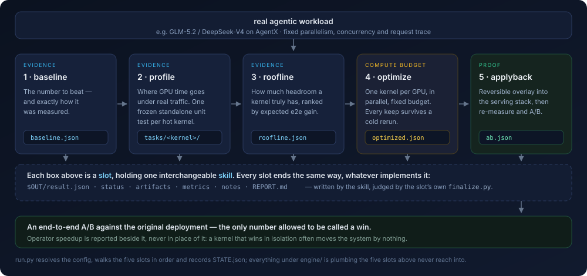

# LLM inference performance optimization for real agentic workloads

*From a serving-level goal, down to kernel-level work, back to a measured end-to-end
number.*

This file explains **why the pipeline is shaped the way it is**. `SKILL.md` is the
operator's guide and carries every command; `PRINCIPLES.md` is the charter — the mandate
this pipeline was built to satisfy and the rules any change to it has to leave intact.
Read that one before editing anything here.

## What it optimizes

Inference throughput under a **real agentic workload** — a model serving an actual agent
trace rather than a synthetic sweep, for example GLM-5.2 or DeepSeek-V4 on AgentX under a
fixed deployment: parallelism layout, concurrency level, request mix.

That distinction is the point. Agentic traffic is bursty, long-context and
decode-dominated, so the kernels that matter are not the ones a fixed-shape benchmark
would nominate, and a kernel that wins in isolation routinely moves the serving number by
nothing at all.

You give the pipeline a reproducible way to measure the workload. It finds where GPU time
actually goes under that traffic, turns the hot kernels into standalone optimization
tasks, spends a fixed compute budget making them faster, puts the survivors back into the
serving stack and re-measures. The deliverable is an end-to-end A/B against the original
deployment — not a collection of microbenchmark speedups.

Nothing here is bound to one model or one benchmark. A scenario is a JSON file in
`config/`.

## The five steps

```
baseline  ──>  profile  ──>  roofline  ──>  optimize  ──>  applyback
measure        extract UTs    rank by        one kernel     wire back,
the target                    headroom       per GPU        measure e2e
```

Steps 1–3 produce evidence. Step 4 spends the compute budget. Only step 5 may claim an
end-to-end gain.



The ASCII line above is the one to read in a terminal; the figure is the same five steps
with what each hands on, the contract they all leave through, and the deliverable. It is
hand-written SVG with fixed coordinates, so treat it as a drawing: when a stage is renamed
or an artifact changes name, the text in it has to be edited by hand, and a figure that
disagrees with the table below is a defect in the figure.

Each step is a **slot**, and each slot holds one or more interchangeable **skills** —
a directory with its own `SKILL.md` and its own code. Steps communicate only through
files on disk. What ships in each slot, and what it can be swapped for, is tabulated in
`SKILL.md`.

## Design

**Two contracts, and nothing else.** Modularity here is not a plugin system, a registry
or a DSL.

- *Stage-skill contract* (`stages/CONTRACT.md`): read `$IN` and `$CONFIG`, write artifacts
  to `$OUT`, finish by writing `$OUT/result.json`. A skill is a `run.sh` script when the
  work is deterministic, or a `SKILL.md` procedure when it needs judgement.
- *Runner contract* (`runners/CONTRACT.md`): `runner.sh <prompt> <workdir> <log>`, exit
  `0` on success, `78` on an unmet precondition (do not retry), anything else retryable.

So swapping the roofline, the optimization method or the agent CLI is a one-line config
change — no code edit, nothing to register. `runners/stub.sh`, which calls no agent at
all, exists as executable proof that the scheduler is genuinely agent-agnostic.

**The slot owns the criterion; the skill owns the work.** How artifacts map to
`result.json`, and what counts as ranked or passing, live in the slot — in its
`finalize.py`, which every slot has and which runs after every stage, and in
`stages/<stage>/README.md` where that criterion is explained rather than restated.
Replacing an implementation therefore never rewrites the mapping — which is
why the upstream roofline skill is vendored byte-identical, hash-enforced by
`skill_manifest.py`, and the profile skill — GEAK main's `kernel-extract`, carried here
with the shared tools it copies into tasks — lists in its `PROVENANCE.json` the origin
hash of every file and which ones this branch changed.

**An operator win is not a system win.** This is the failure mode the whole pipeline is
built around: a kernel that is unambiguously faster in isolation can leave the serving
number flat, or slightly worse, and on this class of workload that is the normal outcome
rather than the exception. So kernels are ranked by expected end-to-end gain rather than
by achievable speedup, operator and end-to-end numbers are written side by side so
neither can stand in for the other, and only `applyback` may claim e2e. The ranking
formula and the measured cases that produced it are in `SKILL.md`.

**No speedup counts until it survives a cold rerun.** Every keep is re-measured from a
fresh process and scored on the **minimum** of N runs. Hot measurement is not enough: the
unit-test leg allocates from a virgin allocator, so an output that is never written reads
back as zeros and compares equal — a kernel can pass every correctness check while hot
and fail from cold. The rerun is the task's own unit test; the slot reads its verdict and
does not re-derive one. A wrapper that re-implements the judgement eventually disagrees
with the test it wraps, and then wins the disagreement — that is how a run that crashed
before comparing any output was once recorded as a wrong answer.

**Refuse to publish rather than publish something unfounded.** Every stage separates
`blocked` (a missing precondition — no GPU, no benchmark client, no receipt) from `fail`
(attempted, did not succeed). `applyback` declines to report an A/B at all if the overlay
did not demonstrably shadow its targets, or if the two sides used different metric bases:
"no gain" is otherwise indistinguishable from "the patch never loaded".

**A run must be able to say what it optimizes.** Every scenario config declares a `target`
block — model, image, component commits — and `engine/core/target.py` enforces two things
with it. The config filename and `run_root` must carry a recognisable token of the
declared model, checked at `plan`/`prepare` time, before a GPU hour is spent; and the
declaration is cross-checked at every `validate` against the image and commits the stages
actually observed and wrote down, with a contradiction failing the stage. The first
campaign ran end to end under the name `agentx_dsv4` against a GLM-5.2-MXFP4 stack: every
number was right and every label was wrong, which is the harder error to catch, because a
wrong number invites doubt and a wrong name invites confidence. An abbreviation the
tokeniser cannot derive (`dsv4` for DeepSeek-V4) is still allowed, but only by writing it
into `target.name_tokens` — a deliberate declaration instead of an accident.

**A run that says nothing until it ends is a run nobody can act on.** So reporting is on
by default rather than opt-in, and the mid-run report is the same document as the final
one — a campaign stopped on its fourth stage still leaves a readable report of the first
three. The monitor describes and acts on nothing, except for one provable condition it
can be told to intervene in; the reasoning for that, and for every threshold, sits next
to the knob in `config/default.json`.

**Thresholds are calibrated, not assumed.** The keep threshold, the attempt cap, the
re-verification repeat count — each is a knob in `config/default.json` with the
measurement that set it recorded alongside.

**A dead knob is silent, so one file has to speak for it.** A parameter that is renamed
or removed leaves the key sitting in the scenario config, the code that read it gone, and
the run proceeding as though nobody had asked. `config/RETIRED.json` is the one place
that records them, and `--dry-run` reports every match before any GPU time — refusing to
start when the lost knob was a *check*, and only warning when it is merely inert, so a
live campaign config is not blocked over a dead word. Add the entry in the same change
that removes the knob.

A skill rename is the same kind of silent breakage one level up, and it is the committed
configs that pay for it: `--dry-run` is what catches it, so every config in `config/` has
to stay in the sweep. Which means `config/` holds only the scenarios we are prepared to
keep working — one per target, plus the two smoke configs. The variants a campaign throws
off while it runs (one per epoch, per resume, per contention experiment) are evidence of
that campaign, not configuration of this skill; they belong beside it under
`campaigns/<name>/`, which is gitignored for the same reason `runs/` is.

## Where the code lives

The top level is the skill: three documents, one entry point, and the three directories a
reader or an operator actually edits. Everything that merely makes it run sits one level
down under `engine/`, so that opening `workload/` shows a skill rather than a codebase.

| | |
| --- | --- |
| `SKILL.md` | the operator's guide: what it is, every command, the two contracts |
| `README.md` | this file: why it is shaped this way |
| `PRINCIPLES.md` | the charter a change has to leave intact |
| `run.py` | the only entry point; it forwards to `engine/core/stage.py` and does nothing else |
| `config/` | one JSON per scenario, layered over `config/default.json` |
| `stages/` | the five slots and their interchangeable skills (`stages/CONTRACT.md`); `stages/_shared/` holds the few helpers several slots need in order to judge |
| `runners/` | agent CLI adapters (`runners/CONTRACT.md`) |
| `docs/` | the one figure this file embeds; nothing reads it at runtime |
| `engine/` | the plumbing; `engine/README.md` says what each directory under it answers |

Inside `engine/` the same rule applies one level smaller: each directory is named after
the question it answers, so that where a file belongs is decided by what it is for and
not by what was convenient the day it was written.

The split runs one way only. A slot may reach into `stages/_shared/`, because the
pipeline implements the stage contract; a slot that reached up into `engine/` for a tool
would tie a replaceable skill to the plumbing it is supposed to be independent of.
