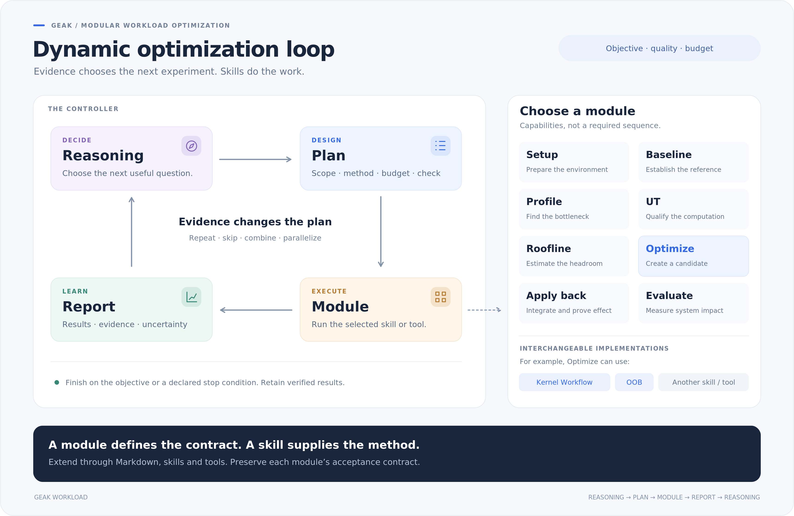

# Workload optimization through modular experiments

Give an agent the [root skill](SKILL.md), task/scenario and a run directory.
[Reasoning](reasoning/SKILL.md) is the persistent main agent: it chooses bounded calls,
receives asynchronous reports and decides what to do next while independent work continues.
Read [PRINCIPLES.md](PRINCIPLES.md) before changing the workflow.

Modules can repeat, combine or run in parallel. A defective task can return to UT and
resume optimization after qualification while healthy branches continue.
[Editable figure](docs/dynamic-loop.svg).

## Modules

This is a discovery table, not a registry or required sequence. Each module's README
defines its contract; implementation skills describe the method.
All calls follow the [invocation contract](stages/CONTRACT.md#direct-module-calls).

| Module | Responsibility | Implementations |
| --- | --- | --- |
| [Setup](stages/setup/README.md) | Prepare runtime and resources | [runtime](stages/setup/runtime/SKILL.md) |
| [Baseline](stages/baseline/README.md) | Establish or revalidate a reference | [adopt](stages/baseline/adopt/SKILL.md), [measure](stages/baseline/measure/SKILL.md) |
| [Profile](stages/profile/README.md) | Diagnose the serving bottleneck | [kernel-extract](stages/profile/kernel-extract/SKILL.md), scoped to observations |
| [UT](stages/ut/README.md) | Define and qualify a computation boundary | [kernel-extract](stages/ut/kernel-extract/SKILL.md), reusing the existing tools |
| [Roofline](stages/roofline/README.md) | Assess bounds and search priority | [kernel-roofline](stages/roofline/kernel-roofline/SKILL.md), [CPU fixture](stages/roofline/stub-roofline/SKILL.md) |
| [Optimize](stages/optimize/README.md) | Produce an isolated candidate | [Kernel Workflow](stages/optimize/geak-kernel-workflow/SKILL.md), [kernel dynamic loop](stages/optimize/kernel-dynamic-loop/SKILL.md), [OOB](stages/optimize/oob/SKILL.md) |
| [Apply back](stages/applyback/README.md) | Integrate a candidate and prove it took effect | [kernel overlay](stages/applyback/overlay-ab/SKILL.md), [system runtime](stages/applyback/system-runtime/SKILL.md) |
| [Evaluate](stages/evaluate/README.md) | Judge a serving comparison | [native-e2e](stages/evaluate/native-e2e/SKILL.md) |
| [Report](stages/report/README.md) | Explain decisions, calls and parallel work | [HTML timeline](stages/report/html-timeline/SKILL.md) and [example](stages/report/html-timeline/assets/example.html) |

## Where things live

| Path | Purpose |
| --- | --- |
| `SKILL.md` | Entry into the campaign |
| `reasoning/` | Persistent controller, starting route and evidence-guided planning |
| `stages/` | Module contracts and interchangeable implementations |
| `config/` | Scenarios and defaults; campaign variants stay with their evidence |
| `run.py`, `engine/core/` | [Sequential driver and protocol](engine/core/README.md) |
| `runners/` | Agent CLI adapters and [runner contract](runners/CONTRACT.md) |
| `engine/` | [Mechanical execution and evidence tools](engine/README.md) |
| `docs/` | Illustrations |

The [starting route](reasoning/SKILL.md#starting-route-and-adoption) preserves existing
coverage, methods and budgets when no better-supported plan is available.
Only a qualified serving comparison can replace the verified performance floor.
The [pipeline figure](docs/pipeline.svg) depicts that sequential route.
